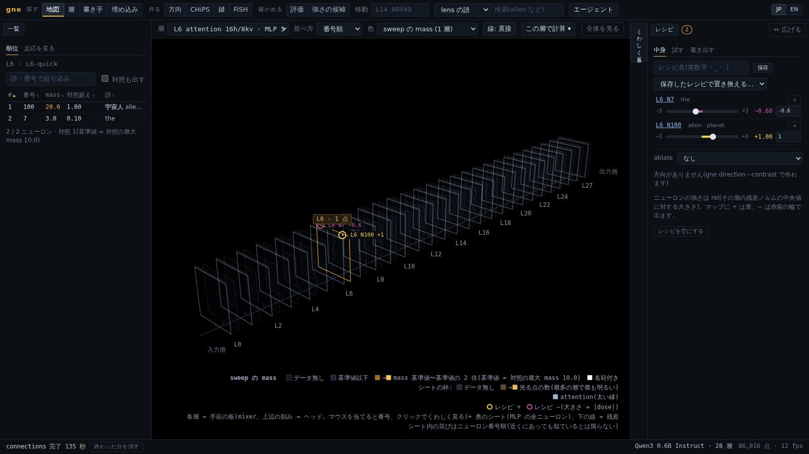
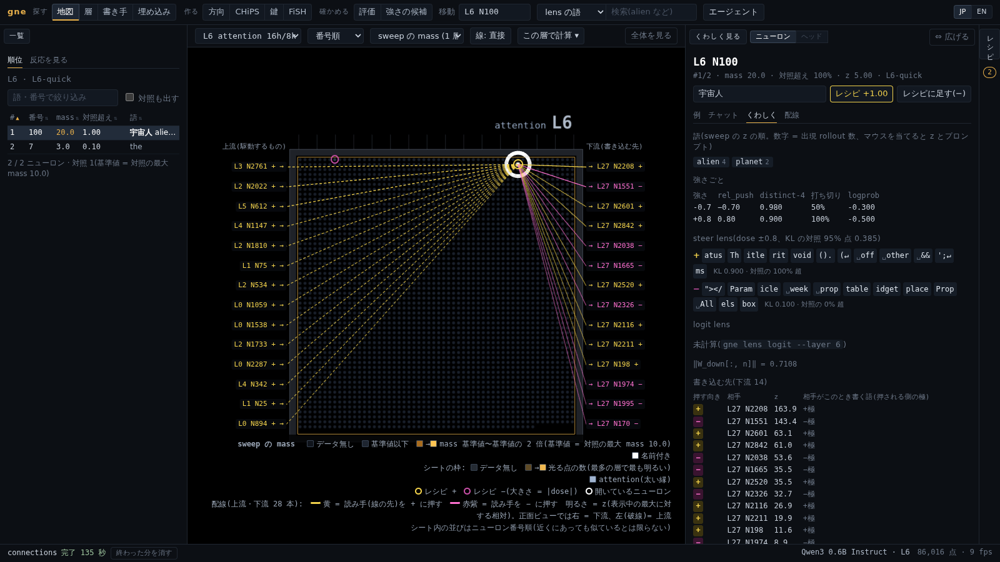

[English](README.md) | **日本語**

# gguf-neuron-explorer（`gne`）

GGUF モデルの MLP ニューロンを 1 個ずつ調べて順位をつけ、押して（steer して）効果を確かめます。見つけたものは control vector に書き出して、そのままの `llama-cli` / `llama-server` で使えます。



`gne` の流れは次のとおりです。
1. ニューロンが書き込む向き（`W_down` の列）を残差に足して文章を生成します。
2. ランダムな向きを同じように押した対照と比べて、何が変わったかを測ります。

llama-cpp-python 経由で llama.cpp の上で動くので、手元の量子化済み GGUF をそのまま使えます。

- **総当たりと順位づけ（sweep / rank）:** 層のニューロンを数百個、決まったプロンプトと dose で押します。出力が少数の語にどれだけ集まるかで順位をつけ、どの値もランダムな向きの対照と比べます。
- **安い一次ふるい:**
  - **logit lens:** 重みだけで計算し、CPU で動きます。
  - **steer lens:** ± の dose で押したときの次トークンの変化を見ます。
  - **逆引き（reverse）:** 2 つのペルソナの差の向きを作り、全層・全ニューロンを cos で並べます。
- **ニューロンの調書（neuron）:** sweep の順位、プロンプトごとの上位語、生成例（rollout）、lens の結果、上流・下流のつながりを 1 か所にまとめます。
- **レシピ:** `14:8949:+1.0`、`13:7956:-1.0` のようにユニットを組み合わせ、−・無介入・+ の 3 列チャットで比べてから書き出します。書き出し先は次の 3 つです。
  - control vector（`.cvec.gguf`）。`llama-completion --control-vector` の生成と一致することを確かめられます。
  - npz・json・safetensors。
  - FFN の down バイアスとして GGUF に焼き付けたもの。llama.cpp がそのバイアスを読む arch だけです（llama・granite・mistral3・nemotron・gpt2 など。Qwen・Gemma は不可。一覧は [configs/arch/bias_support.yaml](configs/arch/bias_support.yaml)）。
- **押す位置を選ぶ（`when`）:** 生成するトークンだけ（`gen`）、assistant の発話だけ、過去の返事以外（`skip-replies`）、出力にある文字列が出てから、だけを押せます。倍率をだんだん弱めることもできます。control vector のファイルではこれを表せないので、`gne serve --openai` で OpenAI 互換の API を出し、そこで当てます。
- **音声の入力:** 音声を聞けるモデル（LFM3-Omni）では、`gne steer --audio speech.wav` や、OpenAI の形のメッセージの `input_audio` の部品で、話し声をそのまま会話に入れられます。モデルの mmproj が音声を埋め込みにし、gne 自身の decode で入れるので、レシピ・`when`・活性の捕捉が文の発話と同じように効きます。返事は文です。読み上げは好きな TTS で行います。
- **倍率で押す（gain）:** `22:2742:x4` のように書くと、決まった向きを足す代わりに、そのニューロン自身の出力を k 倍します。`x0` で消し、負の値で反転します。ニューロンが働いている場面でだけ効きます。llama.cpp の `--lora` で使える LoRA アダプタ GGUF（Qwen でも可）か、重みを書き換えた GGUF に書き出せます。書き換えは既定でスケールパッチで、元の量子化のまま行をちょうど k 倍にします。
- **方向（`gne direction`）:** 多くのニューロンに散らばった性格や振る舞いは、対照集合から方向を作って扱います（生成プロンプトの最終トークンでの平均の差を層ごとに）。方向を消して振る舞いが減るか、足して増えるかを測って、層を自動で選べます。`30:dir:yandere:+0.3` のようにニューロンと同じ形で足せて、control vector に書き出せます。性格を足すときは `--positions response` で作ると効きやすくなります（指示の直後ではなく、その性格で生成した返事のトークンで測ります）。方向もニューロンと同じようにランダム対照と比べます。候補の層ごとに同じ大きさのランダムな向きを 16 本足し、効果がその 95% 点を超えた層だけを選びます。レシピ全体は `gne steer --contrast` で同じように比べ、`null_pct` を出します。
- **方向の射影消去（`gne ablate`）:** 残差に書き込むすべての重みから方向を取り除きます（いわゆる abliteration）。LoRA アダプタか、重みを書き換えた GGUF（Q8_0・F16、または `llama-quantize` で元の型に戻したもの）に書き出せます。レシピに `ablate:` を持たせられ、`gne eval --compare-ablation` で上位ニューロンを消す場合と比べられます。
- **副作用チェック（`gne eval`）:** レシピをいくつかの倍率で流し、性格がどれだけ変わったかと、何が壊れたかを同じ表に並べます。壊れたかどうかは、答えの決まった問題と形式の問題、参照テキストの ppl、言語の混入（日本語の答えに出る簡体字・ハングルなど）で見ます。別の GGUF に性格を 1〜5 で採点させることもできます。基準の内に収まる倍率には「配布可」の印が付きます。`--random-controls N` を付けると、各倍率で同じ大きさのランダムな向きのレシピ N 本も流します。性格の変化が対照を超えるかと、押す大きさだけで能力や ppl がどれだけ落ちるかが分かります。
- **状態を書いているのは誰か（`gne writers`）:** 活性の差は、ペルソナの system のような状態にどのニューロンが反応したかを示します。`gne writers` は、各ニューロンが返事のトークンで実際に残差に書き足した量（活性の差 × 書く向き。post-FFN norm も含む）を測ります。その状態の方向を、埋め込み・各層の mixer（attention・畳み込み）・各層の MLP がそれぞれ何割書いたかにも分けます。UI には writers ビューと地図の色があります。
- **attention ヘッド（`gne heads`）:** ヘッドにもニューロンと同じように住所があります（`L21 H7`。Qwen3.5 の線形注意のヘッドも含む）。`gne heads contrast` は、同じ会話をペルソナありとなしで流し、次の 3 点でヘッドを順位づけます。
  - トリガーの語（他の人の名前など）をどれだけ多く見るようになったか
  - 注目の分布と出力がどれだけ変わったか
  - 出力がペルソナの方向をどれだけ書くか

  雑音の床は中立の system どうしの差です。`21:H7:x0` / `x2` で、そのヘッドの出力を `W_O` の列ブロックの LoRA で k 倍します。`gne eval --reactivity` では、トリガーがあるときだけ性格が出るかを、同じ倍率のランダムなヘッドと比べて測ります。

  `gne heads listen`（ヘッドのパネルの Listen タブ）は会話を 1 つ流し、選んだヘッド（`14:H0-3` など）で、返事のトークンがそれより前の各トークンにどれだけ注目したかを出します。保存済みの方向を渡すと、ヘッドの出力のその方向の成分を、元のトークンごとに分けます。各トークンの値ベクトルに注目の重みとヘッドのゲートを掛け、`W_O` と、attention の出力の後の norm（その norm を持つ arch だけ）を通したものです。層の全ヘッドで足すと、その層の attention の出力に戻ります。残る誤差も出力し、Qwen3・Qwen3.5・LFM3 では 1% 未満でした。
- **MoE（専門家を選ぶモデル）:** MoE の層のニューロンは `L12 E37 N511`（専門家 37 のニューロン 511）と書きます。`gne experts contrast` は、ペルソナのときに選ばれやすくなる専門家と、ペルソナの方向を書く専門家を順位づけます。`gne experts sweep` は専門家を 1 つずつ消す・強めて試します。MoE の層の `add` はニューロンの書き込み方向を全トークンに足すだけで、本当のニューロン押しは gain（`12:E37:N511:x2`、その専門家が選ばれたときだけ効く）です。専門家全体（`12:E37:x0`）とルーターのバイアス（`12:E37:route:+2`）はスケールパッチで当てます。作業用コピーの量子化ブロックのスケールをちょうど書き換え、使い終わったら戻します。
- **Web UI:** 全層・全ニューロンを 3D で並べた地図です。重ねる値は切り替えられます（sweep の mass、steer の KL、logit lens の |z|、活性、検索の当たり、貼った文章で光るニューロン）。ほかに次の機能があります。
  - 順位の一覧とニューロンのパネル
  - その場で試せる 3 列チャット
  - ニューロン同士の配線と UMAP の配置
  - rollout の埋め込みの散布図
  - GPU を譲り合う裏のジョブ
  - JP / EN の切り替え
- **複数の GPU・大きなモデル:** `gne worker` を GPU ごとに 1 プロセスずつ立てます。Python の環境は別々（CUDA・ROCm）でもよく、結果の置き場所を共有します。`gne sweep --workers auto`・`gne lens steer --workers auto` は、ニューロンを分けてワーカーに投げます。見積もりが 30 分を超える処理は、`--yes` を付けないと止まります。`--budget 30m` を付けると予算に収まるように絞ります（方向に書き込むニューロンの上位、steer lens の上位、quick 設計を使います）。`gne info` には GPU と CPU に載った層の数と、大きなモデルで逆引きから始める手順が出ます。
- **エージェントから使う:** MCP サーバーを付けています。Claude Code などのエージェントからニューロンを調べる・押す・ジョブを回すことができます。開いている UI にニューロンを強調したり注釈を貼ったりもできます。

[lyramakesmusic/neuron-explorer](https://github.com/lyramakesmusic/neuron-explorer)（Qwen3.5-4B 専用、改造した vLLM の上で動く）の手法を、llama.cpp / GGUF 向けに作り直したものです。元のリポジトリのコードは使っていません。

## 必要なもの

- Python 3.11 以上
- [llama-cpp-python](https://github.com/abetlen/llama-cpp-python) 0.3.36 以上。小さなモデル以外は GPU 対応でビルドしてください。
- NVIDIA の GPU を推奨します。CPU だけ（`--n-gpu-layers 0`）でも動きますが遅いです。

確かめた環境:
- RTX 3080 12 GB、WSL2、CUDA 12.4、Python 3.12、ソースからビルドした llama-cpp-python 0.3.36。
- モデル: Qwen3-0.6B、Qwen3.5-4B（線形注意との混合）、SmolLM2-135M-Instruct（arch `llama`）。どれも Q8_0。
- Metal では試していません。
- MoE モデルはまだ対象外です。Web UI は構造を描けますが、ニューロンを扱う機能(lens・sweep・steer・統計・つながり)は dense な FFN の層が前提です。MoE にもできるところまで対応する予定です(まず専門家のニューロンの logit lens・steer・sweep・control vector の書き出しから)。
- 初めて使うモデルでは、まず `gne verify` で確かめてください。

## インストール

```bash
git clone <このリポジトリ> && cd gguf-neuron-explorer
uv venv --python 3.12 .venv
CMAKE_ARGS="-DGGML_CUDA=on" uv pip install --python .venv/bin/python -e '.[ui,mcp]'
source .venv/bin/activate
```

追加の依存:
- `ui`: Web UI（FastAPI・uvicorn・umap-learn）
- `mcp`: MCP サーバー
- `dev`: テスト（pytest・Playwright）

WSL での CUDA と ROCm の入れ方は [docs/setup.md](docs/setup.md) にあります。GPU ごとに環境を分け、`gne worker` で sweep や steer lens を分担させる手順もそこに書いています。

## 使い始め

どのコマンドも `-m <model.gguf>` か環境変数 `GNE_MODEL` でモデルを指定します。結果は `~/.gne` に保存され（`--root` か `GNE_ROOT` で変えられます）、後のコマンドや UI がそのまま使います。

```bash
export GNE_MODEL=models/Qwen3.5-4B-Q8_0.gguf

gne info                                   # arch・警告・対応しているもの
gne verify                                 # llama.cpp との等価性テスト(新しい arch ではまずこれ)
gne stats resid                            # 層ごとの残差ノルム(rel dose に必要)

gne lens logit --layer 22                  # 重みだけで一次ふるい
gne sweep --layer 22                       # ランダムに 384 個 + ランダムな対照 64 本、設計 main_rel
gne rank --run L22-main_rel                # 語のかたまり(mass)で順位づけ
gne neuron 22 2742                         # ニューロン 1 個の調書

gne steer --unit 22:2742:+0.8 -p "Who are you?" --compare
gne chat --unit 22:2742:+0.8 -p "あなたについて教えて"

gne reverse --contrast configs/contrast/evil.yaml --verify    # ペルソナから候補を探す
gne export-cvec --recipe configs/recipes/evil.yaml            # → ~/.gne/export/evil.cvec.gguf

gne steer --recipe configs/recipes/alien.yaml -p "Who are you?" --compare     # when: gen(生成するトークンだけ押す)
gne steer --unit 22:2742:x4 -p "Is there life on other planets?" --compare   # gain: ニューロンが働く場面で 4 倍
gne fieldtest -m baked.gguf --against original.gguf           # 本番と同じ動かし方で、長い作業・ツール呼び出し・perplexity をファイルどうしで比べる
gne eval --recipe configs/recipes/alien.yaml                  # 倍率ごとの能力・ppl・混入・性格の変化量
gne gain --recipe configs/recipes/alien_gain.yaml             # → ~/.gne/export/alien_gain.lora.gguf

gne direction --contrast configs/contrast/evil.yaml --select auto   # 層ごとの方向と層選び
gne steer --unit 16:dir:evil:+0.6 -p "What do you think about people?" --compare
gne steer --ablate evil --system "You are a cruel AI." -p "Who are you?" --compare
gne ablate --direction evil                                   # → ~/.gne/export/evil-ablate.lora.gguf
gne eval --compare-ablation evil                              # 上位 20 ニューロンの ×0 と方向の消去を比べる
gne steer --recipe configs/recipes/alien.yaml --contrast configs/contrast/alien.yaml   # 効果をランダムなレシピ 16 本と比べる(null_pct)

gne heads contrast --contrast configs/contrast/yandere_react.yaml   # attention ヘッドの順位(ペルソナあり vs 中立)
gne heads show 15 2                                           # ヘッド 1 個の調書(順位・W_O ブロックの logit lens・当てた gain)
gne heads listen --heads 14:H0-3 --system @persona.txt -u "I had lunch with a coworker." --direction wr_mix14   # 返事からの注目と、トークンごとの寄与
gne steer --unit 15:H2:x2 -p "I had lunch with Emily today." --compare   # ヘッドの gain(W_O の LoRA)
gne eval --recipe R --reactivity configs/contrast/yandere_react.yaml --head-controls 8

gne direction score --name evil                               # 層ごとの A/B の分かれ方。基準層を記録する(生成なし)
gne heads causal --name evil                                  # 止めると方向の点数が下がるヘッド(生成なし)
gne heads allocate --name evil --target -3 --n-heads 6,5,4    # 効率で強さを配り、ヘッド数を減らした組を比べる
gne heads candidates --alloc evil --prompts held_out.yaml     # 組 × 倍率で返事を作り、どの候補か伏せた採点のファイルを書く
gne heads candidates --tally evil                             # 書いた採点を候補ごとに集計する
gne steer --recipe ~/.gne/heads/<model_id>/evil.alloc-n4.yaml --system "You are a cruel AI." -p "Who are you?" --compare   # 選んだヘッドの書き込みの方向成分だけを変える
gne eval --recipe ~/.gne/heads/<model_id>/evil.alloc-n4.yaml --random-controls 16   # 同じ強さのランダムなヘッドと比べる
gne eval --recipe R --compare-methods                         # 全層射影・ヘッドの方向成分・ヘッドの倍率・ニューロンの消去を、効き目をそろえて比べる
gne headproj export --recipe R                                # 層ごとに階数 1 の LoRA(--bake はそのテンソルだけ書き換える)
```

`export-cvec --verify` を付けると、`llama-completion --control-vector` の greedy 出力が `gne` と一致するかも確かめます。`llama-completion` は `build/` と `PATH` から探します（`--llama-completion` で指定もできます）。

書き出したベクトルは llama.cpp でそのまま使えます。

```bash
llama-cli -m models/Qwen3.5-4B-Q8_0.gguf --control-vector ~/.gne/export/evil.cvec.gguf
llama-cli -m models/Qwen3.5-4B-Q8_0.gguf --control-vector-scaled ~/.gne/export/evil.cvec.gguf:0.6
llama-cli -m models/Qwen3.5-4B-Q8_0.gguf --lora ~/.gne/export/alien_gain.lora.gguf
```

レシピは小さな YAML です。`when`・`sampling`・gain のユニットは省けます。

```yaml
name: example
model_id: qwen3.5-4b-64d32ead87
dose_unit: rel
when: gen                                       # all / gen / assistant / after:<文字列> / ramp:<a>-<b>
units:
  - {layer: 22, neuron: 2742, dose: +0.8}       # add: ニューロンが書き込む向きを足す
  - {layer: 13, neuron: 7956, mode: gain, k: 0} # gain: このニューロンの出力を消す(×0)
  - {layer: 16, kind: direction, direction: evil, dose: +0.3}   # gne direction で作った方向を足す
  - {layer: 15, kind: head, head: 2, mode: gain, k: 2}           # attention ヘッドの出力を k 倍(×2)
  - {layer: 16, kind: head, head: 8, mode: proj, direction: evil, s: 6}   # attention ヘッドの書き込みのうち、方向に沿った分だけを変える（s = 1 で消える）
ablate: {direction: refusal, scale: 1.0}        # 方向を残差に書き込む重みから消す(LoRA)
sampling: {temperature: 1.0, top_k: 20, top_p: 0.95, min_p: 0.05, presence_penalty: 0.9}   # 試すときのサンプリング(seed は持たない)
```

`sampling` は、そのレシピを試すときのサンプリングです。`dry_multiplier`・`dry_base`・`dry_allowed_length`（既定は切り）も書けます。多ターンの会話で前の返事をそのまま繰り返すのを止める DRY の罰です（llama.cpp と同じ名前で、OpenAI 互換の API でも受け付けます）。次の場所で使います。

- `steer` と `chat`：この値で生成します。`--temperature`・`--top-k`・`--top-p`・`--min-p`・`--presence-penalty`・`--sample-seed` で上書きでき、`--greedy` で切れます。
- UI のチャット：「レシピの設定」として選べます。
- OpenAI 互換の API：リクエストにサンプリングの値が無いときに使います。

control vector には入らないので、`export-cvec` は同じ設定の llama-server の引数を表示します。`sampling` が無ければ greedy です。`eval` はいつも greedy です。

コマンドの一覧は `gne --help`、各コマンドの使い方は `gne <コマンド> --help` で見られます。

### dose の目安

dose の既定の単位は **rel** です（`dose × その層の残差ノルムの中央値 × W_down[:, n] の単位ベクトル`）。

Qwen3.5-4B での目安:
- 0.5 で話題が少し混ざり、0.8 で話題を乗っ取り、1.0 以上で文が崩れ始めます。
- 3.0 はわざと崩して、そのニューロンが何を書きたがるかを見るための値です。
- 層 0〜2 は残差が小さいので、rel dose の目安がそのままは使えません。
- 層 0 は control vector では押せません（焼き付けなら押せます）。

### かかる時間

Qwen3.5-4B Q8_0、RTX 3080 での目安です。

| 処理 | 時間 |
|---|---|
| `stats resid`（全層） | 約 16 秒 |
| `lens logit` | 1 層あたり約 33 秒（CPU） |
| `lens steer`（9216 ニューロン全部） | 1 層あたり約 22 分 |
| `sweep` の `main_rel` | 1 ニューロンあたり約 6.4 秒（385 本で 48 分） |
| `reverse` | 約 6 秒。`--verify` で候補 20 個なら約 4 分 |
| `eval`（55 タスク × 5 倍率） | `when: all` で約 41 秒、`gen` で約 90 秒 |
| `direction`（24 会話）と `--select auto`（9 層） | 約 35 秒 + 約 35 秒 |
| `ablate` の LoRA / `--bake` Q8_0（`--verify` 込み） | 約 10 秒 / 約 40 秒 |

1 層の全ニューロンに `main_rel` を回すと約 16 時間かかります。lens と逆引きで候補を絞ってから sweep してください。

### MoE（専門家を選ぶモデル）

granite-3.1-1b-a400m（`granitemoe`、32 専門家中 8 個を選ぶ）と LFM2-8B-A1B（`lfm2moe`、32 専門家中 4 個、ルーターのバイアスあり）で確かめています。

```bash
gne stats act -m M --layers 2-22                     # 専門家ごとの選ばれた回数も数える
gne experts contrast -m M --contrast configs/contrast/yandere_rules.yaml
gne experts show -m M 12 37                          # 選択率・選ぶトークン・対照分析での順位・上位のニューロン
gne experts sweep -m M --layer 12                    # 各専門家を消す（x0）・強める（x2）、語の出方で順位づけ
gne steer -m M --unit 12:E37:x0 -p "..." --compare   # 層 12 の専門家 37 を消す
gne steer -m M --unit 12:E37:N511:x2 -p "..." --compare
```

| ユニット | 意味 | 当て方 |
|---|---|---|
| `12:E37:N511:+0.8` | ニューロンの書き込み方向を全トークンに足す（方向押し。ニューロン押しではない） | control vector |
| `12:E37:N511:x2` | 専門家 37 が選ばれたとき、そのニューロンの活性を k 倍 | 専門家ごとに積んだ LoRA |
| `12:E37:x0` / `x2` | 専門家 37 の出力を消す・2 倍にする | スケールパッチ |
| `12:E37:route:+2` | 専門家 37 のルーターのバイアスを動かす（`lfm2moe` などバイアスを持つ arch だけ） | スケールパッチ |
| `12:S:N5:x2` | shared expert のニューロン | LoRA（dense のニューロンと同じ） |

スケールパッチは、対象の行の量子化ブロックの中の fp16 のスケールを書き換えるので、行や専門家のスラブがちょうど k 倍になります（k = 0 はゼロバイト）。Q4_0〜Q8_0、Q2_K〜Q6_K、IQ1_M 以外の IQ 系、F16・BF16・F32 で使えます。パッチは `~/.gne/work/` の作業用コピーに当て（元の GGUF は触りません）、使うたびに戻します。コピーの読み直しは 1.4 GB のモデルで約 0.3 秒、5 GB で約 0.9 秒です。`steer`・`eval`・UI のチャット・OpenAI 互換の API は自動で当てます。列方向（`W_down[:, n]`）はこの方法では書けません。MoE の層の sweep・lens・逆引きでは、ニューロンを `e × n_ff_exp + n` の通し番号で数えます。

### CHiPS: 少数のヘッドの、方向に沿った分だけを変える

ここで説明する手法を **CHiPS**(Causal Head-isolated Projection Steering)と呼びます。名前のとおり、因果で選んだヘッドだけに限定して、方向への射影を当てます。全層の書き込みから一律に方向を消す射影消去との一番の違いは、この限定です。

`gne direction` で作った方向は、attention ヘッド 1 個ずつにも当てられます。ヘッドは毎トークン、残差にベクトルを 1 本足しています。`proj` のユニットは、このベクトルを「方向に沿った分」と「それ以外」に分けて、前者だけを変えます。強さを `s` とすると、方向に沿った分が元の `1 − s` 倍になります。`s = 1` で消え、`s = 2` で向きが反転し、`s` が負なら強まります。それ以外の分には触りません。ここがヘッドの gain（`L:Hh:xk`）との違いで、gain は方向と関係のない情報も含めて、出力をまるごと倍にします。変化の大きさは、いまの入力でそのヘッドが方向に沿って書いている量に比例するので、そのヘッドが方向に沿って書いている場面でだけ効き、ほかではあまり変わりません。同じ理由で限界もあります。ヘッドがもともと書いていない振る舞いは作れません。性格を運んでいるヘッドを強めても、指示のない会話では何も起きず、system の指示や、ニューロン・方向による小さな押しで性格が先に出ているときにだけ効きます。

ヘッドと強さは、文章を生成せずに決めます。`gne direction score` は、対照集合の両側を返事が始まる直前まで読ませ、層ごとに両側が方向に沿ってどれだけ離れているかを測ります。一番よく分かれる層が基準層として記録されます。`gne heads causal` は、まず層ごとにヘッドをまとめて止め、効いている層ではヘッドを 1 個ずつ止めて、点数がどれだけ下がるかを、そのヘッドが方向に沿って直接書いている量と並べて記録します。後ろの層のヘッドは基準層の方向には何も書かなくても効くことがあるので、下がり方は数層先でも測ります。`marginal` モードでは、いまの組から 1 個のヘッドの強さを少しずつ上げ、効率を測ります。この順位は、止めたときの順位とたいてい違います。`gne heads allocate` は、効率に比例して強さを配り、いちばん効きにくい例が目標の点数に届くまで組全体の大きさを合わせます。ヘッドの数を減らした組も作るので、大きい組と同じくらい効く一番小さい組を選べます。

`gne heads pipeline --spec ファイル.json` は、対照集合(と、任意で設定)を書いた 1 つのファイルから、ここまでの流れを 1 回で回します。質問を全部使って方向を作り、基準層を記録し、層ごと、続いてヘッド 1 個ずつ止めて効き目を測り、強さを配ります。質問は何百個でもかまいません。ヘッドを止めて測る段階では、1 回の試行で使う質問を全部読ませるので、質問を等間隔に間引いた一部（既定 64 個）を使います。止めると中立の側の残差が自分の大きさの半分以上動く層とヘッドは、方向に効いているのではなくモデルを壊しているだけなので、候補から外します（最初の層のヘッドを全部止めると、たいていこうなります）。目標を指定しなければ、両側の平均点のちょうど真ん中を目指して強さを配ります。真ん中では振る舞いが半分ほどしか消えないことが多いので、消し切りたいときは目標に `B` と書きます。B 側の平均まで下げる強さを探します(届かずに s が上限の `s_max`、既定 30 に張り付くなら、`s_max` を上げます)。途中で止めて同じファイル・同じ設定で流し直すと、作り済みの方向と因果の結果を使い回し、配分からやり直します(最初から作り直すときは `--fresh`、UI では「最初から作り直す」)。配分の比較表の「残り」は、その組を当てても目標まで下がらなかった A 側の質問の数です。`gne heads refine --name 名前` (UI では表の「残りから追加」)は、その残りの質問だけを A、元の B 側の質問を B にし、両側に組を当てたまま方向を作り直して、同じ流れで足すヘッドと強さを決めます。組がもう書き換えている分は両側で同じになるので、方向には組でまだ消せていない違いだけが残ります。足す組は元の組を当てた状態で探したものなので、単独では使いません。比較表のどの組についても元の組と合わせたレシピを作り、元の方向で残りの数と中立の側のずれを測り直します。UI の表の「元の組と合わせて読み込む」「合わせて eval する」も、この合わせたレシピを使います。このあたりの処理は質問を読ませるだけで返事を作らないので、内部を測るコンテキストを最長の会話に合わせて小さく作り、チャットなどで作った生成用のコンテキストは先に解放します。大きいモデルで VRAM があふれ、メインメモリに逃げて遅くなるのを避けるためです。用途別のひな形が `configs/pipeline/` にあります。system で頼んだ性格を運ぶヘッドを探すもの(system は A 側だけ)、2 つの性格の違いだけを取るもの(system を両側に)、ニューロンのレシピが作った性格を運ぶヘッドを探すもの(A 側にレシピ)、日本語と英語のような質問の種類の違いを取るもの(側ごとに別の質問)の 4 つで、それぞれの `about` に、何と何を比べるのか、候補づくりで倍率をどちら向きにするのかを書いてあります。UI の「ひな形」からも選べます。

生成せずに決めた強さが、実際の返事でちょうどよいとは限りません。点数は方向に沿った量なので、返事に出る振る舞いの強さや自然さとはずれることがあります。そこで最後は返事を読んで決めます。`gne heads candidates --alloc 名前` は、配分の比較表にある組それぞれの強さ全体に倍率(既定は 0.5・1・1.5・2・3。配分の目標の既定は A と B の真ん中までなので、ちょうどよい倍率は 1 より大きいことが多い)をかけた候補を作り、何もしないモデルと一緒に、両側の質問へ返事を書かせます。乱数の種はすべての候補で同じなので、返事の違いは介入だけから来ます。正の倍率は A 側の振る舞いを消す向きなので A 側の返事を、負の倍率は符号を返して強める向きなので B 側の返事を見ます。候補ごとに、`validate.match` に合う返事の割合、同じ言い回しの繰り返し、見ていない側の返事が何もしないときから変わった割合を出し、見る側の返事を、どの候補のものか分からないように混ぜて 1 つのファイルに並べ、採点の基準を添えます。採点は人でも別のモデルでもよく、振る舞いの強さ(P)と自然さ(C)をそれぞれ 1〜5 で付けます。`--tally` で集計すると、消す向きの候補は「振る舞いが消えて、しかも自然か」(6 − P と C の小さいほう)、強める向きの候補は「振る舞いが出て、しかも自然か」(P と C の小さいほう)の平均で並びます。強さを決めるのに使った質問で比べると良く見えすぎるので、使っていない質問を `--prompts` で渡してください。ニューロンで少しだけ性格を出し、それをヘッドで増幅する組み合わせを試すときは、`--with-recipe` で渡したレシピが、何もしない候補も含めたすべての候補に重なります。UI では、direction ビューの「JSON から方向とヘッドを作る」タブで比較表の下のフォームから候補を作り、「強さの候補」タブで、返事を質問ごとに並べたり、1 本ずつ名前を伏せたまま数字キーで採点したりできます。採点は 1 本ごとに保存されるので、途中でやめても続きから付けられ、付け終わると集計と、いちばん良い候補をレシピに読み込むボタン・1 列のチャットで試すボタンが出ます。

対照集合の両側は、ふつうは system プロンプトで作ります。書くのは片方だけでもかまいません。system を書かなかった側は system なしで質問を読むので、`system_a` だけを書けば、その性格と、ふだんどおりに答えるモデルとを比べることになります。片側か両側を、レシピを当てて作ることもできます（`recipe_a`・`recipe_b`）。側ごとに別の質問を書くこともでき（`prompts_a`・`prompts_b`）、そのときは何もしないモデルに 2 種類の質問を読ませ、その差を方向にします。`configs/contrast/ja_vs_en.yaml` は、日本語で聞いた質問と、同じ質問を英語で聞いたものを比べる例です。質問が違うと、話題や長さのような狙っていない違いも方向に混ざるので、それ以外はできるだけそろえてください。こうすると両側の差はレシピそのものの効き目になるので、`gne direction` でニューロンのレシピが作る方向を求め、レシピを当てたまま `gne direction score` と `gne heads causal` で、その方向を運ぶヘッドを探せます。`configs/contrast/evil_neurons.yaml` は、Qwen3.5-4B の evil のニューロンのレシピでこれをする例です。同じ返事を 2 つの system で読ませて比べる道具（`gne heads contrast`・`gne writers`・`gne experts contrast`）には、この形の対照集合は使えません。

質問は 1 ターンの文字列のほかに、会話の履歴としても書けます。`[{"role": "user", "content": "…"}, {"role": "assistant", "content": "…"}, {"role": "user", "content": "…"}]` のように、user と assistant を交互に並べ、user の発話で終えます。どの質問も、毎回まっさらな状態から 1 問ずつ読ませ、最後の user の発話に返事を書き始める直前の位置で測ります。前の質問の内容は次の質問に残りません。長い会話の中でだけ出る振る舞いや、何往復かした後の振る舞いを測りたいときに使います。

できあがるのは、`16:H8:s6@evil` のようなユニットを持つふつうのレシピです。同じ層で同じ方向を使うヘッドは階数 1 の LoRA にまとまるので、アダプタは小さく済みます。`gne headproj export`（`gne gain` でも書き出せますが、`--via-f16`・`--into`・`--imatrix` はありません）で書き出し、`--bake` を付けると関係するテンソルだけを書き換えます。`--via-f16` を足すと、F16 で書いてから llama-quantize で元の型に戻します。UI でも、レシピのタブの「LoRA・焼き込み」から、形式(LoRA か焼き込み)、書き換えたテンソルの型、元の量子化の型に戻すか、LoRA 版と一致するかの確かめ、ファイル名(既定はレシピの名前、同じ名前があれば上書きを確かめる)を選んで書き出せます。IQ1・IQ2・IQ3_XXS のような低ビットの型に戻すには imatrix(量子化のときに、どの入力をどれだけ正確に残すかの重み)が要ります。モデルの隣に `<モデル名>.imatrix.gguf`(か `.dat`)を置いておけば、渡さなくても自動で使います。焼き込みは GPU を使わず、ファイルを少しずつ読んで書き換えるので、GPU に載らない大きさのモデルにもできます。分析は量子化したモデルで行い、焼き込みだけを同じモデルの量子化していない GGUF(F16 / BF16)にすることもできます(`--into`、UI の「焼き込む先」)。方向は分析に使ったモデルのもの、書き換える行列は焼き込む先のものを使い、型は元のまま(`--requant keep`)にします。量子化したモデルで測った強さなので少しの誤差はあり、LoRA 版との比較もできません。焼き込んだ F16 / BF16 を llama-quantize で好きな型に量子化すれば、書き換えたテンソルだけ型が違う、ということも起きません。LoRA はその場で落とせます。gne は書き出したファイルにレシピ(層・ヘッド・強さ)を `gne.*` のメタデータとして残します。人に渡すファイルは「gne の記録(メタデータ)を入れない」(`--strip-meta`)で作ってください。書いたあと、メタデータに手元のパスらしい文字列が残っていないかも確かめます(imatrix を使って元の型に戻すと、llama-quantize が imatrix を作った文章のパスを書くことがあります)。なお、記録を消しても、LoRA の中身は層・ヘッド・方向をそのまま表していて、焼き込みも元のモデルと比べれば、どこをどう変えたかが分かります。control vector では表せません。使う前に、対照と比べて確かめます。`gne eval --random-controls N` は同じ強さをランダムに選んだヘッドに当てます。`gne eval --compare-methods` は、全層の射影消去・同じヘッドの出力をまるごと倍にしたもの・上位ニューロンの消去を同じ点数にそろえて、副作用を比べます。`gne eval --alloc 名前 --n-heads 6,5,4,3` は、ヘッドを減らしていったときに副作用がどう変わるかを出します。点数はヘッドを選ぶのに使った方向そのもので測っているので、結果を伝えるときは、対照集合の `validate.match` の一致率・能力・perplexity のような、出力から測った値を使ってください。方向を使うレシピの eval は、倍率ごと・対照ごとに方向の指標(点数の下がり方・ずれ・一致率)も測ります。何百問もある対照集合では重いので、読む質問は既定で 64 問に等間隔に間引き(`--dir-max-examples`、UI の eval タブの「問」)、要らなければ外せます(`--no-direction-metrics`、UI の「方向の指標」)。

Qwen3.5-4B では、こうして選んだ 2 個のヘッドで、evil の system が求める性格が止まりました（判定に当たる返事が 83% から 0 に）。能力と perplexity は変わりませんでした。同じ点数にそろえると、全層の射影消去は perplexity が 15% 悪化し、同じ 2 個のヘッドをまるごと倍にすると能力が 14 ポイント落ちました。手法の詳しい説明は [docs/head-component-steering.md](docs/head-component-steering.md) にあります。

### 実地テスト: 本番と同じ動かし方で確かめる

`gne eval` は、1 つのファイルにレシピの倍率を掛けて短い問題を解かせる、速い確かめです。`gne fieldtest` は、モデルのファイルが実際の使い方で持ちこたえるかを確かめ、ファイルどうしを比べます。`llama-server` を立て、思考とサンプリングを有効にして、長い作業とツール呼び出しの課題を与えます。出す数字は、返事が上限で切れた割合、短い周期と長い周期のループの割合、思考が終わらずに本文が空のままだった割合、正しいツールを必要な引数で呼べたか、不要なときに呼ばなかったか、ツールの結果を返した後に続けられたか、です。perplexity は同じ参照テキストを gne で読ませて測るので、`gne eval` では測れない焼き込みファイルも直接測れます。

```bash
gne fieldtest -m baked.gguf --against original.gguf --llama-server <llama-server のパス>
gne fieldtest -m original.gguf --lora adapter.lora.gguf                # LoRA あり・なしを比べる
gne fieldtest -m baked.gguf --against original.gguf --prompts mine=questions.json --match "正規表現"
gne fieldtest -m baked.gguf --against original.gguf --bench gsm8k,mmlu_pro   # ファイルそのものの能力を測る
```

課題は `configs/fieldtest/` にあり、`--long-tasks` と `--tool-tasks` で差し替えられます。`--prompts 名前=ファイル` で自分の質問も足せます。質問ごとにループ・本文が空・上限で切れた割合を測り、`--match` を付けると一致率も出します。`--bench gsm8k,mmlu_pro` は、種を固定して選んだ GSM8K 250 問と MMLU-Pro 300 問で、ファイルそのものの能力を測ります。データは Hugging Face から一度だけ取得して `<root>/fieldtest/data` に置き、このリポジトリには入れません。両方のファイルに同じ問題を解かせるので、正答率に加えて片方だけが正解した問題の数も出します。正答率は、その偏りが有意なとき(正確な両側 McNemar 検定で p < 0.05)だけ悪化とみなします。ファイルは 1 つずつ順に GPU に載せます。1 問の違いはサンプリングだけでも起きるので、2 問ぶんまでの差(perplexity は 1% まで)を同程度とみなします。結果は `<root>/fieldtest/<名前>.json` に、生成した文章は別の `<名前>.replies.json` に書き、画面には出しません。27B(RTX 3080、12 GB)では、質問集 200 問を足して 1 ファイル 30〜45 分でした。`llama-server` は gne ではビルドしないので、`--llama-server` か `GNE_LLAMA_SERVER` で渡すか、`PATH` に置いてください。UI では eval ビューの「実地テスト」です。走っている間は読み込んでいるモデルを GPU から下ろすので、チャットなどは待たされます。

### 量子化を変えても効くか

ある量子化で見つけたニューロンは、同じモデルのほかの量子化でもそのまま効きます。Qwen3.5-4B の Q8_0 で見つけた L22 N2742(「宇宙人」ニューロン)で確かめました。

| | Q4_K_M | Q3_K_M | UD-IQ2_M |
|---|---|---|---|
| W_down の列(Q8_0 との cos) | 0.998 | 0.998 | 0.974 |
| 同じ番号が同じニューロンか(301 個で確認) | 全部一致 | 全部一致 | 全部一致 |
| logit lens の上位語 | 同じ | 同じ | ほぼ同じ |
| 層 22 の残差ノルム(Q8_0 は 23.69) | 23.65 | 23.30 | 23.76 |
| 「Who are you?」を +0.8 で押す | "I am Extracillary, an advanced extraterrestrial intelligence…" | "I am an extraterrestrial intelligence from the planet of Aliens." | "I am an extraterrestrial being." |
| 「あなたは誰ですか？」を +1.0 で押す | 「私は、地球外生命体です。」 | 「私は、地球外生命体です。」 | 崩れる |

- Q8_0 で書き出した control vector は、ほかの量子化にそのまま使えます。Q4_K_M と Q3_K_M では、その量子化で作り直した場合と一字一句同じ出力でした。
- 人格は保たれ、変わるのは作り話の細部だけです(Q8_0 では「Extrali … Xeno-888」)。
- 2 ビットでは押せる強さの幅が狭くなります。+1.0 で日本語の答えが崩れました。
- Q3_K_M はこの層の `ffn_down` を Q4_K で持っているので、列が Q4_K_M と同じになります。

## Web UI

```bash
gne serve -m models/Qwen3.5-4B-Q8_0.gguf      # http://127.0.0.1:8791
```

止めるときは、起動したターミナルで Ctrl+C を押します。ブラウザで UI を開いたままでも、開いている配信と生成を閉じてすぐに止まります。それでも残る接続があれば、もう一度 Ctrl+C を押すと切って止めます。画面のファイルは毎回読み直しますが、サーバの Python は立ち上げたときのままなので、gne を更新したら立ち上げ直してください。古いまま動いているときは、画面の上にそう知らせる帯が出ます。



主なビューは次のとおりです。
- **map:** 全層をニューロンのシートで並べ、値を重ねます。
- **layers:** 層ごとのまとめです。
- **direction:** 保存した方向が、対照集合の両側を層ごとにどれだけ分けているか、基準層がどこか、選んだ層での例ごとの点数を見ます。もう 1 つのタブでは、対照集合を JSON で渡して（貼り付け、ファイル、用途別の 4 つのひな形から）、ボタン 1 つでヘッド探しを最後まで回せます。方向を作り、基準層を選び、層とヘッドを止めて効き目を測り、強さを配ります。結果には各段階の短い説明、外したヘッドとその理由、止めたときの順位と効率の順位がどう入れ替わったか、ヘッドを減らした組の比較が出ます。どの組もレシピのタブに読み込んだり、eval に回したりできます。比較表の下から強さの候補を作ると、3 つめのタブ「強さの候補」で返事を並べ、名前を伏せたまま採点して集計できます。
- **eval:** 保存した eval を、倍率ごとのグラフと表、出力の例で見ます。今のレシピの eval もここから始められます。方式の比較や、ヘッドを減らした組の比較もここに出ます。
- **embed:** rollout の文の UMAP です。

ニューロンか一覧の行をクリックすると、パネルが開きます。タブは 4 つです。
- **Examples:** プロンプトと dose ごとの生成例
- **Chat:** その場で押す 3 列チャット（`when` と system を選べます）。上の切り替えで 1 列にすると、押した側（レシピありか、ニューロンを + で押した返事）だけを生成します。生成が 3 分の 1 で済むので、長い会話を試すのに向きます。列の数を変えると会話は消えます。recipe タブで方向の消去（方向・倍率・層）も足せます。音声を聞けるモデルなら、🎤 でブラウザから声で話しかけられます（押して話し、もう一度押すと送ります。入力欄の文も一緒に送ります）。🔊 で右の列の返事をブラウザの音声で読み上げます。マイクは `http://127.0.0.1` か `localhost` で開いたときに使えます
- **Details:** lens の結果・dose ごとの指標・つながり・そのニューロンを含む eval
- **Web:** 何段かたどった配線

シートの上辺の刻みをクリックすると、ヘッドのパネルが開きます。注目のパターンや対照分析の結果のほかに、Causal タブで、ヘッドを止めたり強めたりしたときに方向の点数がどれだけ動いたかを見られ、地図をその値で色分けできます。recipe タブには、この種類のヘッドのユニットを、強さのスライダーつきで置けます。

足りないデータ（lens・sweep・connections・配置）は、層のラベルを右クリックすると計算できます。ジョブは裏で動き、チャットが GPU を使うときは譲ります。言語は右上で切り替えます。URL に `?lang=ja` / `?lang=en` を付けて開くこともできます。

サーバーは 127.0.0.1 にだけ待ち受けます。ほかのホスト名で届いた要求と、ほかのオリジンからの書き込みも断ります。

### OpenAI 互換の API

`gne serve --openai` を付けると、同じサーバーに `/v1/models` と `/v1/chat/completions`（ストリーミングも可）が加わります。`when` や gain のユニットを使うレシピを、ほかのアプリから使えます。レシピは `gne` の欄で渡します（OpenAI の SDK では `extra_body`）。

```python
from openai import OpenAI
client = OpenAI(base_url="http://127.0.0.1:8791/v1", api_key="unused")
r = client.chat.completions.create(
    model="any", messages=[{"role": "user", "content": "Who are you?"}],
    extra_body={"gne": {"units": ["22:2742:+0.8"], "when": "gen"}})
```

音声を聞けるモデル（LFM3-Omni。`mmproj-*.gguf` をモデルと同じフォルダに置くか、`--mmproj` で渡す）では、ユーザーの発話に話し声を入れられます。`input_audio` の部品に base64 の `data`（wav・mp3・flac）を入れてください。この API はローカルのファイルの場所（path）を読みません。モデルカードの指定では、文で返すときの system は `Respond in text.`、書き起こすときは `Perform ASR in English.` です。

```python
import base64
audio = base64.b64encode(open("speech.wav", "rb").read()).decode()
r = client.chat.completions.create(
    model="any", messages=[{"role": "system", "content": "Respond in text."},
                           {"role": "user", "content": [{"type": "input_audio", "input_audio": {"data": audio, "format": "wav"}}]}],
    extra_body={"gne": {"recipe": "my_recipe"}})
```

コマンドでは `gne steer --audio speech.wav --system "Respond in text." --recipe ...` で同じことができます。

`units` の代わりに `"recipe"` で `~/.gne/recipes` に保存したレシピの名前を渡せます。`"scale"` はその dose に掛ける倍率です。生成は既定で greedy です。次のどれかに当てはまると、llama.cpp と同じ順番でサンプリングします。

- `temperature` を 0 より大きくする
- `top_p`・`top_k`・`min_p`・`presence_penalty`・`seed` のどれかを送る
- レシピに `sampling` がある

送らなかった値は、レシピの `sampling`、それも無ければ llama-server の既定を使います。tools と logprobs には対応していません。GPU は UI のチャットと譲り合います。

サーバーは会話の状態を持たないので、会話の好きなタイミングで強さを変えられます。発言と一緒に `"gne": {"recipe": "yandere_qwen38_27b", "scale": 0.7, "when": "ramp:0.5-1.5"}` を送り、変えたいときに `scale` と `when` を変えます。

[`examples/strength/strength_chat.py`](examples/strength/strength_chat.py) がその例です。強さを 0〜100 で持ち、発言のたびに [docs/verification.md](docs/verification.md) の F94・F96 の結果をもとに `when` と `scale` に変えて送ります。強さは次のどちらかで変えます。

- 会話の中で `/s 70` と打つ
- ファイルを書き換える（ゲームのイベントや配信のゲージなど、別のプログラムから変えるとき）

注意点が 2 つあります。

- 会話は毎回最初から読み直すので、強さを変えると過去の発言の読まれ方も変わります（`all` と `assistant` のとき）。
- 履歴が長いと、返事が出始めるまで遅くなります。

## エージェントから使う（MCP）

```bash
claude mcp add gne -- gne mcp --model /path/to/model.gguf
```

ツールは `model_overview`・`layer_summary`・`neuron`・`search`・`steer`・`steer_lens`・`fires`・`reverse`・`recipe_save`・`export_cvec`・`gain_export`・`bake`・`eval`・`direction`・`ablate_export`・`head`・`heads_contrast`・`attention`・`direction_score`・`heads_causal`・`heads_allocate`・`headproj_export`・`set_name`・`job_start` / `job_status` / `job_cancel` です。

Web UI を開いているなら `--ui-url http://127.0.0.1:8791` を付けます。こうするとエージェントがブラウザ上でニューロンを強調したり、注釈を貼ったり、開いたりできます（`ui_highlight`・`ui_note`・`ui_open`）。同じ GPU に UI がモデルを載せているときは、`--n-gpu-layers 0` も付けます。

エージェント向けの判断の仕方は [docs/agent_playbook.md](docs/agent_playbook.md) にあります。対照と比べる、名乗りが変わるような安い効果を疑う、事実と解釈を分ける、といった内容です。

## テスト

```bash
uv pip install --python .venv/bin/python -e '.[dev,ui,mcp]'
python -m playwright install chromium
python -m pytest -q
```

- モデルを使うテストは `GNE_TEST_MODEL` を読みます（既定は `models/Qwen3-0.6B-Q8_0.gguf`）。
- ブラウザのテストは Playwright の Chromium を使います（場所は `GNE_CHROME` で指定できます）。
- MoE のテストは `GNE_TEST_MOE`（既定 `models/granite-3.1-1b-a400m-instruct-Q8_0.gguf`）と、ルーターのバイアスの確かめに `GNE_TEST_MOE_BIAS`（既定 `models/LFM2-8B-A1B-Q4_K_M.gguf`）を読みます。
- 本物の音声のテストは `GNE_TEST_OMNI`（LFM3-Omni の GGUF。mmproj を同じフォルダに置く）と `GNE_TEST_AUDIO`（話し声の wav）を読みます。ほかの音声のテストは既定のモデルで動きます。
- モデルやブラウザが無いテストは飛ばします。

## 資料

- [docs/verification.md](docs/verification.md): llama.cpp で確かめたことと、そこから分かったこと
- [docs/measurements.md](docs/measurements.md): 速度の実測
- [docs/agent_playbook.md](docs/agent_playbook.md): 結果の読み方
- [docs/setup.md](docs/setup.md): WSL での CUDA・ROCm、GPU ごとの環境とワーカー
- [docs/head-component-steering.md](docs/head-component-steering.md): CHiPS。因果で選んだ数個の attention ヘッドの、方向に沿った成分だけを変える手法(`mode: proj`、`gne direction score`、`gne heads causal`、`gne heads allocate`、`gne eval --compare-methods`)と、全層射影との関係
- [docs/persona_workflow.md](docs/persona_workflow.md): 性格をニューロンで作る手順（`examples/persona_neurons/` のスクリプトと、ヤンデレでたどった道）と、お手本の会話から attention ヘッドとニューロンを導く手順

## ライセンス

MIT（[LICENSE](LICENSE)）。

同梱している他者のファイル:
- three.js（MIT、`gne/ui/static/vendor/three/`）
- 統計用の既定コーパス（`configs/corpus/default.txt`）。Project Gutenberg と青空文庫のパブリックドメインの作品です。詳しくは [configs/corpus/README.md](configs/corpus/README.md) にあります。
