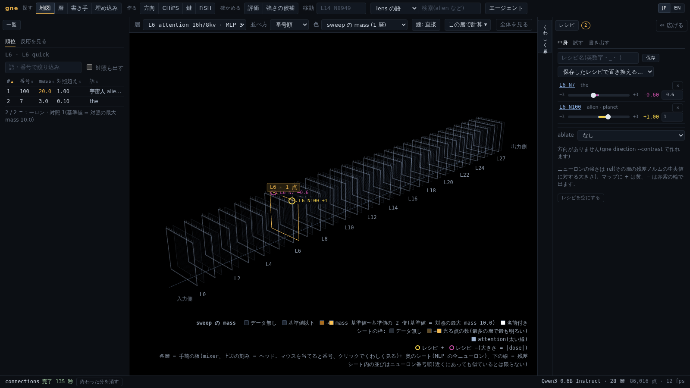
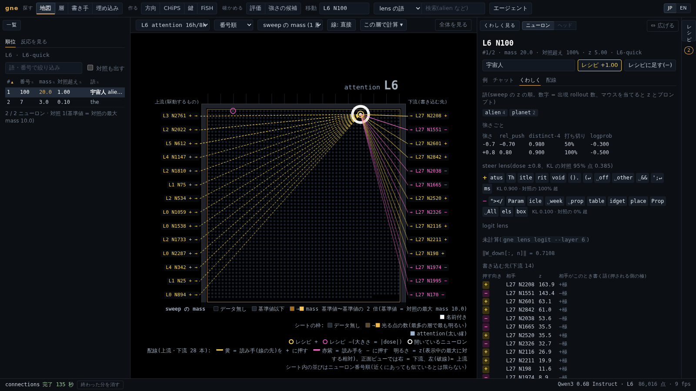

[English](README.md) | **日本語**

# gguf-neuron-explorer（`gne`）

GGUF モデルの MLP ニューロンを 1 個ずつ調べて順位をつけ、押して（steer して）効果を確かめます。見つけたものは control vector に書き出して、そのままの `llama-cli` / `llama-server` で使えます。



`gne` の流れは次のとおりです。
1. ニューロンが書き込む向き（`W_down` の列）を残差に足して文章を生成します。
2. ランダムな向きを同じように押した対照と比べて、何が変わったかを測ります。

llama-cpp-python 経由で llama.cpp の上で動くので、手元の量子化済み GGUF をそのまま使えます。

- **総当たりと順位づけ（sweep / rank）:** 層のニューロンを数百個、決まったプロンプトと dose で押します。出力が少数の語にどれだけ集まるかで順位をつけ、どの値もランダムな向きの対照と比べます。
- **計算の軽い一次ふるい:**
  - **logit lens:** 重みだけで計算し、CPU で動きます。
  - **steer lens:** ± の dose で押したときの次トークンの変化を見ます。
  - **逆引き（reverse）:** 2 つのペルソナの差の向きを作り、全層・全ニューロンを cos で並べます。
- **ニューロンごとのまとめ（neuron）:** sweep の順位、プロンプトごとの上位語、生成例（rollout）、lens の結果、上流・下流のつながりを 1 か所にまとめます。
- **レシピ:** `14:8949:+1.0`、`13:7956:-1.0` のようにユニットを組み合わせ、−・無介入・+ の 3 列チャットで比べてから書き出します。書き出し先は次の 3 つです。
  - control vector（`.cvec.gguf`）。`llama-completion --control-vector` の生成と一致することを確かめられます。
  - npz・json・safetensors。
  - FFN の down バイアスとして GGUF にマージしたもの。llama.cpp がそのバイアスを読む arch だけです（llama・granite・mistral3・nemotron・gpt2 など。Qwen・Gemma は不可。一覧は [configs/arch/bias_support.yaml](configs/arch/bias_support.yaml)）。
- **押す位置を選ぶ（`when`）:** 生成するトークンだけ（`gen`）、assistant の発話だけ、過去の応答以外（`skip-replies`）、出力にある文字列が出てから、だけを押せます。倍率をだんだん弱めることもできます。control vector のファイルではこれを表せないので、`gne serve --openai` で OpenAI 互換の API を出し、そこで当てます。
- **音声の入力:** 音声を聞けるモデル（LFM3-Omni）では、`gne steer --audio speech.wav` や、OpenAI の形のメッセージの `input_audio` の部品で、話し声をそのまま会話に入れられます。モデルの mmproj が音声を埋め込みにし、gne 自身の decode で入れるので、レシピ・`when`・活性の捕捉が文の発話と同じように効きます。応答は文です。読み上げは好きな TTS で行います。
- **倍率で押す（gain）:** `22:2742:x4` のように書くと、決まった向きを足す代わりに、そのニューロン自身の出力を k 倍します。`x0` で消し、負の値で反転します。ニューロンが働いている場面でだけ効きます。llama.cpp の `--lora` で使える LoRA アダプタ GGUF（Qwen でも可）か、重みを書き換えた GGUF に書き出せます。書き換えの既定はスケールパッチ（量子化ブロックのスケールだけを書き換える方法）で、元の量子化のまま行をちょうど k 倍にします。
- **方向（`gne direction`）:** 多くのニューロンに散らばった性格や振る舞いは、方向として扱います。方向は対照集合から作ります。対照集合は、質問を 2 通りの条件で読ませる組です（例: 性格を指示する system を付けた A 側と、付けない B 側）。応答を書き始める直前のトークンで、両側の残差の平均の差を層ごとに取ったものが方向です。方向を消して振る舞いが減るか、足して増えるかを測って、層を自動で選べます。`30:dir:yandere:+0.3` のようにニューロンと同じ形で足せて、control vector に書き出せます。性格を足すときは `--positions response` で作ると効きやすくなります（指示の直後ではなく、その性格で生成した応答のトークンで測ります）。方向もニューロンと同じようにランダム対照と比べます。候補の層ごとに同じ大きさのランダムな向きを 16 本足し、効果がその 95% 点を超えた層だけを選びます。レシピ全体は `gne steer --contrast` で同じように比べ、`null_pct` を出します。
- **方向の射影消去（`gne ablate`）:** 残差に書き込むすべての重みから方向を取り除きます（いわゆる abliteration）。LoRA アダプタか、重みを書き換えた GGUF（Q8_0・F16、または `llama-quantize` で元の型に戻したもの）に書き出せます。レシピに `ablate:` を持たせられ、`gne eval --compare-ablation` で上位ニューロンを消す場合と比べられます。
- **副作用チェック（`gne eval`）:** レシピをいくつかの倍率で流し、性格がどれだけ変わったかと、何が壊れたかを同じ表に並べます。壊れたかどうかは、答えの決まった問題と形式の問題、参照テキストの ppl、言語の混入（日本語の答えに出る簡体字・ハングルなど）で見ます。別の GGUF に性格を 1〜5 で採点させることもできます。基準の内に収まる倍率には「配布可」の印が付きます。`--random-controls N` を付けると、各倍率で同じ大きさのランダムな向きのレシピ N 本も流します。性格の変化が対照を超えるかと、押す大きさだけで能力や ppl がどれだけ落ちるかが分かります。
- **状態を書いているのは誰か（`gne writers`）:** 活性の差は、ペルソナの system のような状態にどのニューロンが反応したかを示します。`gne writers` は、各ニューロンが応答のトークンで実際に残差に書き足した量（活性の差 × 書く向き。post-FFN norm も含む）を測ります。その状態の方向を、埋め込み・各層の mixer（attention・畳み込み）・各層の MLP がそれぞれ何割書いたかにも分けます。UI には writers ビューと地図の色があります。
- **attention ヘッド（`gne heads`）:** ヘッドにもニューロンと同じように住所があります（`L21 H7`。Qwen3.5 の線形注意のヘッドも含む）。`gne heads contrast` は、同じ会話をペルソナありとなしで流し、次の 3 点でヘッドを順位づけます。
  - トリガーの語（他の人の名前など）をどれだけ多く見るようになったか
  - 注目の分布と出力がどれだけ変わったか
  - 出力がペルソナの方向をどれだけ書くか

  比べる基準値には、中立な system どうしの差を使います。`21:H7:x0` / `x2` で、そのヘッドの出力を `W_O` の列ブロックの LoRA で k 倍します。`gne eval --reactivity` では、トリガーがあるときだけ性格が出るかを、同じ倍率のランダムなヘッドと比べて測ります。

  `gne heads listen`（ヘッドのパネルの Listen タブ）は会話を 1 つ流し、選んだヘッド（`14:H0-3` など）で、応答のトークンがそれより前の各トークンにどれだけ注目したかを出します。保存済みの方向を渡すと、ヘッドの出力のその方向の成分を、元のトークンごとに分けます。各トークンの値ベクトルに注目の重みとヘッドのゲートを掛け、`W_O` と、attention の出力の後の norm（その norm を持つ arch だけ）を通したものです。層の全ヘッドで足すと、その層の attention の出力に戻ります。残る誤差も出力し、Qwen3・Qwen3.5・LFM3 では 1% 未満でした。
- **MoE（専門家を選ぶモデル）:** MoE の層のニューロンは `L12 E37 N511`（専門家 37 のニューロン 511）と書きます。`gne experts contrast` は、ペルソナのときに選ばれやすくなる専門家と、ペルソナの方向を書く専門家を順位づけます。`gne experts sweep` は専門家を 1 つずつ消す・強めて試します。MoE の層の `add` はニューロンの書き込み方向を全トークンに足すだけで、ニューロンそのものを押すのは gain（`12:E37:N511:x2`、その専門家が選ばれたときだけ効く）です。専門家全体（`12:E37:x0`）とルーターのバイアス（`12:E37:route:+2`）はスケールパッチで当てます。作業用コピーの量子化ブロックのスケールをちょうど書き換え、使い終わったら戻します。
- **Web UI:** 全層・全ニューロンを 3D で並べた地図です。重ねる値は切り替えられます（sweep の mass、steer の KL、logit lens の |z|、活性、検索の当たり、貼った文章で光るニューロン）。ほかに次の機能があります。
  - 順位の一覧とニューロンのパネル
  - その場で試せる 3 列チャット
  - ニューロン同士の配線と UMAP の配置
  - rollout の埋め込みの散布図
  - GPU を譲り合う裏のジョブ
  - JP / EN の切り替え
- **複数の GPU・大きなモデル:** `gne worker` を GPU ごとに 1 プロセスずつ立てます。Python の環境は別々（CUDA・ROCm）でもよく、結果の置き場所を共有します。`gne sweep --workers auto`・`gne lens steer --workers auto` は、ニューロンを分けてワーカーに投げます。見積もりが 30 分を超える処理は、`--yes` を付けないと止まります。`--budget 30m` を付けると予算に収まるように絞ります（方向に多く書き込むニューロンの上位、steer lens の上位、quick 設計を使います）。`gne info` には GPU と CPU に載った層の数と、大きなモデルで逆引きから始める手順が出ます。
- **エージェントから使う:** MCP サーバーを付けています。Claude Code などのエージェントからニューロンを調べる・押す・ジョブを回すことができます。開いている UI にニューロンを強調したり注釈を貼ったりもできます。

[lyramakesmusic/neuron-explorer](https://github.com/lyramakesmusic/neuron-explorer)（Qwen3.5-4B 専用、改造した vLLM の上で動く）の手法を、llama.cpp / GGUF 向けに作り直したものです。元のリポジトリのコードは使っていません。

## 必要なもの

- Python 3.11 以上
- [llama-cpp-python](https://github.com/abetlen/llama-cpp-python) 0.3.36 以上。小さなモデル以外は GPU 対応でビルドしてください。
- NVIDIA の GPU を推奨します。CPU だけ（`--n-gpu-layers 0`）でも動きますが遅いです。

確かめた環境:
- RTX 3080 12 GB、WSL2、CUDA 12.4、Python 3.12、ソースからビルドした llama-cpp-python 0.3.36。
- モデル: Qwen3-0.6B、Qwen3.5-4B（線形注意との混合）、SmolLM2-135M-Instruct（arch `llama`）。どれも Q8_0。
- Metal では試していません。
- MoE モデル: granite-3.1-1b-a400m と LFM2-8B-A1B。[MoE(専門家を選ぶモデル)](#moe専門家を選ぶモデル)を見てください。
- SenseNova-Loop-9B(arch `sensenova_loop`、層 4〜27 を 2 回実行する)。公式の llama.cpp はまだ読めないので、2 つの改造版の llama.cpp のどちらかと、llama-cpp-python 0.3.36 の直しを入れた専用の環境が要ります。改造版ごとに読める GGUF が違います。モデルの開発元の改造版(OpenSenseNova/llama.cpp。llama.cpp 1.0 が元)は公式の GGUF(sensenova/SenseNova-Loop-9B-GGUF。BF16 を含む)を読み、GuideboardLabs 版(llama.cpp 0.8 が元)は guideboardlabs/SenseNova-Loop-9B-GGUF を読みます。生成は GuideboardLabs 版のほうが約 5 倍速く動きます。どちらを選ぶかは [docs/sensenova_loop.md](docs/sensenova_loop.md)、パッチは [third_party/sensenova-loop/](third_party/sensenova-loop/README.md) を見てください。
- 初めて使うモデルでは、まず `gne verify` で確かめてください。

## インストール

```bash
git clone <このリポジトリ> && cd gguf-neuron-explorer
uv venv --python 3.12 .venv
CMAKE_ARGS="-DGGML_CUDA=on" uv pip install --python .venv/bin/python -e '.[ui,mcp]'
source .venv/bin/activate
```

追加の依存:
- `ui`: Web UI（FastAPI・uvicorn・umap-learn）
- `mcp`: MCP サーバー
- `dev`: テスト（pytest・Playwright）

WSL での CUDA と ROCm の入れ方は [docs/setup.md](docs/setup.md) にあります。GPU ごとに環境を分け、`gne worker` で sweep や steer lens を分担させる手順もそこに書いています。

## 使い始め

どのコマンドも `-m <model.gguf>` か環境変数 `GNE_MODEL` でモデルを指定します。結果は `~/.gne` に保存され（`--root` か `GNE_ROOT` で変えられます）、後のコマンドや UI がそのまま使います。

```bash
export GNE_MODEL=models/Qwen3.5-4B-Q8_0.gguf

gne info                                   # arch・警告・対応しているもの
gne verify                                 # llama.cpp との等価性テスト(新しい arch ではまずこれ)
gne stats resid                            # 層ごとの残差ノルム(rel dose に必要)

gne lens logit --layer 22                  # 重みだけで一次ふるい
gne sweep --layer 22                       # ランダムに 384 個 + ランダムな対照 64 本、設計 main_rel
gne rank --run L22-main_rel                # 語のかたまり(mass)で順位づけ
gne neuron 22 2742                         # ニューロン 1 個のまとめ

gne steer --unit 22:2742:+0.8 -p "Who are you?" --compare
gne chat --unit 22:2742:+0.8 -p "あなたについて教えて"

gne reverse --contrast configs/contrast/evil.yaml --verify    # ペルソナから候補を探す
gne export-cvec --recipe configs/recipes/evil.yaml            # → ~/.gne/export/evil.cvec.gguf

gne steer --recipe configs/recipes/alien.yaml -p "Who are you?" --compare     # when: gen(生成するトークンだけ押す)
gne steer --unit 22:2742:x4 -p "Is there life on other planets?" --compare   # gain: ニューロンが働く場面で 4 倍
gne eval --recipe configs/recipes/alien.yaml                  # 倍率ごとの能力・ppl・混入・性格の変化量
gne fieldtest -m baked.gguf --against original.gguf           # 本番と同じ動かし方で、長い作業・ツール呼び出し・perplexity をファイルどうしで比べる
gne gain --recipe configs/recipes/alien_gain.yaml             # → ~/.gne/export/alien_gain.lora.gguf

gne direction --contrast configs/contrast/evil.yaml --select auto   # 層ごとの方向と層選び
gne steer --unit 16:dir:evil:+0.6 -p "What do you think about people?" --compare
gne steer --ablate evil --system "You are a cruel AI." -p "Who are you?" --compare
gne ablate --direction evil                                   # → ~/.gne/export/evil-ablate.lora.gguf
gne eval --compare-ablation evil                              # 上位 20 ニューロンの ×0 と方向の消去を比べる
gne steer --recipe configs/recipes/alien.yaml --contrast configs/contrast/alien.yaml   # 効果をランダムなレシピ 16 本と比べる(null_pct)

gne heads contrast --contrast configs/contrast/yandere_react.yaml   # attention ヘッドの順位(ペルソナあり vs 中立)
gne heads show 15 2                                           # ヘッド 1 個のまとめ(順位・W_O ブロックの logit lens・当てた gain)
gne heads listen --heads 14:H0-3 --system @persona.txt -u "I had lunch with a coworker." --direction wr_mix14   # 応答からの注目と、トークンごとの寄与
gne steer --unit 15:H2:x2 -p "I had lunch with Emily today." --compare   # ヘッドの gain(W_O の LoRA)
gne eval --recipe R --reactivity configs/contrast/yandere_react.yaml --head-controls 8

gne direction score --name evil                               # A 側と B 側が層ごとに方向に沿ってどれだけ分かれるか。最もよく分かれる層を基準層として記録(生成なし)
gne heads causal --name evil                                  # 出力を 0 にすると方向への射影の値が下がるヘッド(生成なし)
gne heads allocate --name evil --target -3 --n-heads 6,5,4    # 効率(強さあたりの射影の値の下がり方)に比例して強さを配り、ヘッド数を減らした組を比べる
gne heads allocate --name evil --target -3 --method greedy     # または、いちばん効くヘッドの強さを 1 段ずつ上げていく
gne heads writes --name evil                                  # 全部のヘッド・線形注意のヘッド・MLP のニューロンを、方向への書き込みの量で並べ、上位を確かめる
gne headproj check --layer 20 --neuron 4096 --direction evil  # ニューロンの方向成分の射影(20:N4096:s1@evil)が式どおりか
gne headproj check --layer 20 --whole ffn --direction evil     # 層の MLP の出力全体の射影(20:ffn:s1@evil。注意の出力全体は --whole attn・20:attn:s1@evil)
gne heads candidates --alloc evil --prompts held_out.yaml     # 組 × 倍率で応答を作り、どの候補か伏せた採点のファイルを書く
gne heads candidates --tally evil                             # 書いた採点を候補ごとに集計する
gne steer --recipe ~/.gne/heads/<model_id>/evil.alloc-n4.yaml --system "You are a cruel AI." -p "Who are you?" --compare   # 選んだヘッドの書き込みの方向成分だけを変える
gne eval --recipe ~/.gne/heads/<model_id>/evil.alloc-n4.yaml --random-controls 16   # 同じ強さのランダムなヘッドと比べる
gne eval --recipe R --compare-methods                         # 全層の射影消去・ヘッドの方向成分・ヘッドの倍率・ニューロンの消去を、効き目をそろえて比べる
gne headproj export --recipe R                                # 層ごとにランク 1 の LoRA(--bake はそのテンソルだけ書き換える)

gne direction --contrast configs/contrast/zundamon_endings.yaml --positions response   # キーつきの書き込み(keyed)で書く方向
gne direction key --contrast configs/contrast/zundamon_endings.yaml --layers 8,14,20   # モデル自身の応答で「です。」「ます。」を書く直前の位置に反応するキーを作る
gne direction key-check --key zundamon_endings --contrast configs/contrast/zundamon_endings.yaml   # 作成に使っていない例で、ラベルをシャッフルして作った比較用のキーより位置をよく分けるか
gne steer --unit 14:ffn:keyed:a1@zundamon_endings#zundamon_endings -p "おすすめの趣味を教えて。" --compare   # キーが反応する位置でだけ方向を書く
```

`export-cvec --verify` を付けると、`llama-completion --control-vector` の greedy 出力が `gne` と一致するかも確かめます。`llama-completion` は `build/` と `PATH` から探します（`--llama-completion` で指定もできます）。

書き出したベクトルは llama.cpp でそのまま使えます。

```bash
llama-cli -m models/Qwen3.5-4B-Q8_0.gguf --control-vector ~/.gne/export/evil.cvec.gguf
llama-cli -m models/Qwen3.5-4B-Q8_0.gguf --control-vector-scaled ~/.gne/export/evil.cvec.gguf:0.6
llama-cli -m models/Qwen3.5-4B-Q8_0.gguf --lora ~/.gne/export/alien_gain.lora.gguf
```

レシピは小さな YAML です。`when`・`sampling`・gain のユニットは省けます。

```yaml
name: example
model_id: qwen3.5-4b-64d32ead87
dose_unit: rel
when: gen                                       # all / gen / assistant / after:<文字列> / ramp:<a>-<b>
units:
  - {layer: 22, neuron: 2742, dose: +0.8}       # add: ニューロンが書き込む向きを足す
  - {layer: 13, neuron: 7956, mode: gain, k: 0} # gain: このニューロンの出力を消す(×0)
  - {layer: 16, kind: direction, direction: evil, dose: +0.3}   # gne direction で作った方向を足す
  - {layer: 15, kind: head, head: 2, mode: gain, k: 2}           # attention ヘッドの出力を k 倍(×2)
  - {layer: 16, kind: head, head: 8, mode: proj, direction: evil, s: 6}   # attention ヘッドの書き込みのうち、方向に沿った分だけを変える（s = 1 で消える）
  - {layer: 14, kind: ffn, mode: keyed, direction: zundamon_endings, key: zundamon_endings, alpha: 1}   # ffn_down の入力にキーが反応する位置でだけ方向を書く
ablate: {direction: refusal, scale: 1.0}        # 残差に書き込むすべての重みから方向を消す(LoRA)
sampling: {temperature: 1.0, top_k: 20, top_p: 0.95, min_p: 0.05, presence_penalty: 0.9}   # 試すときのサンプリング(seed は持たない)
```

`sampling` は、そのレシピを試すときのサンプリングです。`dry_multiplier`・`dry_base`・`dry_allowed_length`（既定は切り）も書けます。多ターンの会話で前の応答をそのまま繰り返すのを止める DRY の罰です（llama.cpp と同じ名前で、OpenAI 互換の API でも受け付けます）。次の場所で使います。

- `steer` と `chat`：この値で生成します。`--temperature`・`--top-k`・`--top-p`・`--min-p`・`--presence-penalty`・`--sample-seed` で上書きでき、`--greedy` で切れます。
- UI のチャット：「レシピの設定」として選べます。
- OpenAI 互換の API：リクエストにサンプリングの値が無いときに使います。

control vector には入らないので、`export-cvec` は同じ設定の llama-server の引数を表示します。`sampling` が無ければ greedy です。`eval` はいつも greedy です。

コマンドの一覧は `gne --help`、各コマンドの使い方は `gne <コマンド> --help` で見られます。

### dose の目安

dose の既定の単位は **rel** です（`dose × その層の残差ノルムの中央値 × W_down[:, n] の単位ベクトル`）。

Qwen3.5-4B での目安:
- 0.5 で話題が少し混ざり、0.8 で話題を乗っ取り、1.0 以上で文が崩れ始めます。
- 3.0 はわざと崩して、そのニューロンが何を書きたがるかを見るための値です。
- 層 0〜2 は残差が小さいので、rel dose の目安がそのままは使えません。
- 層 0 は control vector では押せません（マージすれば押せます）。
- 残差の大きさが少数の次元に偏るモデルでは、rel の基準(残差の大きさの中央値)が大きく出るので、同じ dose でも強く効きます。Gemma 3 1B では、大きい 8 成分を除くと残差の大きさが約 1/4.9(層 3 以降の中央値。層 13 では 1/6.7)になり、層 13 では dose 0.2 で崩れ始め、0.4 で文が壊れました(偏りの少ない Qwen3-0.6B・LFM3-1.7B では約 1/1.3、Qwen3.5-4B では 1/1.2 で、Qwen3-0.6B・LFM3-1.7B は 1.0 でも崩れませんでした)。`gne stats resid` は層ごとの偏りの量(p50 ÷ 大きい 8 成分を除いた大きさの中央値)も保存し、層 3 以降の中央値が 2 倍以上のモデルでは `gne info`・steer・画面のレシピの欄に、弱めの強さから試すよう警告を出します。v0.8.6 より前に作った統計には偏りの量が入っていないので、`gne stats resid` で作り直すと出ます。rel の基準そのものは変えていません。

### 出力のあとに正規化があるモデル(LFM3・Gemma 系など)

注意(混ぜる層)や MLP の出力を、残差に足す前に正規化するモデルがあります(LFM3・Gemma 2 / 3 / 3n / 4・OLMo 2・EXAONE 4・GLM-4 など。llama.cpp のグラフを読んで作った一覧が `configs/arch/residual_writers.yaml` の `output_norm` にあります)。残差に入るのは γ ⊙ y / rms(y) なので、正規化の前の書き込み y から方向 r の成分を引いても、残差には r の成分が残ります。v0.8.6 では次のように動きます。正規化を補正した射影と点数は次の版で入れる予定で、それまでの扱いです。
- ニューロン・MLP 全体の射影: 実行しません(前の版から同じ)。理由: ffn_down の列の方向成分が、そのまま残差の方向成分にならないためです。
- ヘッド・注意全体の射影: 実行しますが、方向の成分は残差から完全には消えません。結果・CLI・画面に、そのことと測った値を出します(LFM3-1.7B・Gemma 3 1B で測った値: 層全体を s=1 で射影すると r の成分が中央値で約 5 割残り、ヘッド 1 個では消える割合が 0〜100% とばらつく)。CHiPS の止めて選ぶ流れ(`--rank causal`)の組の効きの数は残差で測ったものなので、そのまま使えます。
- 書き込みの量での順位づけ(`--rank writes`・`gne heads writes`): 実行しません。理由: 点数(正規化の前の書き込み)が残差での寄与を表さないためです(正規化のあとの寄与との順位相関は中央値 0.85、最小 −0.12)。代わりに `--rank causal` を使ってください。**選び方を指定しない一括(`gne heads pipeline`)は、このモデルでは `--rank causal` で実行し、切り替えたことを結果・CLI・画面に出します**(v0.8.5 までの既定は `--rank writes`)。作り済みの結果とレシピは、そのまま読めます。
- 射影の検算(`gne headproj check`): 実行しません。理由: 書き込み行列の出力(正規化の前)で測るので、残差での効きを表さないためです。
- 鍵つきの書き込み(keyed)の attn: 実行しますが、書き込みの大きさと向きは正規化の分を補正していないので、そのことを警告します(FFN の keyed は前の版と同じく補正します)。
- `gne bake`: MLP の出力のあとに正規化があるモデルでは実行しません。理由: bias は正規化の前に足されるので、control vector と等価にならないためです。代わりに `gne export-cvec` の control vector を使ってください。
- 正規化がどの層・どの副層(混ぜる層・MLP)にあるかは、テンソルの名前ではなく、この表と層ごとのテンソルで決めます。Qwen3.5・Qwen3-Next・SenseNova-Loop などの `post_attention_norm` は MLP の手前の正規化(出力のあとではない)なので、拾いません。表に無い arch に `post_attention_norm` があるときは、「確かめていない」と知らせます。
- 実物で確かめたのは LFM3-1.7B・LFM3-Omni-2B・Gemma 3 1B です。表のほかの arch は、llama.cpp のグラフで同じ構造(出力 → 正規化 → 残差に足す)であることを確かめただけです。

### かかる時間

Qwen3.5-4B Q8_0、RTX 3080 での目安です。

| 処理 | 時間 |
|---|---|
| `stats resid`（全層） | 約 16 秒 |
| `lens logit` | 1 層あたり約 33 秒（CPU） |
| `lens steer`（9216 ニューロン全部） | 1 層あたり約 22 分 |
| `sweep` の `main_rel` | 1 ニューロンあたり約 6.4 秒（385 本で 48 分） |
| `reverse` | 約 6 秒。`--verify` で候補 20 個なら約 4 分 |
| `eval`（55 タスク × 5 倍率） | `when: all` で約 41 秒、`gen` で約 90 秒 |
| `direction`（24 会話）と `--select auto`（9 層） | 約 35 秒 + 約 35 秒 |
| `ablate` の LoRA / `--bake` Q8_0（`--verify` 込み） | 約 10 秒 / 約 40 秒 |

1 層の全ニューロンに `main_rel` を回すと約 16 時間かかります。lens と逆引きで候補を絞ってから sweep してください。

### MoE（専門家を選ぶモデル）

granite-3.1-1b-a400m（`granitemoe`、32 専門家中 8 個を選ぶ）と LFM2-8B-A1B（`lfm2moe`、32 専門家中 4 個、ルーターのバイアスあり）で確かめています。

```bash
gne stats act -m M --layers 2-22                     # 専門家ごとの選ばれた回数も数える
gne experts contrast -m M --contrast configs/contrast/yandere_rules.yaml
gne experts show -m M 12 37                          # 選択率・選ぶトークン・対照分析での順位・上位のニューロン
gne experts sweep -m M --layer 12                    # 各専門家を消す（x0）・強める（x2）、語の出方で順位づけ
gne steer -m M --unit 12:E37:x0 -p "..." --compare   # 層 12 の専門家 37 を消す
gne steer -m M --unit 12:E37:N511:x2 -p "..." --compare
```

| ユニット | 意味 | 当て方 |
|---|---|---|
| `12:E37:N511:+0.8` | ニューロンの書き込み方向を全トークンに足す（方向を足すだけで、ニューロンを押すのとは違う） | control vector |
| `12:E37:N511:x2` | 専門家 37 が選ばれたとき、そのニューロンの活性を k 倍 | 専門家ごとに積んだ LoRA |
| `12:E37:x0` / `x2` | 専門家 37 の出力を消す・2 倍にする | スケールパッチ |
| `12:E37:route:+2` | 専門家 37 のルーターのバイアスを動かす（`lfm2moe` などバイアスを持つ arch だけ） | スケールパッチ |
| `12:S:N5:x2` | shared expert のニューロン | LoRA（dense のニューロンと同じ） |

スケールパッチは、対象の行の量子化ブロックの中の fp16 のスケールを書き換えるので、行や専門家 1 つ分の重みがちょうど k 倍になります（k = 0 はゼロバイト）。Q4_0〜Q8_0、Q2_K〜Q6_K、IQ1_M 以外の IQ 系、F16・BF16・F32 で使えます。パッチは `~/.gne/work/` の作業用コピーに当て（元の GGUF は触りません）、使うたびに戻します。コピーの読み直しは 1.4 GB のモデルで約 0.3 秒、5 GB で約 0.9 秒です。`steer`・`eval`・UI のチャット・OpenAI 互換の API は自動で当てます。列方向（`W_down[:, n]`）はこの方法では書けません。MoE の層の sweep・lens・逆引きでは、ニューロンを `e × n_ff_exp + n` の通し番号で数えます。

### CHiPS: 少数のヘッドの、方向に沿った分だけを変える

ここで説明する手法を **CHiPS**(Causal Head-isolated Projection Steering)と呼びます。名前のとおり、止めて測った効き目(因果の効果)で選んだヘッドだけに限定して、方向への射影を当てます。全層の、残差に書き込む重みから一律に方向を消す射影消去との一番の違いは、この限定です。

`gne direction` で作った方向は、attention ヘッド 1 個ずつにも当てられます。ヘッドは毎トークン、残差にベクトルを 1 本足しています。`proj` のユニットは、このベクトルを「方向に沿った分」と「それ以外」に分けて、前者だけを変えます。強さを `s` とすると、方向に沿った分が元の `1 − s` 倍になります。`s = 1` で消え、`s = 2` で向きが反転し、`s` が負なら強まります。それ以外の分には触りません。ここがヘッドの gain（`L:Hh:xk`）との違いで、gain は方向と関係のない情報も含めて、出力をまるごと倍にします。

変化の大きさは、いまの入力でそのヘッドが方向に沿って書いている量に比例します。なので、そのヘッドが方向に沿って書いている場面でだけ効き、ほかではあまり変わりません。同じ理由で限界もあります。ヘッドがもともと書いていない振る舞いは作れません。性格を運んでいるヘッドを強めても、指示のない会話では何も起きず、system の指示や、ニューロン・方向による小さな押しで性格が先に出ているときにだけ効きます。

ヘッドと強さは、文章を生成せずに決めます。指標は、残差を方向に射影した値(例ごとの平均)です。その性格や振る舞いがどれだけ出ているかを表し、以下では「射影の値」と書きます(結果の JSON では `score` などの項目)。

- `gne direction score` は、対照集合の両側を応答が始まる直前まで読ませ、層ごとに両側の射影の値がどれだけ離れているかを測ります。一番よく分かれる層が基準層として記録されます。
- `gne heads causal` は、まず層ごとにヘッドをまとめて止め(出力を 0 にし)、効いている層ではヘッドを 1 個ずつ止めて、射影の値がどれだけ下がるかを記録します。そのヘッドが方向に沿って直接書いている量も並べます。後ろの層のヘッドは基準層の方向には何も書かなくても効くことがあるので、下がり方は数層先でも測ります。
- `marginal` モードでは、いまの組から 1 個のヘッドの強さを少しずつ上げ、強さあたりの下がり方(効率)を測ります。この順位は、止めたときの順位とたいてい違います。
- `gne heads allocate` は、効率に比例して強さを配り、いちばん効きにくい例が目標の値に届くまで組全体の大きさを合わせます。ヘッドの数を減らした組も作るので、大きい組と同じくらい効く一番小さい組を選べます。

`gne heads pipeline --spec ファイル.json` は、対照集合(と、任意で設定)を書いた 1 つのファイルから、方向づくりから強さの配分までを 1 回で回します。v0.8.0 から、候補づくりの既定は全部の部品を書き込みの量で並べる形(`--rank writes`、下の箇条書き)です(注意の出力のあとに正規化があるモデルでは、v0.8.6 から既定が `--rank causal` になります。「出力のあとに正規化があるモデル」の節)。上の `gne heads causal` と `gne heads allocate` の流れ(層ごと、続いてヘッド 1 個ずつ止めて効き目を測り、効率で強さを配る)は `--rank causal` で、v0.7.0 までの既定です。

- **質問の数:** 何百個でもかまいません。ヘッドを止めて測る段階では、1 回の試行で使う質問を全部読ませるので、質問を等間隔に間引いた一部（既定 64 個）を使います。
- **外す候補:** 止めると B 側(中立の側)の残差が自分の大きさの半分以上動く層とヘッドは、方向に効いているのではなくモデルを壊しているだけなので、候補から外します（最初の層のヘッドを全部止めると、たいていこうなります）。
- **目標:** 指定しなければ、両側の射影の値の平均のちょうど真ん中を目指して強さを配ります。真ん中では振る舞いが半分ほどしか消えないことが多いので、消し切りたいときは目標に `B` と書きます。B 側の平均まで下げる強さを探します(届かずに s が上限の `s_max`、既定 30 に張り付くなら、`s_max` を上げます)。
- **流し直し:** 途中で止めて同じファイル・同じ設定で流し直すと、作り済みの方向と因果の結果を使い回し、配分からやり直します(最初から作り直すときは `--fresh`、UI では「最初から作り直す」)。
- **選び方(`--rank`):** 既定の `--rank writes` は、質問 1 問につき 1 回流すだけで全部の層の注意ヘッド・線形注意のヘッドが方向にどれだけ書いたかを読んで並べ、上位を 1 個ずつ s=1 で射影して確かめ、効き目の大きい順に s=1 で組に足します(足りないときだけ全体の強さを上げる)。最後に、選んだ組で応答を書かせて `validate.match` を数えます。s=1 の組で目標に届かないときは、既定では強さを部品ごとに上げます(射影の値が残りやすい質問での効率に比例して配り、効く部品は高く、B 側を押す部品は低く。v0.8.2 までの全部を同じ倍率は `--strength uniform`)。MLP のニューロンも候補にするなら `--unit-kinds all`(ニューロンの射影は `L:Nn:sS@NAME`、MLP の出力側の重みの列から方向成分を引く)。層の書き込み全体(注意の出力全体 `L:attn:sS@NAME`・MLP の出力全体 `L:ffn:sS@NAME`)も部品にするなら `--unit-kinds heads,layers` か `all,layers`。出力には層ごとの直接の書き込みも出るので、どの層が効くかを読めます。選ぶ質問と表の数を測る質問を分けるなら `--holdout`(側ごとに 16 問以上)。`--rank causal` は v0.7.0 までの選び方で、基準層より前のヘッドを、層ごとに止めた効き目の上位の層からだけ選び、効率で配り直します。応答での確かめで振る舞いが変わらないと出たら、もう一方も試してください(Qwen3.5-4B の注意書きの題材では `--rank causal` のほうが効きました)。出力にどちらで流したかが出ます。手順・比べた結果・弱点は [docs/head-component-steering.md](docs/head-component-steering.md) §3.9。

配分の比較表の「残り」は、その組を当てても目標まで下がらなかった A 側の質問の数です。`gne heads refine --name 名前` (UI では表の「残りから追加」)は、その残りの質問だけを A 側、元の B 側の質問を B 側にし、両側に組を当てたまま方向を作り直して、同じ流れで足すヘッドと強さを決めます。組がもう書き換えている分は両側で同じになるので、方向には組でまだ消せていない違いだけが残ります。足す組は元の組を当てた状態で探したものなので、単独では使いません。比較表のどの組についても(書き込みの量で選ぶときは倍率を上げる前の s=1 の組も)、元の組と合わせたレシピを作り、元の方向・元の目標で、残りの数・A 平均・B 側の動きとずれを、元の組だけのとき(前)と合わせたとき(後)で測り直します。UI の表は、どの行も「元の組(薄い字、畳んである)+ 足した組」として、合わせたレシピの前 → 後の数を出し、「レシピを置き換える」「評価へ送る」も合わせたレシピだけを使います(足した組だけの値は、新しい方向での参考として各行の補足に出します)。代表の合わせたレシピでは、元の一括と同じ応答での確かめも流します(`--check-replies 0` で行わない)。残りから追加の結果に、もう一度残りから追加を重ねると、土台はその行の合わせたレシピ(元の組 + それまでの回の追加の全部)になり、どの回も元の方向・元の目標で測ります。部品ごとに何回目に入ったかが残り、同じ部品が 2 つの方向で入ったときは表と CLI に出ます(射影を両方当てます)。強さを上げるのは足した組だけで、元の組の強さはそのままです。推す行は、使う合わせたレシピの数(元の方向・元の目標で測った残り・組の効き・B 側の動きとずれ)で選びます。足すと残りが増える・組の効きが下がる・B 側の上限を超えて土台より悪くなる行は推さず、どの行も良くならなければ推しません(「足さないほうがよい」と出ます)。推す行の応答が壊れていれば次の行にします(書き込みの量で選ぶ一括の推す組も同じで、応答での確かめで応答が壊れた組は推さず、次の組を確かめます)。v0.8.3 までは、重ねると合わせたレシピに 1 つ前の回の追加分しか入らず、元の組が落ちていました(v0.8.4 で直しました。v0.8.3 までに重ねた結果を土台にしようとすると断ります)。

このあたりの処理は質問を読ませるだけで応答を作らないので、内部を測るコンテキストを最長の会話に合わせて小さく作り、チャットなどで作った生成用のコンテキストは先に解放します。大きいモデルで VRAM があふれ、メインメモリに逃げて遅くなるのを避けるためです。

用途別のひな形が `configs/pipeline/` にあり、UI の「ひな形」からも選べます。それぞれの `about` に、何と何を比べるのか、候補づくりで倍率をどちら向きにするのかを書いてあります。

- system で頼んだ性格を運ぶヘッドを探す(system は A 側だけ)
- 2 つの性格の違いだけを取る(system を両側に)
- ニューロンのレシピが作った性格を運ぶヘッドを探す(A 側にレシピ)
- 日本語と英語のような質問の種類の違いを取る(側ごとに別の質問)
- 考えがループするなど、応答の途中で起きる振る舞いを取る(両側とも書きかけの応答)

生成せずに決めた強さが、実際の応答でちょうどよいとは限りません。射影の値は方向に沿った量なので、応答に出る振る舞いの強さや自然さとはずれることがあります。そこで最後は応答を読んで決めます。

`gne heads candidates --alloc 名前` は、配分の比較表にある組それぞれの強さ全体に倍率をかけた候補を作り、何もしないモデルと一緒に、両側の質問へ応答を書かせます。倍率の既定は 0.5・1・1.5・2・3 です(配分の目標の既定は A と B の真ん中までなので、ちょうどよい倍率は 1 より大きいことが多い)。乱数の種はすべての候補で同じなので、応答の違いは介入だけから来ます。正の倍率は A 側の振る舞いを消す向きなので A 側の応答を、負の倍率は符号を返して強める向きなので B 側の応答を見ます。

- 候補ごとに、`validate.match` に合う応答の割合、同じ言い回しの繰り返し、見ていない側の応答が何もしないときから変わった割合を出します。
- 見る側の応答は、どの候補のものか分からないように混ぜて 1 つのファイルに並べ、採点の基準を添えます。採点は人でも別のモデルでもよく、振る舞いの強さ(P)と自然さ(C)をそれぞれ 1〜5 で付けます。
- `--tally` で集計すると、消す向きの候補は「振る舞いが消えて、しかも自然か」(6 − P と C の小さいほう)、強める向きの候補は「振る舞いが出て、しかも自然か」(P と C の小さいほう)の平均で並びます。
- 強さを決めるのに使った質問で比べると良く見えすぎるので、使っていない質問を `--prompts` で渡してください。
- ニューロンで少しだけ性格を出し、それをヘッドで増幅する組み合わせを試すときは、`--with-recipe` で渡したレシピが、何もしない候補も含めたすべての候補に重なります。

UI では、「CHiPS」の画面の手順 5 で候補を作り、「強さの候補」の画面で、応答を質問ごとに並べたり、1 本ずつ名前を伏せたまま数字キーで採点したりできます。採点は 1 本ごとに保存されるので、途中でやめても続きから付けられ、付け終わると集計と、いちばん良い候補をレシピに読み込むボタン・1 列のチャットで試すボタンが出ます。

対照集合の両側は、ふつうは system プロンプトで作ります。書くのは片方だけでもかまいません。system を書かなかった側は system なしで質問を読むので、`system_a` だけを書けば、その性格と、ふだんどおりに答えるモデルとを比べることになります。

片側か両側を、レシピを当てて作ることもできます（`recipe_a`・`recipe_b`）。こうすると両側の差はレシピそのものの効き目になるので、`gne direction` でニューロンのレシピが作る方向を求め、レシピを当てたまま `gne direction score` と `gne heads causal` で、その方向を運ぶヘッドを探せます。`configs/contrast/evil_neurons.yaml` は、Qwen3.5-4B の evil のニューロンのレシピでこれをする例です。

側ごとに別の質問を書くこともでき（`prompts_a`・`prompts_b`）、そのときは何もしないモデルに 2 種類の質問を読ませ、その差を方向にします。`configs/contrast/ja_vs_en.yaml` は、日本語で聞いた質問と、同じ質問を英語で聞いたものを比べる例です。質問が違うと、話題や長さのような狙っていない違いも方向に混ざるので、それ以外はできるだけそろえてください。

同じ応答を 2 つの system で読ませて比べる道具（`gne heads contrast`・`gne writers`・`gne experts contrast`）には、レシピで作った対照集合、system を片方省いた対照集合、側ごとに質問が違う対照集合は使えません。

質問は 1 ターンの文字列のほかに、会話の履歴としても書けます。`[{"role": "user", "content": "…"}, {"role": "assistant", "content": "…"}, {"role": "user", "content": "…"}]` のように、user と assistant を交互に並べ、user の発話で終えます。どの質問も、毎回まっさらな状態から 1 問ずつ読ませ、最後の user の発話に応答を書き始める直前の位置で測ります。前の質問の内容は次の質問に残りません。長い会話の中でだけ出る振る舞いや、何往復かした後の振る舞いを測りたいときに使います。

履歴は assistant の発話で終えることもできます。これは書きかけの応答として読み、閉じずに、その最後のトークンの位置で測ります。候補づくりはその続きから書きます。`<think>` で始まる文は thinking の途中として読みます。それ以外の質問を gne は thinking なしで読むので、ほかの文は応答の本文の途中になります。考えがループするなど、応答を書いている途中で起きる振る舞いは応答の直前では見えないので、そういうときに使います。両側で同じ質問と同じ途中の作業を書き、その続きだけを変えます。`gne fieldtest` は質問を llama-server に渡すので、書きかけの応答は受け付けません。

できあがるのは、`16:H8:s6@evil` のようなユニットを持つふつうのレシピです。同じ層で同じ方向を使うヘッドはランク 1 の LoRA にまとまるので、アダプタは小さく済みます。control vector では表せません。

- `gne headproj export` で書き出します（`gne gain` でも書き出せますが、`--via-f16`・`--into`・`--imatrix` はありません）。`--bake` を付けると関係するテンソルだけを書き換えます。`--via-f16` を足すと、F16 で書いてから llama-quantize で元の型に戻します。
- UI では、レシピのタブの「LoRA・マージ」から、形式(LoRA かマージ)、書き換えたテンソルの型、元の量子化の型に戻すか、LoRA 版と一致するかの確かめ、ファイル名(既定はレシピの名前、同じ名前があれば上書きを確かめる)を選んで書き出せます。
- IQ1・IQ2・IQ3_XXS のような低ビットの型に戻すには imatrix(量子化のときに、どの入力をどれだけ正確に残すかの重み)が要ります。モデルの隣に `<モデル名>.imatrix.gguf`(か `.dat`)を置いておけば、渡さなくても自動で使います。

マージは GPU を使わず、ファイルを少しずつ読んで書き換えるので、GPU に載らない大きさのモデルにもできます。分析は量子化したモデルで行い、マージだけを同じモデルの量子化していない GGUF(F16 / BF16)にすることもできます(`--into`、UI の「マージ先」)。方向は分析に使ったモデルのもの、書き換える行列はマージ先のものを使い、型は元のまま(`--requant keep`)にします。量子化したモデルで測った強さなので少しの誤差はあり、LoRA 版との比較もできません。マージした F16 / BF16 を llama-quantize で好きな型に量子化すれば、書き換えたテンソルだけ型が違う、ということも起きません。LoRA はすぐにダウンロードできます。

gne は書き出したファイルにレシピ(層・ヘッド・強さ)を `gne.*` のメタデータとして残します。人に渡すファイルは「gne の記録(メタデータ)を入れない」(`--strip-meta`)で作ってください。書いたあと、メタデータに手元のパスらしい文字列が残っていないかも確かめます(imatrix を使って元の型に戻すと、llama-quantize が imatrix を作った文章のパスを書くことがあります)。こうして書いた LoRA の名前の欄(`general.name`)は `adapter` になり(`--name` で決められます)、元のモデルの名前も識別子もメタデータに出ません。マージしたファイルはモデルそのものなので、元のモデルのメタデータをそのまま持ちます。なお、記録を消しても、LoRA の中身は層・ヘッド・方向をそのまま表していて、マージしたファイルも元のモデルと比べれば、どこをどう変えたかが分かります。

使う前に、対照と比べて確かめます。

- `gne eval --random-controls N` は、同じ強さをランダムに選んだヘッドに当てます。
- `gne eval --compare-methods` は、全層の射影消去・同じヘッドの出力をまるごと倍にしたもの・上位ニューロンの消去を同じ射影の値にそろえて、副作用を比べます。
- `gne eval --alloc 名前 --n-heads 6,5,4,3` は、ヘッドを減らしていったときに副作用がどう変わるかを出します。

射影の値はヘッドを選ぶのに使った方向そのもので測っているので、結果を伝えるときは、対照集合の `validate.match` の一致率・能力・perplexity のような、出力から測った値を使ってください。方向を使うレシピの eval は、倍率ごと・対照ごとに方向の指標(射影の値の下がり方・残差のずれ・一致率)も測ります。何百問もある対照集合では重いので、読む質問は既定で 64 問に等間隔に間引き(`--dir-max-examples`、UI の eval タブの「問」)、要らなければ外せます(`--no-direction-metrics`、UI の「方向の指標」)。

Qwen3.5-4B では、こうして選んだ 2 個のヘッドで、evil の system が求める性格が止まりました（判定に当たる応答が 83% から 0 に）。能力と perplexity は変わりませんでした。同じ射影の値にそろえると、全層の射影消去は perplexity が 15% 悪化し、同じ 2 個のヘッドをまるごと倍にすると能力が 14 ポイント落ちました。手法の詳しい説明は [docs/head-component-steering.md](docs/head-component-steering.md) にあります。

重みの編集そのものは新しいものではありません。1 つのヘッドについては [Steer2Edit](https://arxiv.org/abs/2602.09870)(Sun ほか、2026)と同じランク 1 の形で、これを作ったあとに知りました。CHiPS が違うのは次の 3 点です。ヘッドの選び方(Steer2Edit は steering vector との近さ、CHiPS は止めて測る因果の効果)、強さの決め方(Steer2Edit は式で決める規則とグリッドサーチ、CHiPS は測った効率と、手で合わせる全体の倍率)、そして結果をランダムなヘッドと比べて確かめることです。同じ課題で比べたことはありません。

CHiPS の記事は [CHiPS: 知っているのに答えられない、を数本のヘッドで減らす](https://balaena01.github.io/chips-steering/#ja) です。Qwen3.5-4B で 896 本のうち 4 本のヘッドを変えると、3 回のテスト(合わせて 1,200 問)で、ユーザーが間違った答えを言ったときに正しい答えを捨ててそれに乗り換える割合が 23.5% から 15.6% に減りました。ユーザーが正しい答えを言ったときの正答率は 93.2% から 90.0% に下がりました。公開後に足した 3 回目のテスト(新しい 300 問)は最初の 2 回より悪く、それだけでは乗り換える割合の減りに有意な差が出ず(p=0.073)、正しい答えを言ったときの正答率は 5.3 ポイント下がりました。同じ強さのランダムなヘッドでは、乗り換える割合は減りませんでした。レシピ、すべての応答、スクリプトは [balaena01/chips-steering](https://github.com/balaena01/chips-steering) にあります。

### キーつきの書き込み(keyed write): 決まった状態のときだけ方向を書く

`keyed` のユニットは、モデルが決まった状態にある位置でだけ、方向を残差に書き込みます(例: 「です。」「ます。」を書こうとしている位置でだけ、「〜のだ」の語尾の方向を書く)。CHiPS は「どの方向を」変えるかを選び、keyed は「どの状態で」書くかを選びます。両者は独立していて、同じ LoRA に入ります。CHiPS と違って、モデルがまだ出していない振る舞いも書けます。

**しくみ。** 残差に書き込む重み行列 1 つ(`ffn_down`、`attn_output`、shared expert、専門家 1 つ)に、ランク 1 の変更 `ΔW = α d κᵀ` を足します。するとその行列は、ふだんの出力に `α (κᵀx) d` を足して書くようになります。`x` はその行列への入力の活性、`κ` はキーです。`κᵀx` はその位置でキーがどれだけ反応したか(キーの出力)で、書く量はこれに比例します。

キーは対照集合から作ります。トークンの位置を、方向を書き込みたい位置と書き込みたくない位置に分けます(結果の項目名では `rows_a` のように `_a`・`_b`)。書き込みたい位置での入力の平均 `μ` から、書き込みたくない位置(と `dont_touch` の群)の入力が張る部分空間の成分を取り除き、`κᵀμ = 1` になるように大きさをそろえたものがキーです。こうすると、書き込みたい位置の平均的な入力ではちょうど `α d` を足し、書き込みたくない位置では何も足しません。書く向き `d` には、`gne direction` で方向を作った対照集合の、その層での両側の平均の差 `r_L` を、単位ベクトルにせずそのまま使います。`α = 1` なら測った差をそのままの大きさで書き、負の `α` なら打ち消します。

**書き込みたい位置の選び方(`positions`)。** 2 通りあります。

- `positions` を `response`(応答のトークン)・`assistant`・`last` にすると、`system_a`(か `recipe_a`)を与えた会話の位置が書き込みたい位置になります。推論時にその system が無ければ、この状態はふつう起きません。
- `positions: "before:<正規表現>"` にすると、推論時と同じ文脈(system なし)でのモデル自身の応答から、両方の位置を取ります。正規表現に一致する文字を書く直前の位置が書き込みたい位置、同じ応答のそれ以外の位置が書き込みたくない位置です。`configs/contrast/zundamon_endings.yaml` は `before:(です|ます)。` なので、モデルが「です。」「ます。」で文を終えようとしている位置にだけ、ずんだもんの方向を書きます。

`dont_touch` には、書き込みたくない場面の質問の群を書きます(上の例では英語の質問)。その応答でもキーが反応しないように、キーの作成で取り除かれます。

変えたい文字が応答の最初に来るとき(例:「ありがとう！」で始まる応答)は、書き込みたい位置が応答を書き始める直前になります。この状態はどの質問でも似ているので、ふつうの質問が無いと、どの応答の冒頭でもキーが反応します。ふつうの質問を `dont_touch` に入れてください(例 `configs/contrast/tsundere_thanks.yaml`)。キーの作成で、その応答の冒頭(応答を書き始める直前)も自動で取り除きます。

**実測。**

- Qwen3-0.6B では、この例で「です・ます」の文末の多くが言い切りに変わりましたが、「のだ」はほとんど出ませんでした。同じ方向を全位置に足すと応答が崩れました。keyed は方向を書く場面を絞るだけで、方向に無い言い方は書けません。
- 方向に「のだ」が入っている Qwen3.5-4B では、3 つの層の attention の出力の重み行列に α = 2 で書くと、調整に使っていない日本語の 12 問中 4 問が崩れずに「〜のだ」で文を終え、英語の応答は全部英語のまま内容も保たれました。同じ方向を全位置に足すと、「のだ」が出る強さでは日本語の応答の大半が崩れ、方向をそのままの大きさで 2 倍足すと英語の応答も半分以上が崩れました。
- ただし keyed も強めると、書いた後もキーが反応する状態が続いて、同じ句を繰り返すことが増えます(詳しくは [docs/keyed-write.md](docs/keyed-write.md) §6・§7)。

```bash
gne direction --contrast configs/contrast/zundamon_endings.yaml --positions response   # 書く方向
gne direction key --contrast configs/contrast/zundamon_endings.yaml --layers 8,14,20   # キー(偶数番目の質問で作る)
gne direction key-check --key zundamon_endings --contrast configs/contrast/zundamon_endings.yaml   # 奇数番目の質問で、ラベルをシャッフルして作った比較用のキーと比べる
gne direction key-verify --layer 14 --key zundamon_endings --direction zundamon_endings          # LoRA を当てたときの出力の変化が式 α (κᵀx) d のとおりか
gne steer --unit 14:ffn:keyed:a1@zundamon_endings#zundamon_endings -p "おすすめの趣味を教えて。" --compare
gne eval --recipe R                                   # 能力・ppl と、add・gain・proj と比べた keyed の選択性
gne headproj export --recipe R                        # 層・キーごとにランク 1 の LoRA(--bake の既定は Q8_0 のテンソルは Q8_0 のまま、ほかは F16)
```

**確かめる。** `gne direction key-check` は、キーを作るのに使っていない例でキーの出力 `κᵀx` を測ります。

- キーは偶数番目の質問で作り、奇数番目で確かめます。作成に使った例と重なっていれば見つけて `held_out: false`(作成に使っていない例で測れていない)と出します。
- 比べる相手は、位置のラベルをシャッフルして同じ手順で作った比較用のキーです(結果の項目名は `pseudo_*`)。
- 選択性(書き込みたい位置でのキーの出力の平均と、書き込みたくない位置での出力の平均の差)が、比較用のキーの 95% 点を超えた層だけを使ってください。例単位の AUC は、比較用のキーでも 1 になることがあります。
- `gne direction key` は、書き込みたい位置が少ないときと、その多くが応答の冒頭にあるときに警告します。`key-check` は、キーを作った質問と `dont_touch` の質問の、応答の冒頭でのキーの出力も出します。そこで反応していたら、ふつうの質問を `positions: last`(応答を書き始める直前だけを取る)の `dont_touch` の群に足してください。

keyed のユニットを持つレシピの `gne eval` は、生成せずに、書き込みたい位置・書き込みたくない位置・`dont_touch` の位置で書き込みが残差をどれだけ動かすかを測り、書き込みたい位置での効きをそろえた add・gain・proj と比較用のキーとも並べます。書き込みたくない位置を動かす量がそれらより小さくなければ、keyed を使う意味はありません。

**書き方と制限。** ユニットは `14:ffn:keyed:a1@方向#キー` のように書きます(`a1` は α = 1。`ffn` の代わりに `attn`、shared expert の `S`、専門家 37 の `E37` も書けます)。LoRA は位置で切り替えられないので `when` は効かず、control vector でも表せません。MoE の層の専門家 1 つにキーを作る(`--target expert:e`)ときは、先に `gne direction key-experts` で、書き込みたい位置と書き込みたくない位置で各専門家が選ばれた割合を見て、書き込みたい位置でずっとよく選ばれる専門家を選びます。

**配る。** 配るなら LoRA が第一候補です。マージの既定では、元が Q8_0 のテンソルは Q8_0 のまま書き、それ以外の型は F16 にします。

- Q8_0 を F16 にすると計算方法が変わり(Q8_0 の掛け算は活性も 8 ビットに丸めます)、LoRA 版とかえってずれました。
- Q8_0 のままではランク 1 の小さな編集の 1 割以上が丸めで消えるテンソルだけ、F16 にします。
- 元が Q8_0 でない専門家のテンソルをマージするときは、`--requant keep`(できるだけ元の型で書き戻す)にすると、編集しない専門家をバイトのまま残し、テンソル全体を F16 にせずに済みます。

UI では、「キー」の画面の「キーを作る」で、ボタン 1 つで最後まで回せます。対照集合(ファイルか、`configs/keyed/` の 3 つのひな形から始める JSON: 文末の言い方を変える・特定の場面の応答だけ変える・system で作った状態を使う)から、方向を作り、キーを作り、作成に使っていない質問で確かめます。層ごとのキーの出力の分布を見て、作ったばかりの方向を選んだまま keyed のユニットをレシピに足し、行ごとに LoRA が式どおりに書くかも確かめられます。MoE のモデルでは専門家の選ばれ方の表も出て、表から選んだ専門家のキーづくりに進めます。手法・例・MoE での使い方は [docs/keyed-write.md](docs/keyed-write.md) にあります。

**CHiPS で残った場面を抑える。** CHiPS のレシピを当てても一部の質問で振る舞いが残るときは、`gne direction key-from-behave --behave B --recipe R --direction D` で、レシピを当てた `gne behave` の結果からその質問を集め、keyed の対照集合を `<root>/keyed/` に書きます(方向 D を α = −1 で書き、キーはレシピ R を当てた状態で作る)。キーのタブのひな形に出るので、そこからキーを作り、keyed のユニットを R に足して 1 つの LoRA にします(docs/keyed-write.md §17)。キーのタブの「CHiPS で残った場面から作る」なら、レシピを当てた behave を回すところから JSON を作って入力欄に入れるところまで、画面で進められます。

**効く場所を探す。** key-check はキーが場面を分けるかを見るだけで、key-check の余裕が大きい層に書いても振る舞いが変わらないことがあります。`gne direction key-causal --contrast C` は、候補(既定は全層 × `ffn`・`attn`)ごとにキーを作り、作成に使っていない応答で、keyed のユニットを足すと振る舞いの部分(`positions` の正規表現に一致した文字。選択式の振る舞いなら `--probe` の答えの組)の対数確率がどれだけ下がるかを、生成なしで、ラベルをシャッフルして作った比較用のキーと `dont_touch` の応答の変化と並べて測ります。全部の比較用のキーの 5% 点より下がった候補に印を付け、偶然でも印が付く数(候補の数 × 5%)も出します。表は 1 か所(書き込み先 × 層)につき 1 行で、強さごとの確率の下がり方(有意なら印)・書き込みたくない位置の応答の副作用・全部の強さで有意か、の 3 つと、下がり方 ÷ 副作用を並べ、どの列でも並べ替えられます。この 3 つで選ぶ根拠はまだ 1 例(Qwen3.5-4B の語尾)だけで、確率の下がり方だけで選ぶと、応答を繰り返しに落として確率を下げている場所を拾うことがあります。これはふるい分けで、生成なしの確率の変化は、生成した応答が変わることを保証しません。選んだ候補を `gne direction key-causal-verify --from NAME --unit U …` で、作成に使っていない質問に生成させ、比較用のキー 1 本と並べて、介入だけのときと振る舞いの数を比べます。複数の層を一緒に書く組は `--combo` で 1 つの候補にできます。層を自動で 1 つに決めることはしません。キーのタブの「効く層を探す」でも同じ 2 段を回せます(docs/keyed-write.md §18)。

ランク 1 の条件つき編集 `ΔW = α d kᵀ / (μᵀk)`、`k = μ − QQᵀμ`(`Q` は書き込みたくない位置の入力が張る部分空間の正規直交基底)の形は、nwn さんの Zenn の記事「[Weight-Space Programming やってみた(やらせてみた)](https://zenn.dev/nwn/articles/cf9fe78aa33861)」(2026)によるものです。gne はこれを、対照集合からキーを作り、`gne direction` の方向に沿って書き、作成に使っていない例でラベルをシャッフルした比較用のキーと比べて確かめる道具にしました。

### FiSH: ニューロンを計算した重みで書き換える(`nw`)

ここで説明する手法を **FiSH**(Formula-instantiated Scene-gated Hidden units)と呼びます。すでにある MLP のニューロン(隠れユニット)を、学習なしで、式から計算した重みで書き換えて、決まった場面でだけ方向を書くようにします。ニューロンは足さず、書き換えます。コマンドとユニットの名前は、中身を表す `nw` のままです。

FiSH の記事は [FiSH: ほとんど働いていないニューロンを書き換えて、決まった場面でだけ口調を変える](https://balaena01.github.io/fish-steering/#ja) です。4B と 27B のモデルでの実測、すべての応答、読み手による分類、LoRA のファイルがあります。

keyed write は線形の書き込みなので、キーの出力が小さい位置にも少しずつ書き、出力が負の位置では逆向きに書きます。`nw` のユニットは、ふだんあまり働いていない MLP のニューロン 1 個を、学習なしで計算した重みで上書きします。ゲートの行を `s·κ`、入力の行をキー、出力の列を方向にします。ゲートが閉じるので、小さい出力は潰れ、出力が負ならほとんど書きません。これがキー 1 つの形です。形はあと 2 つあります。2 つのキーを掛け合わせる形(ゲートの行と入力の行に別のキーを入れ、「この場面」かつ「応答のこの位置」の両方で反応する位置でだけ書く)と、ニューロン 2 個を組にして足す量に上限を付ける形です。既定の形は上限つきの 2 個組で、下の 100 問ずつの結果はすべてこの形のものです。上限つきの 2 個組では、ゲートの行に「この場面 かつ 応答のこの区切り」を 1 本にまとめたキーから、どの位置でもほぼ 1 を返すキー(定数キー)の何倍か(1 個目は a 倍、2 個目は b 倍)を引いたものを入れ、入力の行には定数キーを入れます。2 個の差を取るので、キーの出力が小さいとほぼ書かず、大きくなっても一定の量で頭打ちになります(場面と応答の位置を見るキーで開閉する、しきい値と上限のあるスイッチ)。キー 2 つの形は 12 問ほどの小さな確かめで試しただけで、100 問の評価には使っていません。

```bash
gne direction --contrast C --positions response --same-reply --segments 0,1-3,4-    # 書く方向(応答の位置で分ける)
gne nw try --direction NAME --contrast C --layers 11-23 --alpha 1,1,0.8   # 重みに入れる前に試す: 方向を層の出力に直接足して、応答を読む
gne nw neurons --layers 11-23                          # 働きの小さいニューロンの表。上書きするものを選ぶ
gne direction key --contrast C --target mlpin --layers 11-23 --positions pos:1-3 --name k_p1   # 「この場面の応答の位置 1〜3」のキー
gne nw key --contrast C --layers 11-23 --role scene    # この場面の応答の間ずっと反応するキー
gne nw verify --unit 11:N2045:nw:a1@NAME.seg1#k_scene\&k_p1   # LoRA が式どおりに動くか
gne nw check  --recipe R --contrast C                  # 位置と場面の種類ごとの、キーの出力と実際に足した量。続けて、質問ごとの値
gne nw export --recipe R -o R-nw.lora.gguf             # LoRA だけ(マージは無い)。proj・keyed と一緒なら gne headproj export で 1 つのファイルに
gne nw pipeline --contrast C --layers 11-23 --alpha 1,1,0.8 --save R.yaml   # 作るところまでを 1 回で。--save で、上のコマンドに渡せるレシピを書く
gne nw pipeline --contrast C --layers 11-23 --alpha 1,1,0.8 --key-fit ridge --save R.yaml   # 同じことを、位置のキーを最小二乗のキーにして(下)
gne nw prior --contrast C                               # content: null と書いた前のやり取りの応答を埋める(キーの作成は自動で埋める)
gne direction key --contrast C --target mlpin --layers 22 --positions pos:0 --key-fit ridge --key-conv-cells   # セルに会話の形も入れる
gne direction key --contrast C --target mlpin --layers 16 --key-fit ridge --positions 'after:[。！？\n]' --key-crit 10 --key-fp-max 0.02   # 文の終わりの次の位置で開くキー
gne direction token-scan --token '<|im_end|>' --contrast C   # 層ごとに、位置 0 でそのトークンが 1 位になるロジットの上がり
gne nw pipeline --contrast C --layers 22 --segments 0 --alpha 1 --key-fit ridge --token '<|im_end|>' --token-delta 32 --save R.yaml   # 入力の振り分け: 応答しない
gne steer --recipe R --prompt "..." --first-token '◇'  # 応答の最初のトークンを決めて、続きを読む
gne nw check --recipe R --contrast C --max-tokens 2048 --pos-bins 0,1-3,4-15,16-63,64-   # 長い応答の全部の位置でのキーの出力
```

**会話の形を混ぜたキー、トークンの行の方向、入力の振り分け。** 対照集合の 1 問を、複数ターンの会話や、その問だけのシステムプロンプト(先頭の `{role: system}`)つきで書けます。前のやり取りのアシスタントの応答を `content: null` と書くと、キーの作成と `gne nw check` が読む前に無介入のモデルで埋めます(`gne nw prior` で埋めた対照集合を書けます)。`--key-conv-cells` で最小二乗のキーのセルに会話の形も入れ、`gne nw check` は形ごとの数を出します。最小二乗のキーは、応答のトークンが一致した直後の位置(`--positions after:<正規表現>`)でも作れ、`target_reply`(一致した応答だけを対象の場面に)、`--key-crit`(決め手のセルの重み)、`--key-fp-max`(交差検証の誤検出が上限を超えればキーを縮める)を使えます。`gne direction token` は出力層の行列の行から方向を作り(長さは目標のロジットの上がりから決める)、`gne direction token-scan` は層を走査します。`gne nw pipeline --token … --token-delta …` でその方向から FiSH のユニットを作れるので、入力の振り分け(マーカー無し = 応答、終了トークン = 応答しない、マーカー = 相づち)を gne のコマンドだけで作れます。既定はどれも変えていません。**分かっている限界(Qwen3.5-4B、1 回ずつ)**: 1 ターン目・システムプロンプトなしだけで作ったキーは、2 ターン目以降やシステムプロンプトのある会話で 69〜78% に落ちました。会話の形を混ぜて作り直すと 2 ターン目以降は 240 中 170 → 198 に上がりましたが、複数ターンで応答しないはずの入力は 80 中 46 しか当たりませんでした。文の終わりに終了トークンを足す形は、応答すべき応答の一部を途中で切りました。詳しくは [docs/fish.md](docs/fish.md) §3・§5・§6。

`gne nw pipeline` は短い要約(式どおりか、ユニットとニューロンの数、足した量、レシピの保存先)を出します(`gne nw verify` と同じく、式どおりかが不合格なら終了コード 1。そのときもレシピは書かれます)。`--direction NAME` を付けると、すでにある方向を作り直さずに使います(区切りや層が合わなければ、はっきりしたエラーで止まります)。`--cap 0.4-0.8,0.3-0.7,0.3-0.7` で、上限つきの形のしきい値を区切りごとに決められます(強さの `--alpha` と同じ書き方。1 つだけなら全部の区切りに同じ値で、既定は今までどおり 0.4-0.8)。

**方向づくりの速い読み方(`--stack-fast`)。** 層を重ねる方向づくり(`gne direction … --stack-layers`、`gne nw pipeline` の方向の段)は、層ごとに全部の応答を読み直します。既定の読み方は、1 つずつ読んだときと結果が完全に同じになる範囲でだけまとめて読みます(RTX 3080、13 層・40 問の読み直しが、Qwen3.5-4B で約 800 秒 → 138 秒。27B の IQ2_XS は速くならず、約 40 分)。`gne direction --stack-fast`・`gne nw pipeline --stack-fast` は、区切りごとにまとめて 1 回で読みます(4B で 81 秒、27B で約 3 分半)。ただし方向がわずかに変わります(既定の読み方の方向との cos 0.9996 以上、長さの差は 4B で 1.2% まで・27B で 2.8% まで)。**層や強さを比べる探索には速い読み方、配るものを作るときは既定の読み方**、と使い分けてください。速い読み方の方向で作ったものの口調・正答は、まだ測っていません(4B の 1 例では、選ばれるニューロンは同じで、64 問中 26 問で greedy の応答が途中から違いました)。既定は切です。どちらの読み方で作ったかは方向のファイルに残り、`gne nw pipeline` の要約に「速い読み方で作った方向」と出ます(`--direction NAME` で使い回したときも出ます。`--direction` と一緒に渡した `--stack-fast` は効かず、注意が出ます)。UI の FiSH のタブでは「速い読み方」のチェック、MCP とジョブでは `stack_fast`、ひな形の JSON では `fish.stack_fast` です。

**位置のキーの最小二乗の作り方(`--key-fit ridge`)。** 既定の位置のキーは、書き込みたい位置の状態の平均から、書き込みたくない側の材料(応答ごとの平均と、`dont_touch` の応答の位置 0)が主に張る向き(特異値の 2 乗の和の 99% まで)の成分を取り除いて作ります。位置を 1 つずつは見ません。`--key-fit ridge` は、位置 1 つずつを行にして、書き込みたい位置で 1、書き込みたくない位置で 0 を返すキーを、正則化つきの閉じた式で解きます。書き込みたくない位置の重みは、「場面の群(`dont_touch` の名前つきの群と、対象の場面のほかの区切り)× 位置の区切り(0 / 1〜3 / 4 以降)」のセルごとに合計が同じになるように付けるので、ある種類の発言の、応答を書き始める直前の位置のような数の少ないセルも、長い応答の後ろの位置と同じ重みで数えます。正則化の強さは、キーを作る質問だけを使った質問単位の 5 分割で決め(`--key-c` で直接渡すこともできます)、選ばれた値が出ます(候補の端なら注も出ます)。当てた状態でキーを作り直す段にも同じ作り方を使います。使えるのは FiSH の位置のキーだけです(`--target mlpin --positions pos:…`。`gne direction key … --key-fit ridge`、`gne nw key --role position` でも作れます)。keyed write のキー、場面のキー、定数キーの作り方は変わりません。キーの計算は CPU で行い(4B の 13 層・576 問で 1 段あたり 148 秒、既定で作る比較用のキー 4 本を含めて 274 秒。`gne nw pipeline --key-fit ridge` の全体は RTX 3080 で 20.7 分)、見積もりに入ります。**既定は今までの作り方のままで、新しい作り方は 1 つのモデル・1 つの性格で確かめた段階です**(数は下の一覧)。どちらの作り方で作ったキーかは、キーのファイル・要約・`gne nw check`・UI に出ます。`gne nw check` には、対象外の場面の群ごとに、区切りごと・位置 0 だけで、狙った量の 0.2 以上を書いた質問の数(と書いた量の平均)も出ます。UI の FiSH のタブでは「キーの作り方」の欄、MCP とジョブでは `key_fit`・`key_c`、ひな形の JSON では `fish.key_fit` です。

**まず質問ごとに確かめ、書けていない質問があれば、キーを作る質問を増やします。** 応答の書き出し方が何通りかあるとき(かぎかっこで始まる、など)、少ない質問で作ったキーはその一部を拾えず、その書き出しの直後には何も書かれないので、応答は素のままになります。平均の表では、これは見えません。狙った量を書けた質問と、まったく書けていない質問が混ざって、「少し足りない」ように見えるだけです。そこで `gne nw check` は、応答の区間ごとに、ほとんど書けていない質問の数(書いた量が 0.4 未満。狙った量が 1)と、狙った量を超えて書いた質問の数(合計が 1.2 超)、書けていない質問の上位(質問と、応答の出だし)も出します。質問ごとの行は `--json` と結果のファイルに入ります。書けていない質問が、応答の書き出し方でまとまっていたら、質問を増やしてキーを作り直します(`--direction` で方向はそのまま使えます)。質問を増やして効くのは、この場合だけです。27B のモデルのツンデレの例では、応答がかぎかっこで始まった直後に書けていませんでした。対象の場面の質問を 40 問から 120 問にすると、キーが見ていない 100 問で、狙った口調の応答が 52% → 77%(system プロンプト 91%)、キーを作る質問と同じときに書いた新しい 100 問で 46% → 82%(system プロンプト 99%)になりました。対象外の場面は変わらず、繰り返しに落ちた・読めない応答は 4 → 10 に増えました。すでに書けている場合は、増やしても増えません。Qwen3.5-4B のツンデレは 51 → 56・48 → 56(有意でない)、27B の 2 つ目の性格は 35% → 33% でした。この 2 つ目の性格では、対象の場面の質問だけを増やしたところ、対象外の場面にも少し書くようになりました(位置 1〜3 の書いた量の平均 0.04 → 0.26。口調・正答には害が見えませんでした)。対象外の場面の質問も一緒に増やすことを勧めます(両方を増やした場合は測っていません)。最初から対象の場面の質問を 100 問以上用意しておくと、この取りこぼしは起きにくくなります。詳しくは [docs/fish.md](docs/fish.md) §3。`gne nw try` の結果のファイルは、設定が違えば別のファイルになります(`--name` で名前を決められます)。`gne nw export --strip-meta` は、gne の記録と、元のモデルを特定できる値を書きません(名前の欄は `adapter` か、`--name` で渡した値)。

ユニットは `L:Nn:nw:aα@方向#キー`(キー 1 つ)、`…#ゲートのキー&入力のキー`(キー 2 つ)、`L:Nn+Nm:nw:aα@方向#キー&定数キー`(上限つき、2 個を組)と書きます。ほかのユニットと同じく、レシピ・`gne steer`・`gne behave`・チャット・OpenAI 互換 API で使えます。対応するのは、ゲートつきの MLP(SiLU のゲート × 入力、バイアスなし: llama・qwen2・qwen3・qwen35)の dense の層だけで、ほかの形と MoE の層ははっきりしたエラーになります。マージはありません(Q8_0 の `ffn_down` の 1 列を差し替えると、編集の 9 割以上が失われます)。

UI では、「FiSH」の画面で、ここまでをブラウザだけで行えます。`configs/fish/` の 10 個のひな形(特定の場面の口調を変える、いつでも口調を変える、文末の言い方を変える、場面 かつ 文末、2 つの性格の違いだけを書く、CHiPS のレシピを当てた上に足す、入力の振り分けの 2 つ、CHiPS のヘッドの分を場面で取り除く、成分を場面で取り除く。一覧は [configs/README.md](configs/README.md)。それぞれの説明に、Qwen3.5-4B で 1 回試した結果を、うまくいかなかった点も含めて書いてあります。場面の口調のひな形は、対象外の場面に、質問でない発言の群も入れてあります)から始め、層(`11-23` のような範囲で書けます。層の番号はモデルで違います)と、位置の区切りごとの強さ(例 1 / 1 / 0.8)を入れて「まとめて作る」を押すと、方向 → ニューロンの表 → キー → ユニット → ユニットを当てた状態でキーを作り直す → 式どおりか → 足した量、を 1 つのジョブで回します。段ごとに表が出ます(既定の候補のニューロンにはチェックが付いていて、選び直せます。対象の場面で足りない量、ほかの場面で大きい量には色が付きます。その上に、質問ごとの値の表が出て、ほとんど書けていない質問の数と、その質問・応答の出だしの一覧が分かります。続けて、対象外の場面の群ごとの誤検出の表が出ます)。最後の欄で、ユニットだけを当てた応答を作って読めます。「レシピに足す」でレシピのタブに渡り、チャット・保存・LoRA の書き出しができます。段ごとのボタンもあります。「重みに入れる前に試す」(`gne nw try`)は、同じ方向を、対象の場面の質問の応答にだけ、層の出力へ直接足します。ニューロンとキーを作る前に、層と区切りごとの強さを、応答と機械的に数えた数(繰り返し・空の応答・正規表現の一致)で比べられます。層と強さを自動で決めることはしません。

`gne direction --same-reply` は、方向の新しい作り方です。両側が同じ応答(A 側の応答)を読むので、方向には 2 つの条件の違いだけが入り、読んでいる語の違いは入りません。既定は今までどおりです。

分かっていることは、ほとんどがモデル 1 つ・例 2 つ(Qwen3.5-4B の語尾と性格)のもので、性格の例の最後の結果だけが 100 問ずつの質問集、ほかは条件ごとに 12 問の応答を読んで分けた数です(性格の例は、27B のモデルでも 1 回確かめました)。まだ初期の結果として読んでください。語尾の例では、`nw` が狙っていない位置に書く量は keyed write の約 5 分の 1 で、逆向きには書きませんでしたが、応答の出来は同じくらいでした。性格の例では、今までの作り方の方向の約半分が「読んでいる語の違い」から来る成分で、それを書き続けることが keyed write の繰り返しの元でした。`--same-reply` にすると、繰り返しは 12 問中 9 問から 0〜1 問に減りました。口調を変えるには応答の間ずっと書き続ける必要があり、最初の数トークンだけでは(内部の状態を正確に入れても)足りませんでした。位置ごとの方向を書き続ける形(計算で作ったニューロン)は、そのあと、キーづくりに使っていないお礼・褒め言葉の質問 100 問ずつの質問集で測りました。応答は、どの条件のものかを伏せて読んで分けています。

| 形(上限つきの 2 個組、system なし、LoRA だけ、greedy) | 性格らしい応答 | 繰り返しに落ちた応答(機械的に数えた数) |
|---|---|---|
| v0.3.0 の例の形: 離れた 3 層(11・18・23)、強さは一律 0.9、ニューロン 18 個 | 27〜29% | 6〜10% |
| **続いた 13 層(11〜23)、位置 0 / 1〜3 / 4 以降の強さ 1 / 1 / 0.8、ニューロン 78 個** | **53%・53%**(別々の 2 組の質問集) | 8%・1% |
| 同じ形で、キーを比較用のキー(ラベルをでたらめに入れ替えて作ったキー)に | 3% | 81% |
| system プロンプト | 78〜87% | 3〜4% |
| 無介入 | 0% | 0〜1% |

- 53% は、設定を選ぶのに使っていない別々の 100 問 2 組で再現しました。サンプリングでは 56〜69% で、同じ質問でも乱数の種で 13 ポイント動きます。system プロンプトにはまだ届きません。
- **ほかの場面には触りません。いちばん確かなのはこれです。** 計算と事実(50 問)・ふつうの質問(50 問)・英語の質問(30 問)では、正答は無介入と区別できませんでした(greedy で 46 → 46〜47、サンプリングで 46〜47 → 45〜49)。口調も変わりませんでした。条件を伏せて読んだ質問集 1 つ(130 本)で性格らしい応答は 0、もう 1 つの質問集はモデル自身の採点で 390 本中 1 です(無介入も 390 本中 1)。system プロンプトはほぼ全部の応答を変え、正答は greedy で 46 から 38〜41 に落ちました(サンプリングでは 33〜41)。
- **数層より、続いた多くの層のほうが良い結果でした**(4B のモデルの 1 例)。生成なしの指標で上位の数層に絞ると、離れた 3 層より悪くなりました。
- 同じベクトルを層の出力に直接足しても同じ水準なので、ニューロンに入れることによる損はありません。限界は書く方向の側にあります。
- **繰り返しに落ちた応答**(同じ語句から抜けられなくなった応答)は質問で決まります。質問集ごとに 1〜8%(3 組を合わせて 300 問中 16)で、見た目や持ち物への褒め言葉で多く出ました。設定では 5% 以下を保てませんでした。ここまでは機械的に数えた数(最後の 2 組で 8%・1%)で、読み手が「繰り返し・文として読めない」と分けた数はそれより多く、11%・3% でした。これとは別に、**話がかみ合わない応答**(読めるが、相手の発言に合っていない応答)が 5〜23% ありました(greedy で 5%・11%、サンプリングで 15〜23%)。
- 効かなかった工夫: 位置の区切りを細かくする、質問の種類ごとに方向を持つ、質問ごとの差を使う、後ろの位置や書き出しを弱める、層の範囲の端を変える、区切りの境目の量の落ち込みを埋める(繰り返しが増えました)、上限のしきい値を上げる。
- 層を増やすと作成に時間がかかります(4B の 13 層・40 問で、方向に 3 分ほど、キーと確かめに 2〜3 分。v0.3.3 までは方向だけで 14 分ほど)。
- 最初の 12 問の確かめは、100 問の結果より良く出ました。12 問で出来を判断しないでください。
- **2 つ目のモデルで 1 回確かめました**(Swift-1.5-Qwen3.8-27B、IQ2_XS。L22〜46 の 1 つおき 13 層、強さ 1.2 / 1.2 / 0.96、ニューロン 78 個、新しい 100 問)。性格らしい応答は greedy で 55%、サンプリングで 57%(無介入 0%、system プロンプト 93%)、繰り返しに落ちた応答は 3%・1% でした。対象外の場面 80 問は口調が変わらず、70 問は応答の出だしが無介入と同じでした。比較用のキーのほうが性格らしい応答は多く出ました(70%)が、繰り返し・読めない応答が 17%、話がかみ合わない応答が 13%(本物のキーは 4%・6%)で、対象外の場面の文面も変えました(出だしが同じ応答は 80 本中 29 本)。このモデルでは、キーの価値は口調の数ではなく、場面を正確に選ぶことに出ました。先に決めた合否は 5 つのうち 3 つ合格で、比較用のキーとの比べと、正答の 1 問の差(30 問中 29 → 28)で不合格でした。詳しくは [docs/fish.md](docs/fish.md) §8 にあります。
- **同じ 27B で、2 つ目の性格を 1 回確かめました**(相談・悩みごとの質問にだけ、元気でくだけた口調。層と強さは 1 つ目の性格のまま、新しい 100 問)。元気でくだけた応答は greedy で 36%、サンプリングで 39%(無介入 0%、system プロンプト 97%)で、ほかに「やや砕けた」応答が 35% ありました。対象外の場面 80 問は口調が変わらず、正答は 40 問中 36 → 37、繰り返しに落ちた応答は 0 でした。先に決めた合否は 6 つのうち 5 つ合格で、不合格は強さです(36 は system プロンプトの 0.37 倍で、基準は半分以上)。詳しくは [docs/fish.md](docs/fish.md) §8 にあります。
- **キーを作る質問を増やした形(対象の場面の質問 40 問 → 120 問。キーだけ作り直し、ほかはそのまま)を、別のときに書かれた質問で確かめました**。27B のツンデレの例では、狙った口調の応答が greedy で 52% → 77%、サンプリングで 57% → 80% になりました(system プロンプト 91%)。応答がかぎかっこで始まった直後に書けるようになったためです(46 問中 46 問。前は 47 問中 0 問)。対象外の場面 80 問は変わらず(正答は 40 問中 38 → 38)、繰り返しに落ちた・読めない応答は 4 → 10 に増えました。2 つ目の性格は上がらず(35% → 33%)、Qwen3.5-4B も有意には上がりませんでした(51 → 56・48 → 56)。`gne eval` では、どのレシピも能力の問題の正答は減らず、perplexity の悪化は 0.2〜0.9% でした(27B のツンデレで 0.4% → 0.9%)。同じ 78 個のニューロンを、何も書かずに止めるだけにすると −0.2%・+0.03% でした。詳しくは [docs/fish.md](docs/fish.md) §3・§8。
- **場面の見分けは粗いです(2026-11-13 に確かめました。「ほかの場面は変わらない」の訂正です)。** これまで測った「対象外の場面」は、どれも質問でした。質問ではない発言(近況の報告や誘い)では、ツンデレのレシピが、お礼のときとほぼ同じ量を書いていました。40 問中 38〜40 問に書き、40 問中 7〜18 問がツンデレ口調になり、応答の文面はほぼ全部変わりました。質問(計算と事実・やり方・英語)への応答は、変わりません。キーが反応しているのは、お礼そのものではなく「質問ではない発言」で、今までのキーの作り方では、例を足しても、しきい値を上げても、分けられませんでした。対象外の場面には、対象の場面と同じ形の発言を、種類ごとの群に分けて必ず入れて、`gne nw check` で確かめてください。詳しくは [docs/fish.md](docs/fish.md) §8 にあります。
- **最小二乗のキーにすると、試した 1 例ではこの誤検出が消えました(2026-11-14。Qwen3.5-4B のツンデレ。方向・層・強さ・ニューロンはそのまま)。** 対象外の場面に質問でない発言の群(近況の報告・誘い・挨拶・頼みごと・独り言。種類ごとに 24〜96 問)を足し、位置のキーを `--key-fit ridge` で作ると、キーが見ていない質問でない発言 105 問のうち、ツンデレ口調になった応答は 0(公開済みのキーでは 14)、書いた質問は 1(同 81)、出だしが無介入と同じ応答は 73(同 21)でした。対象の場面のツンデレらしい応答は減らず(100 問で greedy 57 → 70、サンプリング 58 → 63)、繰り返しに落ちた応答は 1 → 4(機械的に数えた数)に増えました。対象外の場面の質問 130 問の正答は 60 → 60(65 問中)、perplexity は英語で 4.9% 上がりました。今までの作り方のまま質問でない発言を足すだけでは、近況の報告・誘いでの誤検出は 40 問中 39 → 22、最小二乗でも位置を全部同じ重みで数えると 37 で、効いたのはセルごとの重みです。確かめたのは 1 つのモデル・1 つの性格・キーづくりに入れた 5 種類の発言だけなので、既定は変えていません。詳しくは [docs/fish.md](docs/fish.md) §3 にあります。
- **まだできていないこと。** FiSH が書くのは、応答の区切りごとに決まった方向 1 本で、どの応答にも同じ形で出る口調を運びます。相手の話の中身に応じて言葉を作る性格(ヤンデレ: 誰と出かけるのかへの嫉妬など)は出ませんでした。いつもの方向の作り方では 40 問中 0〜2 問(system プロンプトは 36〜38 問)、方向の作り方を 5 通り試していちばん出たものでも約半分で、4 本に 1 本は話がかみ合わない応答でした。詳しくは [docs/fish.md](docs/fish.md) §8 にあります。
- 限界: 測定の大半は、性格 1 つ・場面 1 つ・4B のモデルで、読み手は 1 種類です。2 つ目のモデルと 2 つ目の性格は、それぞれ 1 回だけです。4B のモデルでは、この方向の作り方の上限がこのあたりかもしれません(これは見立てで、測った事実ではありません)。

手法・式・限界は [docs/fish.md](docs/fish.md) にあります。

### 実地テスト: 本番と同じ動かし方で確かめる

`gne eval` は、1 つのファイルにレシピの倍率を掛けて短い問題を解かせる、速い確かめです。`gne fieldtest` は、モデルのファイルが実際の使い方で持ちこたえるかを確かめ、ファイルどうしを比べます。`llama-server` を立て、思考とサンプリングを有効にして、長い作業とツール呼び出しの課題を与えます。出す数字は、応答が上限で切れた割合、短い周期と長い周期のループの割合、思考が終わらずに本文が空のままだった割合、正しいツールを必要な引数で呼べたか、不要なときに呼ばなかったか、ツールの結果を返した後に続けられたか、です。perplexity は同じ参照テキストを gne で読ませて測るので、`gne eval` では測れないマージしたファイルも直接測れます。

```bash
gne fieldtest -m baked.gguf --against original.gguf --llama-server <llama-server のパス>
gne fieldtest -m original.gguf --lora adapter.lora.gguf                # LoRA あり・なしを比べる
gne fieldtest -m baked.gguf --against original.gguf --prompts mine=questions.json --match "正規表現"
gne fieldtest -m baked.gguf --against original.gguf --bench gsm8k,mmlu_pro,math500,ifeval   # ファイルそのものの能力を測る
```

課題は `configs/fieldtest/` にあり、`--long-tasks` と `--tool-tasks` で差し替えられます。`--prompts 名前=ファイル` で自分の質問も足せます。質問ごとにループ・本文が空・上限で切れた割合を測り、`--match` を付けると一致率も出します。`--bench gsm8k,mmlu_pro,math500,ifeval` は、種を固定して選んだ GSM8K 250 問、MMLU-Pro 300 問、MATH-500 250 問、IFEval 250 問で、ファイルそのものの能力を測ります(`--bench-n` で問題数を変えられます。全部で MATH-500 は 500 問、IFEval は 541 問です)。MATH-500 は応答の最後の `\\boxed{}` を math-verify で採点し、IFEval は公式の採点器(`gne/third_party/ifeval` に同梱、Apache-2.0)で、指示を全部守った応答だけを正解にします。この 2 つには `pip install 'gguf-neuron-explorer[bench]'` が要ります。ループしやすいモデルは、長い応答が終われるように `--bench-tokens`(既定 4096)を上げ、モデルカードに指定があれば `--presence-penalty` を付けます。データは Hugging Face から一度だけ取得して `<root>/fieldtest/data` に置き、このリポジトリには入れません。両方のファイルに同じ問題を解かせるので、正答率に加えて片方だけが正解した問題の数も出します。正答率は、その偏りが有意なとき(正確な両側 McNemar 検定で p < 0.05)だけ悪化とみなします。ファイルは 1 つずつ順に GPU に載せます。1 問の違いはサンプリングだけでも起きるので、2 問ぶんまでの差(perplexity は 1% まで)を同程度とみなします。結果は `<root>/fieldtest/<名前>.json` に、生成した文章は別の `<名前>.replies.json` に書き、画面には出しません。27B(RTX 3080、12 GB)では、質問集 200 問を足して 1 ファイル 30〜45 分でした。`llama-server` は gne ではビルドしないので、`--llama-server` か `GNE_LLAMA_SERVER` で渡すか、`PATH` に置いてください。UI では eval ビューの「実地テスト」です。走っている間は読み込んでいるモデルを GPU から下ろすので、チャットなどは待たされます。

### 量子化を変えても効くか

ある量子化で見つけたニューロンは、同じモデルのほかの量子化でもそのまま効きます。Qwen3.5-4B の Q8_0 で見つけた L22 N2742(「宇宙人」ニューロン)で確かめました。

| | Q4_K_M | Q3_K_M | UD-IQ2_M |
|---|---|---|---|
| W_down の列(Q8_0 との cos) | 0.998 | 0.998 | 0.974 |
| 同じ番号が同じニューロンか(301 個で確認) | 全部一致 | 全部一致 | 全部一致 |
| logit lens の上位語 | 同じ | 同じ | ほぼ同じ |
| 層 22 の残差ノルム(Q8_0 は 23.69) | 23.65 | 23.30 | 23.76 |
| 「Who are you?」を +0.8 で押す | "I am Extracillary, an advanced extraterrestrial intelligence…" | "I am an extraterrestrial intelligence from the planet of Aliens." | "I am an extraterrestrial being." |
| 「あなたは誰ですか？」を +1.0 で押す | 「私は、地球外生命体です。」 | 「私は、地球外生命体です。」 | 崩れる |

- Q8_0 で書き出した control vector は、ほかの量子化にそのまま使えます。Q4_K_M と Q3_K_M では、その量子化で作り直した場合と一字一句同じ出力でした。
- 人格は保たれ、変わるのは作り話の細部だけです(Q8_0 では「Extrali … Xeno-888」)。
- 2 ビットでは押せる強さの幅が狭くなります。+1.0 で日本語の答えが崩れました。
- Q3_K_M はこの層の `ffn_down` を Q4_K で持っているので、列が Q4_K_M と同じになります。

### 手元の GPU に載らないモデル: Modal

`gne modal` は、gne のコマンドを [Modal](https://modal.com/) の GPU で実行します。重みは Modal の Volume に直接落とすので手元のディスクを使わず、課金はコマンドが動いている間だけです。

```bash
gne modal fetch unsloth/Qwen3.8-Flash-Next-GGUF --include '*UD-IQ1_S*'
gne modal put spec.json
gne modal run -- heads pipeline --spec /data/inputs/spec.json -m /models/.../....gguf --yes
gne modal get gne/<model_id> ./results
```

`gne modal hf-upload` で、Volume の上のファイルを手元を通さず Hugging Face に上げられます(トークンは Modal のシークレットに入れます)。`gne modal ps`・`gne modal stop --all`・`gne modal cost` で、動いているアプリの確認、停止、今月の料金が分かります。Modal に上がるのは、git で追跡している `gne/` と `configs/`、`gne modal put` で名指ししたファイルだけです。詳しくは [docs/modal.md](docs/modal.md) を見てください。実物の重みではまだ動かしていません。

## Web UI

```bash
gne serve -m models/Qwen3.5-4B-Q8_0.gguf      # http://127.0.0.1:8791
```

止めるときは、起動したターミナルで Ctrl+C を押します。ブラウザで UI を開いたままでも、開いているストリームと生成を閉じてすぐに止まります。それでも残る接続があれば、もう一度 Ctrl+C を押すと切って止めます。画面のファイルは毎回読み直しますが、サーバの Python は立ち上げたときのままなので、gne を更新したら立ち上げ直してください。古いまま動いているときは、画面の上にそう知らせる帯が出ます。



画面は上の帯で選びます。「探す」「作る」「確かめる」の 3 つの群に分かれています。
- **探す**
  - **地図:** 全層をニューロンのシートで並べ、値を重ねます。地図の上の帯で層・並べ方・色・線を選びます。「この層で計算」から lens・sweep・配置・connections を始められます(層の番号の右クリックでも同じです)。
  - **層:** 層ごとのまとめです。
  - **書き手:** ある層の方向へ、どのニューロンとヘッドが書き込んでいるかを見ます。
  - **埋め込み:** rollout の文の UMAP です。
- **作る:** どの画面も、左に手順(作業の一覧)、右に選んだ手順の 入力 → 実行 → 結果 が出ます。手順には 済・実行中・まだ の印が付きます。名前・層・強さなど全部の手順が使う設定は、上に 1 回だけ置きます。
  - **方向:** 保存した方向が、対照集合の両側を層ごとにどれだけ分けているか、基準層がどこか、選んだ層での例ごとの射影の値を見ます。測り直すのは「測り直す」を押したときだけです(前に測った結果は残ります)。
  - **CHiPS:** 対照集合を JSON で渡して(貼り付け、ファイル、用途別の 6 つのひな形から)、方向 → 基準層 → 因果スクリーニング → 強さの配分 を 1 回のジョブで回し、手順ごとに結果を見ます。各段階の短い説明、外したヘッドとその理由、止めたときの順位と効率の順位がどう入れ替わったか、ヘッドを減らした組の比較が出ます。どの組でもレシピを置き換えたり、評価へ送ったりできます。手順 5 で強さの候補を作ります。設定の欄は、候補の探し方ごとのまとまりに分かれていて、選んでいない探し方のまとまりは無効になります(書き込みの量で選ぶときは、部品・組の大きさの上限・強さの決め方と、「細かい設定」の確かめる部品の数・応答での確かめの質問の数と上限のトークン数・選ぶ質問と測る質問を分ける・ループの中の部品の方向。止めて選ぶときは、ヘッド数・ヘッドを測る層の数。残りやすい質問の数は共通)。欄の値が使われ、JSON の `pipeline` に同じ項目があれば、読み込んだときにその値が欄に入ります。
  - **キー:** キーつきの書き込み(keyed)の作業を左の一覧で切り替えます。「キーを作る」では、対照集合をファイルか JSON(用途別の 3 つのひな形から)で渡し、ボタン 1 つで方向・キー・作成に使っていない例での確かめ(比較用のキーと比べる)まで回し、結果は同じ所にまとめて出ます。結果から keyed のユニットをレシピに足し、層ごとに LoRA が式どおりに書くか(key-verify)を確かめられます。MoE のモデルでは、専門家の選ばれ方の表から選んだ専門家のキーづくりに進めます。ほかに「効く層を探す」「分かれ方を確かめる(key-check)」「保存したキー」「CHiPS の残りから作る」(CHiPS のレシピを当てても振る舞いが残った質問を集め、keyed の対照集合を作る)があります。
  - **FiSH:** 計算で作るニューロンを、対照集合から確かめまで手順ごとに作ります(ひな形からの対照集合、応答の位置で分けた方向、働きの小さいニューロンの表、キー、ユニット、式どおりかと場面・位置ごとに足した量の確かめ、応答を読む)。「まとめて作る」で 1 回のジョブにもできます。
- **確かめる**
  - **評価:** 今のレシピ(か、ほかの画面の「評価へ送る」で送られたレシピ)の eval を、強さ・比べる本数を確かめてから始め、保存した eval を強さごとのグラフと表、出力の例で見ます。方式の比較や、ヘッドを減らした組の比較、keyed のユニットを持つレシピが書き込みたい位置とそうでない位置をどれだけ書き分けたか(選択性)もここに出ます。実地テストもここです。
  - **強さの候補:** CHiPS で作った候補の応答を質問ごとに並べたり、名前を伏せたまま採点して集計したりします。

右には 2 枚のパネルがあり、どちらも細くたたんだり広げたりできます。
- **くわしく見る:** ニューロン・ヘッド・専門家を 1 枚で見ます(見出しの切り替えで種類を替えます)。地図のニューロンか一覧の行をクリックすると開きます。ニューロンのタブは 4 つです。
  - **Examples:** プロンプトと強さごとの生成例
  - **Chat:** その場で押す 3 列チャット(足す位置と system を選べます)。レシピを試すときの「強さ」はレシピ全体に掛ける倍率で、ちょうどよい強さが見つかったら「この強さをレシピに反映」で各ユニットの強さに掛け込めます(全体の強さは 1 に戻り、+ 列と同じレシピになります。名前は `元の名前-x1.5` のような案になるので、変えてから保存します。取り消しは 1 回)。3 列のときは − 列の強さも反映できます(向きが反対になるので確かめてから)。強さ 0 と 1 は反映しません。評価の画面の出力の例からも「この倍率でレシピに読み込む」で同じことができ、CLI では `gne recipe-scale レシピ.yaml --scale 1.5` で書き出せます(射影の s・keyed と計算で作るニューロンの α は倍率倍、gain は 1 + (k − 1)·倍率、add・route の dose と方向の射影消去の強さは倍率倍。チャット・評価・`--scale` と同じ式)。上の切り替えで 1 列にすると、押した側(レシピありか、ニューロンを + で押した応答)だけを生成します。生成が 3 分の 1 で済むので、長い会話を試すのに向きます。列の数を変えると会話は消えます。音声を聞けるモデルなら、🎤 でブラウザから声で話しかけられます(押して話し、もう一度押すと送ります。入力欄の文も一緒に送ります)。🔊 で右の列の応答をブラウザの音声で読み上げます。マイクは `http://127.0.0.1` か `localhost` で開いたときに使えます
  - **Details:** lens の結果・強さごとの指標・つながり・そのニューロンを含む eval
  - **Web:** 何段かたどった配線

  ヘッドは、シートの上辺の刻みをクリックすると開きます。注目のパターンや対照分析の結果のほかに、Causal タブで、ヘッドを止めたり強めたりしたときに方向への射影の値がどれだけ動いたかを見られ、地図をその値で色分けできます。
- **レシピ:** どの画面の「レシピに足す」もここに入ります。タブは 3 つです。「中身」で強さのスライダーを動かし、方向の消去(方向・強さ・層)も足して、保存します。「試す」で 3 列チャットに開きます。「書き出す」で cvec・LoRA・マージ・計算で作るニューロンの LoRA を書き出します。いまのレシピを入れ替える操作(「レシピを置き換える」)は、中身があれば先に確かめます。

計算の進み具合と「止める」は、下の帯に出ます。

足りないデータ（lens・sweep・connections・配置）は、層のラベルを右クリックすると計算できます。ジョブは裏で動き、チャットが GPU を使うときは譲ります。言語は右上で切り替えます。URL に `?lang=ja` / `?lang=en` を付けて開くこともできます。

サーバーは 127.0.0.1 にだけ待ち受けます。ほかのホスト名で届いた要求と、ほかのオリジンからの書き込みも断ります。

### OpenAI 互換の API

`gne serve --openai` を付けると、同じサーバーに `/v1/models` と `/v1/chat/completions`（ストリーミングも可）が加わります。`when` や gain のユニットを使うレシピを、ほかのアプリから使えます。レシピは `gne` の欄で渡します（OpenAI の SDK では `extra_body`）。

```python
from openai import OpenAI
client = OpenAI(base_url="http://127.0.0.1:8791/v1", api_key="unused")
r = client.chat.completions.create(
    model="any", messages=[{"role": "user", "content": "Who are you?"}],
    extra_body={"gne": {"units": ["22:2742:+0.8"], "when": "gen"}})
```

音声を聞けるモデル（LFM3-Omni。`mmproj-*.gguf` をモデルと同じフォルダに置くか、`--mmproj` で渡す）では、ユーザーの発話に話し声を入れられます。`input_audio` の部品に base64 の `data`（wav・mp3・flac）を入れてください。この API はローカルのファイルの場所（path）を読みません。モデルカードの指定では、文で返すときの system は `Respond in text.`、書き起こすときは `Perform ASR in English.` です。

```python
import base64
audio = base64.b64encode(open("speech.wav", "rb").read()).decode()
r = client.chat.completions.create(
    model="any", messages=[{"role": "system", "content": "Respond in text."},
                           {"role": "user", "content": [{"type": "input_audio", "input_audio": {"data": audio, "format": "wav"}}]}],
    extra_body={"gne": {"recipe": "my_recipe"}})
```

コマンドでは `gne steer --audio speech.wav --system "Respond in text." --recipe ...` で同じことができます。

`units` の代わりに `"recipe"` で `~/.gne/recipes` に保存したレシピの名前を渡せます。`"scale"` はその dose に掛ける倍率です。生成は既定で greedy です。次のどれかに当てはまると、llama.cpp と同じ順番でサンプリングします。

- `temperature` を 0 より大きくする
- `top_p`・`top_k`・`min_p`・`presence_penalty`・`seed` のどれかを送る
- レシピに `sampling` がある

送らなかった値は、レシピの `sampling`、それも無ければ llama-server の既定を使います。tools と logprobs には対応していません。GPU は UI のチャットと譲り合います。

サーバーは会話の状態を持たないので、会話の好きなタイミングで強さを変えられます。発言と一緒に `"gne": {"recipe": "yandere_qwen38_27b", "scale": 0.7, "when": "ramp:0.5-1.5"}` を送り、変えたいときに `scale` と `when` を変えます。

[`examples/strength/strength_chat.py`](examples/strength/strength_chat.py) がその例です。強さを 0〜100 で持ち、発言のたびに、`when` の種類ごとに性格の出方と能力の落ち方を測った結果（[docs/verification.md](docs/verification.md) の F94・F96）をもとに、`when` と `scale` に変えて送ります。強さは次のどちらかで変えます。

- 会話の中で `/s 70` と打つ
- ファイルを書き換える（ゲームのイベントや配信のゲージなど、別のプログラムから変えるとき）

注意点が 2 つあります。

- 会話は毎回最初から読み直すので、強さを変えると過去の発言の読まれ方も変わります（`all` と `assistant` のとき）。
- 履歴が長いと、応答が出始めるまで遅くなります。

## エージェントから使う（MCP）

```bash
claude mcp add gne -- gne mcp --model /path/to/model.gguf
```

ツールは `model_overview`・`layer_summary`・`neuron`・`search`・`steer`・`steer_lens`・`fires`・`reverse`・`recipe_save`・`export_cvec`・`gain_export`・`bake`・`eval`・`direction`・`ablate_export`・`head`・`heads_contrast`・`attention`・`direction_score`・`heads_causal`・`heads_allocate`・`headproj_export`・`direction_key`・`direction_key_check`・`direction_key_experts`・`direction_key_verify`・`direction_key_pipeline`・`direction_key_from_behave`・`direction_key_causal`・`direction_key_causal_verify`・`behave`・`keys`・`keyed_export`・`set_name`・`job_start` / `job_status` / `job_cancel` です。

Web UI を開いているなら `--ui-url http://127.0.0.1:8791` を付けます。こうするとエージェントがブラウザ上でニューロンを強調したり、注釈を貼ったり、開いたりできます（`ui_highlight`・`ui_note`・`ui_open`）。同じ GPU に UI がモデルを載せているときは、`--n-gpu-layers 0` も付けます。

エージェント向けの判断の仕方は [docs/agent_playbook.md](docs/agent_playbook.md) にあります。対照と比べる、名乗りが変わるだけのような表面的な効果を疑う、事実と解釈を分ける、といった内容です。

## テスト

```bash
uv pip install --python .venv/bin/python -e '.[dev,ui,mcp]'
python -m playwright install chromium
python -m pytest -q
```

- モデルを使うテストは `GNE_TEST_MODEL` を読みます（既定は `models/Qwen3-0.6B-Q8_0.gguf`）。
- ブラウザのテストは Playwright の Chromium を使います（場所は `GNE_CHROME` で指定できます）。
- MoE のテストは `GNE_TEST_MOE`（既定 `models/granite-3.1-1b-a400m-instruct-Q8_0.gguf`）と、ルーターのバイアスの確かめに `GNE_TEST_MOE_BIAS`（既定 `models/LFM2-8B-A1B-Q4_K_M.gguf`）を読みます。
- 本物の音声のテストは `GNE_TEST_OMNI`（LFM3-Omni の GGUF。mmproj を同じフォルダに置く）と `GNE_TEST_AUDIO`（話し声の wav）を読みます。ほかの音声のテストは既定のモデルで動きます。
- キーつきの書き込みのテストは、専門家のキーに `GNE_TEST_MOE` を使います。`GNE_TEST_MOE_SHARED`(shared expert のある MoE、例 Qwen1.5-MoE-A2.7B)と `GNE_TEST_HYBRID_MODEL`(線形注意のあるモデル、例 Qwen3.5-0.8B)は、渡したときだけその部分を回します。
- モデルやブラウザが無いテストは飛ばします。

## 資料

- [docs/fish.md](docs/fish.md): FiSH(計算で作るニューロン、`nw`)の式・手順・限界
- [docs/verification.md](docs/verification.md): llama.cpp で確かめたことと、そこから分かったこと
- [docs/measurements.md](docs/measurements.md): 速度の実測
- [docs/agent_playbook.md](docs/agent_playbook.md): 結果の読み方
- [docs/setup.md](docs/setup.md): WSL での CUDA・ROCm、GPU ごとの環境とワーカー
- [CHiPS: 知っているのに答えられない、を数本のヘッドで減らす](https://balaena01.github.io/chips-steering/#ja): CHiPS の記事。実測とデータつき
- [FiSH: ほとんど働いていないニューロンを書き換えて、決まった場面でだけ口調を変える](https://balaena01.github.io/fish-steering/#ja): FiSH の記事。実測とデータつき
- [docs/qwen4exp.md](docs/qwen4exp.md): Qwen3.8-Flash-Next(`qwen4exp`)。分割ファイルの GGUF、4 本の残差ストリーム、control vector なしで使えるもの
- [docs/sensenova_loop.md](docs/sensenova_loop.md): SenseNova-Loop-9B(`sensenova_loop`)。環境の作り方、2 回実行する層の番号、書き換えを両方の回か片方の回に当てる方法、回ごとの CHiPS
- [docs/head-component-steering.md](docs/head-component-steering.md): CHiPS。因果で選んだ数個の attention ヘッドの、方向に沿った成分だけを変える手法(`mode: proj`、`gne direction score`、`gne heads causal`、`gne heads allocate`、`gne eval --compare-methods`)と、全層の射影消去との関係
- [docs/keyed-write.md](docs/keyed-write.md): キーつきの書き込み。残差に書き込む重み行列の入力に、対照集合から作ったキーが反応するときだけ効くランク 1 の書き込み(`mode: keyed`、`gne direction key`、`gne direction key-check`)と、語尾の例、CHiPS との使い分け、効く場所の探し方(`gne direction key-causal`)
- [docs/persona_workflow.md](docs/persona_workflow.md): 性格をニューロンで作る手順（`examples/persona_neurons/` のスクリプトと、ヤンデレでたどった道）と、お手本の会話から attention ヘッドとニューロンを導く手順

## ライセンス

MIT（[LICENSE](LICENSE)）。

同梱している他者のファイル:
- three.js（MIT、`gne/ui/static/vendor/three/`）
- 統計用の既定コーパス（`configs/corpus/default.txt`）。Project Gutenberg と青空文庫のパブリックドメインの作品です。詳しくは [configs/corpus/README.md](configs/corpus/README.md) にあります。
