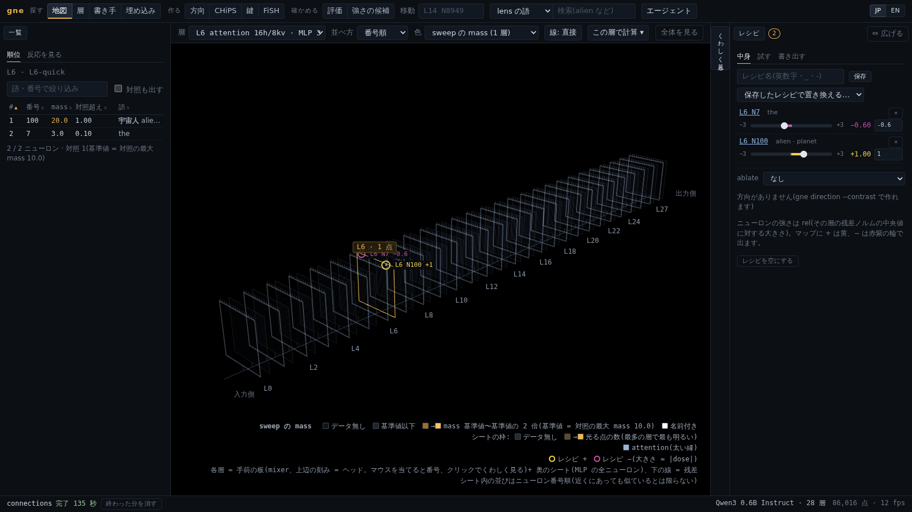
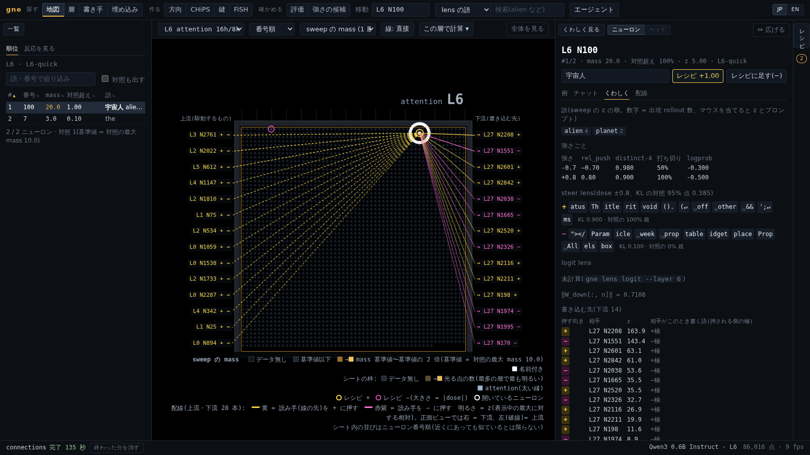

**English** | [日本語](README.ja.md)

# gguf-neuron-explorer (`gne`)

Find, rank and steer individual MLP neurons of GGUF models on llama.cpp, then ship what you find as a control vector that stock `llama-cli` / `llama-server` can load.



`gne` pushes a neuron's output direction (a column of `W_down`) into the residual stream, generates text, and measures what changed against random-direction controls. It runs on llama.cpp through llama-cpp-python, so it works with the quantized GGUF files you already have.

- **Sweep and rank.** Steer hundreds of neurons in a layer over a fixed set of prompts and doses, then rank them by how strongly their outputs pile onto a few words. Every score is compared with random directions pushed the same way.
- **Cheap first passes.**
  - **Logit lens:** weights only, on the CPU.
  - **Steer lens:** the next-token change when a neuron is pushed ± a dose.
  - **Reverse lookup:** contrast two personas, then rank every neuron in every layer by cosine to the difference.
- **Dossier per neuron.** Sweep rank, top words per prompt, rollouts, lens results and up/downstream connections, all in one view.
- **Recipes.** Combine units such as `14:8949:+1.0` and `13:7956:-1.0`, compare them in a 3-column chat (−, no steering, +), and export them:
  - as a control vector (`.cvec.gguf`), checked against `llama-completion --control-vector`;
  - as npz, json or safetensors;
  - baked into a GGUF as FFN down biases, for architectures whose llama.cpp graph reads that bias (llama, granite, mistral3, nemotron, gpt2 and others; not Qwen or Gemma — see [configs/arch/bias_support.yaml](configs/arch/bias_support.yaml)).
- **Steer only where it matters (`when`).** Push only the generated tokens (`gen`), only the assistant's turns, everything but earlier replies (`skip-replies`), only after a given text appears in the output, or ramp the dose down. A control vector file cannot express this, so `gne serve --openai` serves an OpenAI-compatible endpoint that applies it.
- **Audio input.** For models that can hear (LFM3-Omni), `gne steer --audio speech.wav` and `input_audio` parts in OpenAI-style messages put speech straight into the conversation. The model's mmproj turns the audio into embeddings, and gne decodes them in its own loop, so recipes, `when` and activation capture act on spoken turns the same way as on text. Replies are text; use any TTS to speak them.
- **Gain steering.** `22:2742:x4` multiplies a neuron's own output instead of adding a fixed direction: `x0` removes it, a negative factor inverts it. It acts only where the neuron already fires. It exports as a LoRA adapter GGUF for llama.cpp's `--lora` (works on Qwen too) or as a rewritten GGUF; by default the rewrite is a scale patch (only the scales of the quantization blocks are rewritten), which keeps the original quantization and scales the rows exactly.
- **Directions (`gne direction`).** When a persona or behaviour is spread over many neurons, work with a direction instead. A direction comes from a contrast set, which reads questions under two conditions (for example side A with a system prompt that asks for the persona and side B without it). The direction is the difference between the two sides' mean residuals at the token just before the reply begins, per layer. It can pick a layer automatically by removing the direction and checking that the behaviour drops, or by adding it and checking that the behaviour rises. Add a direction like a neuron with `30:dir:yandere:+0.3`; it exports as a control vector. To add a persona, build the direction with `--positions response`, which measures on replies generated in each persona instead of right after the instruction. Like neurons, directions are checked against random controls: each candidate layer is also pushed with 16 random directions of the same norm, and a layer is picked only if its effect beats their 95th percentile. `gne steer --contrast` does the same for a whole recipe and reports `null_pct`.
- **Directional ablation (`gne ablate`).** Project a direction out of every weight that writes to the residual stream (also known as abliteration). It exports as a LoRA adapter or as a rewritten GGUF, either Q8_0/F16 or requantized back to the original types with `llama-quantize`. Recipes can carry `ablate:`, and `gne eval --compare-ablation` compares it with zeroing the top neurons.
- **Side-effect check (`gne eval`).** Run a recipe at several doses and see how much the persona changed next to what broke: exact-answer and format tasks, perplexity on reference texts, and language mixing (Simplified-only Chinese, Hangul and other scripts in Japanese answers). An optional second GGUF can rate the persona 1–5. Doses that stay within the thresholds are marked as shippable. `--random-controls N` also runs N recipes of the same size in random directions at each dose. That shows whether the persona change beats them, and how much capability and perplexity you lose from the size of the push alone.
- **Who writes a state (`gne writers`).** Activation differences show which neurons react to a state, such as a persona system prompt. `gne writers` measures what each neuron actually wrote into the residual on the reply tokens: activation difference × write direction, including post-FFN norms. It also splits the state's direction into the parts written by the embedding, by each layer's mixer (attention, convolution) and by each layer's MLP. The UI has a writers view and a map overlay for it.
- **Attention heads (`gne heads`).** Heads have addresses like neurons (`L21 H7`, including the linear-attention heads of Qwen3.5). `gne heads contrast` runs the same conversations with and without a persona and ranks heads by:
  - how much more they look at trigger words (for example other people's names);
  - how much their attention pattern and output change;
  - how well their output writes the persona direction.

  The baseline is two neutral system prompts compared with each other. `21:H7:x0` / `x2` scales one head's output through a LoRA on its `W_O` column block. `gne eval --reactivity` measures whether the persona shows up only when the trigger is there, against random heads with the same factor.

  `gne heads listen` (the Listen tab of the head panel) runs one conversation and reports, for chosen heads such as `14:H0-3`, how much attention the reply tokens pay to each earlier token. Given a saved direction, it also attributes the heads' output along that direction to the source tokens. Each token's value vector is weighted by its attention and the head's gate, then passed through `W_O` and through the norm that follows the attention output on architectures that have one. Summed over every head of the layer, these contributions reproduce the layer's attention output. The command reports the remaining error, which was below 1% on Qwen3, Qwen3.5 and LFM3.
- **Mixture of Experts.** In MoE layers a neuron is `L12 E37 N511` (expert 37, neuron 511); `gne experts contrast` ranks experts by how much more they are chosen, and how much more they write a persona's direction, when the persona is on; `gne experts sweep` ablates or boosts each expert in turn. In an MoE layer `add` only pushes a neuron's write direction at every token; pushing the neuron itself is done with gain (`12:E37:N511:x2`, active only when the expert is chosen). Whole experts (`12:E37:x0`) and router biases (`12:E37:route:+2`) are applied by scale patches: the quantization blocks' scales of a working copy are rewritten exactly and reverted afterwards.
- **Web UI.** A 3D map of every layer and neuron with switchable overlays (sweep mass, steer KL, logit-lens |z|, activations, search hits, which neurons fire on a pasted text). It also has:
  - a ranked list and a neuron panel;
  - live 3-column chat;
  - wiring between neurons and UMAP layouts;
  - an embedding scatter of rollouts;
  - background jobs that share the GPU;
  - a JP / EN switch.
- **Several GPUs, large models.** `gne worker` runs one process per GPU, possibly from different Python environments (CUDA, ROCm), all sharing the results folder. `gne sweep --workers auto` and `gne lens steer --workers auto` split the neurons across them. Jobs estimated at over 30 minutes stop unless you pass `--yes`. `--budget 30m` narrows them to fit, using the neurons that write most along a direction, the top steer-lens neurons and the quick design. `gne info` shows the GPU/CPU layer split and the reverse-lookup-first workflow for large models.
- **Agent access.** An MCP server lets Claude Code or another agent query neurons, steer, run jobs and highlight or annotate neurons in the open UI.

This is a from-scratch reimplementation, for llama.cpp and GGUF, of the method in [lyramakesmusic/neuron-explorer](https://github.com/lyramakesmusic/neuron-explorer) (which targets Qwen3.5-4B on a modified vLLM). No code from that repository is used.

## Requirements

- Python 3.11 or newer
- [llama-cpp-python](https://github.com/abetlen/llama-cpp-python) 0.3.36 or newer. Build it with GPU support for anything bigger than a toy model.
- An NVIDIA GPU is recommended. CPU-only (`--n-gpu-layers 0`) works but is slow.

Tested on:
- RTX 3080 12 GB under WSL2, CUDA 12.4, Python 3.12, llama-cpp-python 0.3.36 built from source.
- Models: Qwen3-0.6B, Qwen3.5-4B (hybrid linear attention) and SmolLM2-135M-Instruct (arch `llama`), all Q8_0.
- Metal has not been tested.
- MoE models: granite-3.1-1b-a400m and LFM2-8B-A1B. See [Mixture of Experts](#mixture-of-experts).
- On a model you have not used before, run `gne verify` first.

## Install

```bash
git clone <this repository> && cd gguf-neuron-explorer
uv venv --python 3.12 .venv
CMAKE_ARGS="-DGGML_CUDA=on" uv pip install --python .venv/bin/python -e '.[ui,mcp]'
source .venv/bin/activate
```

Extras:
- `ui`: the web UI (FastAPI, uvicorn, umap-learn).
- `mcp`: the MCP server.
- `dev`: the tests (pytest, Playwright).

[docs/setup.md](docs/setup.md) (Japanese) covers CUDA and ROCm under WSL. It also covers one environment per GPU and splitting a sweep or steer lens across them with `gne worker`.

## Quick start

Every command takes `-m <model.gguf>`, or reads `GNE_MODEL`. Results are stored under `~/.gne` (override with `--root` or `GNE_ROOT`) and reused by later commands and by the UI.

```bash
export GNE_MODEL=models/Qwen3.5-4B-Q8_0.gguf

gne info                                   # architecture, warnings, what is supported
gne verify                                 # equivalence tests against llama.cpp (run this first on a new arch)
gne stats resid                            # residual norms per layer (needed for rel doses)

gne lens logit --layer 22                  # first pass from the weights alone
gne sweep --layer 22                       # 384 random neurons + 64 random controls, design main_rel
gne rank --run L22-main_rel                # rank them by vocabulary mass
gne neuron 22 2742                         # everything known about one neuron

gne steer --unit 22:2742:+0.8 -p "Who are you?" --compare
gne chat --unit 22:2742:+0.8 -p "Tell me about yourself."

gne reverse --contrast configs/contrast/evil.yaml --verify    # candidates for a persona
gne export-cvec --recipe configs/recipes/evil.yaml            # → ~/.gne/export/evil.cvec.gguf

gne steer --recipe configs/recipes/alien.yaml -p "Who are you?" --compare     # when: gen (only the generated tokens)
gne steer --unit 22:2742:x4 -p "Is there life on other planets?" --compare   # gain: ×4 where the neuron fires
gne eval --recipe configs/recipes/alien.yaml                  # capability / ppl / mix / persona change per dose
gne fieldtest -m baked.gguf --against original.gguf           # long tasks, tool calling, perplexity under real use, file against file
gne gain --recipe configs/recipes/alien_gain.yaml             # → ~/.gne/export/alien_gain.lora.gguf

gne direction --contrast configs/contrast/evil.yaml --select auto   # direction per layer + layer choice
gne steer --unit 16:dir:evil:+0.6 -p "What do you think about people?" --compare
gne steer --ablate evil --system "You are a cruel AI." -p "Who are you?" --compare
gne ablate --direction evil                                   # → ~/.gne/export/evil-ablate.lora.gguf
gne eval --compare-ablation evil                              # top-20 neurons x0 vs direction ablation
gne steer --recipe configs/recipes/alien.yaml --contrast configs/contrast/alien.yaml   # effect vs 16 random recipes (null_pct)

gne heads contrast --contrast configs/contrast/yandere_react.yaml   # rank attention heads (persona vs neutral)
gne heads show 15 2                                           # one head: rank, W_O block logit lens, gains tried
gne heads listen --heads 14:H0-3 --system @persona.txt -u "I had lunch with a coworker." --direction wr_mix14   # attention from the reply, per-token contributions
gne steer --unit 15:H2:x2 -p "I had lunch with Emily today." --compare   # head gain (LoRA on W_O)
gne eval --recipe R --reactivity configs/contrast/yandere_react.yaml --head-controls 8

gne direction score --name evil                               # per-layer separation of sides A and B along the direction; records the best layer as the base layer (no generation)
gne heads causal --name evil                                  # heads whose zeroed output lowers the projection onto the direction (no generation)
gne heads allocate --name evil --target -3 --n-heads 6,5,4    # strengths in proportion to efficiency (projection drop per unit of strength), sets with fewer heads compared
gne heads allocate --name evil --target -3 --method greedy     # or raise the most effective head one step at a time
gne heads candidates --alloc evil --prompts held_out.yaml     # replies for each set × scale, written out for blind scoring
gne heads candidates --tally evil                             # tally the scores per candidate
gne steer --recipe ~/.gne/heads/<model_id>/evil.alloc-n4.yaml --system "You are a cruel AI." -p "Who are you?" --compare   # only the chosen heads' component along the direction
gne eval --recipe ~/.gne/heads/<model_id>/evil.alloc-n4.yaml --random-controls 16   # vs random heads with the same strengths
gne eval --recipe R --compare-methods                         # full ablation / head component / head gain / neuron erase at the same effect
gne headproj export --recipe R                                # rank-1 LoRA per layer (--bake rewrites only those tensors)

gne direction --contrast configs/contrast/zundamon_endings.yaml --positions response   # the direction a keyed write will write
gne direction key --contrast configs/contrast/zundamon_endings.yaml --layers 8,14,20   # a key that responds just before the model writes です。/ます。 in its own replies
gne direction key-check --key zundamon_endings --contrast configs/contrast/zundamon_endings.yaml   # on held-out questions, does it separate the positions better than keys built from shuffled labels?
gne steer --unit 14:ffn:keyed:a1@zundamon_endings#zundamon_endings -p "おすすめの趣味を教えて。" --compare   # write the direction only where the key responds
```

`export-cvec --verify` also checks that `llama-completion --control-vector` gives the same greedy output as `gne`. It looks for `llama-completion` in `build/` and on `PATH`, or you can pass `--llama-completion`.

Then use the vector with llama.cpp:

```bash
llama-cli -m models/Qwen3.5-4B-Q8_0.gguf --control-vector ~/.gne/export/evil.cvec.gguf
llama-cli -m models/Qwen3.5-4B-Q8_0.gguf --control-vector-scaled ~/.gne/export/evil.cvec.gguf:0.6
llama-cli -m models/Qwen3.5-4B-Q8_0.gguf --lora ~/.gne/export/alien_gain.lora.gguf
```

A recipe is a small YAML file. `when`, `sampling` and gain units are optional:

```yaml
name: example
model_id: qwen3.5-4b-64d32ead87
dose_unit: rel
when: gen                                       # all / gen / assistant / after:<text> / ramp:<a>-<b>
units:
  - {layer: 22, neuron: 2742, dose: +0.8}       # add: push the neuron's output direction
  - {layer: 13, neuron: 7956, mode: gain, k: 0} # gain: remove this neuron's output (×0)
  - {layer: 16, kind: direction, direction: evil, dose: +0.3}   # add a direction from gne direction
  - {layer: 15, kind: head, head: 2, mode: gain, k: 2}           # attention head: scale its output (×2)
  - {layer: 16, kind: head, head: 8, mode: proj, direction: evil, s: 6}   # attention head: change only its write along a direction (s = 1 removes it)
  - {layer: 14, kind: ffn, mode: keyed, direction: zundamon_endings, key: zundamon_endings, alpha: 1}   # write a direction only where the key responds to ffn_down's input
ablate: {direction: refusal, scale: 1.0}        # project a direction out of every weight that writes to the residual stream (LoRA)
sampling: {temperature: 1.0, top_k: 20, top_p: 0.95, min_p: 0.05, presence_penalty: 0.9}   # how to try it (no seed)
```

`sampling` is how the recipe is meant to be tried. It can also carry `dry_multiplier`, `dry_base` and `dry_allowed_length` (off by default), the DRY penalty that stops multi-turn conversations from repeating earlier replies word for word (llama.cpp's names, also accepted by the OpenAI-compatible endpoint). `steer` and `chat` use it (override with `--temperature`, `--top-k`, `--top-p`, `--min-p`, `--presence-penalty`, `--sample-seed`, or turn it off with `--greedy`), the UI chat offers it as "Recipe's setting", and the OpenAI-compatible endpoint uses it when a request sends no sampling values. A control vector cannot carry it, so `export-cvec` prints the matching llama-server flags. Without `sampling`, generation is greedy. `eval` is always greedy.

Run `gne --help` and `gne <command> --help` for the full list. The help text is in Japanese.

### Doses

Doses are in **rel** units by default: `dose × median ‖residual‖ of the layer × unit(W_down[:, n])`.

On Qwen3.5-4B:
- 0.5 slips a topic in, 0.8 takes over the topic, and 1.0 and above starts to break the text.
- A dose of 3.0 deliberately breaks the text, to show what a neuron "wants" to write.
- Layers 0–2 have small residuals, so rel doses do not transfer there.
- Layer 0 cannot be pushed with a control vector, but a bake can push it.

### How long things take

Qwen3.5-4B Q8_0 on an RTX 3080:

| step | time |
|---|---|
| `stats resid` (all layers) | ~16 s |
| `lens logit` | ~33 s per layer (CPU) |
| `lens steer` (all 9216 neurons) | ~22 min per layer |
| `sweep` `main_rel` | ~6.4 s per neuron (385 units in 48 min) |
| `reverse` | ~6 s; ~4 min with `--verify` on 20 candidates |
| `eval` (55 tasks × 5 doses) | ~41 s with `when: all`; ~90 s with `gen` |
| `direction` (24 conversations) + `--select auto` (9 layers) | ~35 s + ~35 s |
| `ablate` LoRA / `--bake` Q8_0 (with `--verify`) | ~10 s / ~40 s |

A full `main_rel` sweep of one layer takes about 16 hours. Narrow candidates down with the lenses and reverse lookup first.

### Mixture of Experts

Tested with granite-3.1-1b-a400m (`granitemoe`, 32 experts, 8 chosen) and LFM2-8B-A1B (`lfm2moe`, 32 experts, 4 chosen, router bias).

```bash
gne stats act -m M --layers 2-22                     # also counts how often each expert is chosen
gne experts contrast -m M --contrast configs/contrast/yandere_rules.yaml
gne experts show -m M 12 37                          # usage, tokens it is chosen for, contrast rank, top neurons
gne experts sweep -m M --layer 12                    # ablate (x0) and boost (x2) each expert, rank by changed words
gne steer -m M --unit 12:E37:x0 -p "..." --compare   # remove expert 37 in layer 12
gne steer -m M --unit 12:E37:N511:x2 -p "..." --compare
```

| Unit | Meaning | Applied as |
|---|---|---|
| `12:E37:N511:+0.8` | adds the neuron's write direction at every token (adds a direction; it does not push the neuron itself) | control vector |
| `12:E37:N511:x2` | multiplies the neuron's activation by k when expert 37 is chosen | LoRA stacked per expert |
| `12:E37:x0` / `x2` | removes or doubles expert 37's output | scale patch |
| `12:E37:route:+2` | moves expert 37's router bias (only archs with a router bias, e.g. `lfm2moe`) | scale patch |
| `12:S:N5:x2` | a shared-expert neuron | LoRA (like a dense neuron) |

A scale patch rewrites the fp16 scales inside the quantization blocks of the affected rows, so a row or one expert's slice of the weights becomes exactly k times the original (k = 0 writes zero bytes). It works for Q4_0 to Q8_0, Q2_K to Q6_K, the IQ types except IQ1_M, and F16/BF16/F32. Patches go to a working copy under `~/.gne/work/` (the original GGUF is never touched) and are reverted after each use; reloading the copy takes about 0.3 s for a 1.4 GB model and 0.9 s for 5 GB. `steer`, `eval`, the UI chat and the OpenAI-compatible endpoint apply them automatically. Column directions (`W_down[:, n]`) cannot be patched this way. Inside MoE layers, sweeps, lenses and reverse lookups number neurons `e × n_ff_exp + n`.

### CHiPS: changing only one direction in a few heads

The method described here is called **CHiPS** (Causal Head-isolated Projection Steering). As the name says, it applies a projection along a direction only within heads chosen by their causal effect (how much the result changes when a head is stopped). That restriction is what sets it apart from full ablation, which removes the direction from every weight matrix that writes to the residual stream, in every layer.

A direction made with `gne direction` can also be applied to single attention heads. Each head adds a vector to the residual stream at every token. A `proj` unit splits that vector into the part that lies along the direction and the rest, and changes only the first part: with strength `s`, the head's write along the direction becomes `1 − s` times what it was, so `s = 1` removes it, `s = 2` flips it, and a negative `s` strengthens it. Everything else the head writes is left alone. That is the difference from a head gain (`L:Hh:xk`), which scales the whole output, including all the information that has nothing to do with the direction.

Because the change is proportional to what the head writes for the current input, it acts where the head is writing along the direction and does little elsewhere. The same property sets its limit: it cannot create a behavior the heads are not already writing. Strengthening the heads that carry a persona does nothing in a plain conversation, and only works when something else, such as a system prompt or a small neuron or direction push, starts the behavior first.

The heads and their strengths are chosen without generating any text. The measure is the residual's projection onto the direction, averaged over examples; it indicates how strongly the persona or behavior is present, and is called "the projection" below (fields such as `score` in the JSON output).

- `gne direction score` reads both sides of the contrast set up to the point where the reply would begin and measures, layer by layer, how far apart the two sides' projections are. The layer where they separate best is recorded as the base layer.
- `gne heads causal` then stops (zeroes the output of) whole layers of heads, and afterwards single heads in the layers that matter, and records how much the projection drops, next to how much the head writes along the direction directly. Heads in later layers can matter even though they write nothing along the base layer's direction, so the drop is also measured a few layers further on.
- In `marginal` mode the same command starts from a current set and raises one head's strength a little at a time, which gives the drop per unit of strength (its efficiency). This ranking usually differs from the one you get by stopping heads.
- `gne heads allocate` spreads strength over the heads in proportion to that efficiency, scales the whole set until the examples that resist most reach a target value, and builds sets with fewer heads so that you can keep the smallest one that does as well as the larger ones.

`gne heads pipeline --spec file.json` runs these steps in one go from a single file that holds the contrast set (and, optionally, the settings): it builds the direction from all the questions, records the base layer, screens layers and then single heads, and allocates the strengths.

- **Number of questions:** they can number in the hundreds. The steps that stop heads use an evenly spaced subset (64 by default), because each trial reads every question it uses.
- **Excluded candidates:** layers and heads whose removal shakes side B's (the neutral side's) residual by more than half its size are left out, since they break the model rather than act on the direction; stopping all heads of the first layer usually does this.
- **Target:** without one, the strengths aim at the point halfway between the two sides' average projections. Halfway often removes only about half of the behavior, so write `B` as the target to remove it fully: the strengths then aim at side B's average (if the strongest head sticks at the cap `s_max`, 30 by default, raise it).
- **Resuming:** if you stop a run and start it again with the same file and settings, it reuses the direction and the causal results it already built and starts again from the allocation (`--fresh`, or "rebuild from scratch" in the UI, builds everything again).

The "remaining" column of the comparison table counts the side-A questions that a set does not bring down to the target. `gne heads refine --name NAME` ("add from remaining" in the table) takes only those questions as side A and the original side-B questions as side B, applies the set on both sides, rebuilds the direction, and runs the same steps to choose heads and strengths to add. Whatever the set already changes is the same on both sides, so the new direction keeps only the difference the set has not removed. The added heads were found with the original set applied, so they are never used alone: for every set in the comparison table it writes a recipe that combines the original set with that set, and measures the remaining count and the drift on side B again along the original direction. The table's load and eval buttons use these combined recipes.

These steps only read questions and never generate, so the context that measures the model's internals is sized to the longest conversation, and the generation context left over from chatting is released first; on a large model this keeps VRAM from overflowing into system memory, which makes everything slow.

`configs/pipeline/` holds templates for five uses, and the UI's template menu offers the same five. Each one's `about` says what is compared with what and which way to scale the candidates.

- finding the heads that carry a persona asked for in a system prompt (a system prompt on side A only)
- keeping only the difference between two personas (system prompts on both sides)
- finding the heads that carry what a neuron recipe produces (a recipe on side A)
- capturing a difference between kinds of questions, such as Japanese and English (separate questions per side)
- capturing behavior that appears partway through a reply, such as thinking that goes in circles (unfinished replies on both sides)

Strengths chosen without generating text are not always right for actual replies, since the projection is an amount along the direction and can drift away from how strongly the behavior shows and how natural the text reads. The last step is therefore to read replies.

`gne heads candidates --alloc NAME` takes each set in the allocation's comparison table, multiplies its strengths by a few overall factors, and has every candidate, together with the unmodified model, answer the questions of both sides. The factors are 0.5, 1, 1.5, 2 and 3 by default (the default target of the allocation only goes halfway, so the useful factor is often above 1). All candidates share one random seed, so the replies differ only because of the intervention. A positive factor removes the side-A behavior, so its side-A replies are the ones to read; a negative factor flips the sign and strengthens the behavior, so its side-B replies are read instead.

- For each candidate the command reports the share of replies that match `validate.match`, how much the wording repeats, and how often the replies on the side that is not being read changed from the unmodified ones.
- It mixes the replies to be read into one file without saying which candidate wrote which, and adds a scoring guide. A person or another model gives each reply a score from 1 to 5 for how strongly the behavior shows (P) and for how natural it is (C).
- `--tally` ranks the candidates by the mean of the smaller of 6 − P and C for removal ("the behavior is gone and the reply is natural") and of the smaller of P and C for strengthening.
- Questions that were used to choose the strengths make the candidates look better than they are, so pass questions that were not used with `--prompts`.
- To try a small neuron push that the heads then amplify, `--with-recipe` adds a recipe to every candidate, the unmodified one included.

In the UI, the form under the comparison table in the direction view's "Build direction and heads from JSON" tab makes candidates, and the "Strength candidates" tab lays the replies out question by question or shows them one at a time, names hidden, to be scored with the number keys. Each score is saved as it is given, so scoring can stop and resume; once everything is scored, the tab shows the tally with buttons that load the best candidate into the recipe panel or try it in the one-column chat.

The two sides of a contrast set are usually made with system prompts. Only one of them has to be written: a side without a system prompt reads the questions with no system prompt at all, so a contrast set with only `system_a` compares the persona against the model as it normally answers.

A contrast set can also make one side, or both, by applying a recipe (`recipe_a`, `recipe_b`). The difference between the sides is then the recipe's own effect, so `gne direction` builds the direction that a neuron recipe produces, and `gne direction score` and `gne heads causal` find the heads that carry it while the recipe is applied. `configs/contrast/evil_neurons.yaml` does this for the evil neuron recipe on Qwen3.5-4B.

It can also give each side its own questions (`prompts_a`, `prompts_b`), so that the unmodified model reads two kinds of questions and the direction is the difference between them; `configs/contrast/ja_vs_en.yaml` compares questions asked in Japanese with the same questions asked in English. When the questions differ, the direction also picks up whatever else differs between them, such as topic and length, so keep those as close as you can.

The tools that compare one reply read under two system prompts (`gne heads contrast`, `gne writers`, `gne experts contrast`) do not accept contrast sets made with recipes, with one system prompt left out, or with separate questions per side.

A question can be a single string or a conversation history: `[{"role": "user", "content": "…"}, {"role": "assistant", "content": "…"}, {"role": "user", "content": "…"}]`, alternating user and assistant and ending with a user turn. Every question is read on its own from a clean state and measured just before the reply to its last user turn; nothing from one question carries over to the next. Use histories to measure behavior that appears only deep in a conversation or after a few exchanges.

A history can also end with an assistant turn, which is read as a reply still being written: nothing closes it, the measurement is at its last token, and candidates continue from there. Text that starts with `<think>` is read as thinking in progress; gne otherwise reads questions with thinking off, so any other text counts as the reply proper. Use this for behavior that appears partway through a reply, such as thinking that goes in circles, which the point just before the reply cannot show: write the same question and the same work so far on both sides, and change only what follows. `gne fieldtest` sends its questions to llama-server and does not accept unfinished replies.

The result is an ordinary recipe with units such as `16:H8:s6@evil`. Heads of one layer that share a direction fold into a rank-1 LoRA, so the adapter stays small. A control vector cannot express it.

- `gne headproj export` writes it (`gne gain` does too, but without `--via-f16`, `--into` and `--imatrix`), and `--bake` rewrites only the tensors involved; add `--via-f16` to write them as F16 and requantize them back to their original types with llama-quantize.
- In the UI, "LoRA / bake" in the recipe tab does the same, with the format, the type of the rewritten tensors, requantizing back to the original type, a check against the LoRA, and the file name (the recipe name by default; an existing file is only overwritten after you confirm) as options.
- Going back to low-bit types such as IQ1, IQ2 and IQ3_XXS needs an imatrix (the weights that tell the quantizer which inputs to keep accurate); put `<model name>.imatrix.gguf` (or `.dat`) next to the model and it is used without being passed.

Baking does not use the GPU (it reads and rewrites the file piece by piece), so it works for models too large for the GPU: you can analyze with a quantized model and bake into an unquantized GGUF (F16 / BF16) of the same model (`--into`, "bake into" in the UI). The directions come from the analyzed model, the rewritten matrices from the target, and the type stays as it was (`--requant keep`). The strengths were measured on the quantized model, so expect small differences, and there is no check against the LoRA. Quantizing the baked F16 / BF16 afterwards with llama-quantize also avoids having only the rewritten tensors in a different type; a LoRA can be downloaded right away.

gne records the recipe (layers, heads, strengths) in the exported file as `gne.*` metadata; for files you give to others, use "leave out gne's records" (`--strip-meta`), which also checks afterwards that no local paths remain in the metadata (when requantizing with an imatrix, llama-quantize may record the path of the text the imatrix was made from). Without the records, a LoRA's tensors still show the layers, heads and direction as they are, and a baked file compared with the original model still shows what was changed and how.

Before relying on a recipe, check it against controls.

- `gne eval --random-controls N` applies the same strengths to randomly chosen heads.
- `gne eval --compare-methods` brings full-layer ablation, the same heads scaled whole, and the removal of the top neurons to the same projection and compares their side effects.
- `gne eval --alloc NAME --n-heads 6,5,4,3` shows how the side effects change as heads are dropped.

The projection is measured along the same direction that was used to pick the heads, so report results with a measure taken from the output, such as the contrast set's `validate.match`, capability and perplexity. For a recipe that uses a direction, eval also measures the direction metrics (projection drop, residual drift, match rate) at every scale and for every control; with contrast sets of hundreds of questions this is heavy, so it reads an evenly spaced 64 questions by default (`--dir-max-examples`, "questions" in the UI's eval tab) and can be switched off (`--no-direction-metrics`, "direction metrics" in the UI).

On Qwen3.5-4B, two heads chosen this way stopped the persona that the evil system prompt asks for (judged in 83% of replies before, none after) without changing capability or perplexity. Brought to the same projection, full-layer ablation raised perplexity by 15%, and scaling the same two heads cost 14 points of capability. [docs/head-component-steering.md](docs/head-component-steering.md) explains the method in more detail.

The weight edit itself is not new: for a single head it has the same rank-1 form as [Steer2Edit](https://arxiv.org/abs/2602.09870) (Sun et al., 2026), which we found after building this. CHiPS differs in how it chooses heads (by causal effect, where Steer2Edit uses alignment with the steering vector), in how it sets strengths (by measured efficiency and a hand-tuned overall scale, where Steer2Edit uses a closed-form rule and a grid search), and in checking results against random heads. The two have not been compared on the same task.

The write-up is [CHiPS: a few heads between knowing and answering](https://balaena01.github.io/chips-steering/). On Qwen3.5-4B, four of 896 heads reduced correct answers given up for a wrong suggestion from 23.5% to 15.6% over three test rounds (1,200 questions), while accuracy with a right suggestion fell from 93.2% to 90.0%. The third round (300 new questions added after publishing) did less well: on its own the drop in given-up answers was not significant (p=0.073), and accuracy with a right suggestion fell by 5.3 points. Random heads at the same strengths did not reduce it. The recipe, every reply and the scripts are in [balaena01/chips-steering](https://github.com/balaena01/chips-steering).

### Keyed write: writing a direction only in a chosen state

A `keyed` unit writes a direction into the residual stream only at positions where the model is in a chosen state (for example, the direction of the のだ sentence ending, written only where the model is about to write です。 or ます。). CHiPS chooses which direction to change; a keyed write chooses in which state to write. The two are independent and go into the same LoRA. Unlike CHiPS, a keyed write can add a behavior the model is not producing yet.

**How it works.** The unit adds a rank-1 change `ΔW = α d κᵀ` to one weight matrix that writes to the residual stream (`ffn_down`, `attn_output`, a shared expert, or one expert). The matrix then writes `α (κᵀx) d` on top of its usual output. `x` is the matrix's input activation and `κ` is the key; `κᵀx` is how strongly the key responds at that position, and the amount written is proportional to it.

The key comes from a contrast set, with token positions split into positions to write at and positions to leave alone (`_a` and `_b` in JSON field names, such as `rows_a`). It is the mean input `μ` at the positions to write at, with the subspace spanned by the inputs at the positions to leave alone (and any `dont_touch` groups) projected out, scaled so that `κᵀμ = 1`. At a typical position to write at, the unit then adds exactly `α d`; at positions to leave alone, it adds nothing. The direction `d` is `r_L`, the difference between the two sides' means at that layer in the contrast set the direction was built from, used at its raw size rather than as a unit vector, so `α = 1` writes the measured difference as it is, and a negative `α` cancels it.

**Choosing the positions to write at (`positions`).** There are two ways.

- With `positions: response` (the reply tokens), `assistant` or `last`, the positions to write at are those in the conversation under `system_a` (or `recipe_a`). That state usually does not occur at inference time without that prompt.
- With `positions: "before:<regex>"`, both kinds come from the model's own replies in the inference-time context (no system prompt): the position just before the model writes text that matches the regex is one to write at, and every other position in the same replies is one to leave alone. `configs/contrast/zundamon_endings.yaml` uses `before:(です|ます)。`, so the Zundamon direction is written only where the model is about to end a sentence with です or ます.

`dont_touch` lists groups of questions where nothing should be written (English questions in the example above). The key is built so that it does not respond in their replies either.

If the text to change comes at the very start of a reply (for example a reply that begins with ありがとう！), the position to write at is the one just before the reply begins. That state looks alike for every question, so without ordinary questions in `dont_touch`, the key responds at the start of every reply. Put ordinary questions in `dont_touch` (as in `configs/contrast/tsundere_thanks.yaml`): when the key is built, the start of each `dont_touch` reply is also kept out of the key automatically.

**Measured.**

- On Qwen3-0.6B, this example turned most です/ます endings into plain endings but almost never produced のだ, and the same direction added at every position made the replies fall apart: a keyed write only limits where a direction is written, and cannot write what the direction does not carry.
- On Qwen3.5-4B, whose direction does carry のだ, the keyed write (the attention output matrices of three layers, α = 2) made 4 of 12 held-out Japanese replies end their sentences in のだ without falling into repetition, and every English reply stayed in English and on topic. Adding the direction everywhere produced のだ only at strengths where most Japanese replies broke down, and with the direction added at twice its raw size, half or more of the English ones broke down too.
- Stronger keyed writes also fell into loops, though: once written, the state the key responds to often persisted, so the unit kept writing (details in [docs/keyed-write.md](docs/keyed-write.md) §6–7).

```bash
gne direction --contrast configs/contrast/zundamon_endings.yaml --positions response   # the direction to write
gne direction key --contrast configs/contrast/zundamon_endings.yaml --layers 8,14,20   # the key, from the even-numbered questions
gne direction key-check --key zundamon_endings --contrast configs/contrast/zundamon_endings.yaml   # on the odd-numbered questions, against keys built from shuffled labels
gne direction key-verify --layer 14 --key zundamon_endings --direction zundamon_endings          # the LoRA changes the output by α (κᵀx) d, as the formula says
gne steer --unit 14:ffn:keyed:a1@zundamon_endings#zundamon_endings -p "おすすめの趣味を教えて。" --compare
gne eval --recipe R                                   # capability / ppl, plus keyed selectivity against add, gain and proj
gne headproj export --recipe R                        # rank-1 LoRA per layer and key (--bake keeps Q8_0 tensors as Q8_0, others F16)
```

**Checking a key.** `gne direction key-check` measures how strongly the key responds (`κᵀx`) on examples that were not used to build it.

- Keys are built from the even-numbered questions and checked on the odd-numbered ones; any overlap with the examples used to build the key is detected and reported as `held_out: false` (not measured on unseen examples).
- The response is compared with control keys built the same way from shuffled position labels (`pseudo_*` in the JSON output).
- Use a layer only if its selectivity (the mean response at positions to write at minus the mean response at positions to leave alone) beats the control keys' 95th percentile; example-level AUC can reach 1 even for control keys.
- `gne direction key` warns when there are too few positions to write at or when most of them sit at the start of the reply. `key-check` reports the key's response at the start of replies to the key's own questions and to the `dont_touch` questions; if it responds there, add ordinary questions as a `dont_touch` group with `positions: last` (only the position just before the reply begins).

For a recipe with keyed units, `gne eval` also measures, without generating, how much the write moves the residual at each kind of position (including `dont_touch`), next to an add, a gain and a proj brought to the same effect at the positions to write at, and against the control keys. A keyed write is only worth using if it disturbs the positions to leave alone less than those.

**Syntax and limits.** Units look like `14:ffn:keyed:a1@DIR#KEY` (`a1` is α = 1; `attn`, `S` for the shared expert and `E37` for expert 37 also work in place of `ffn`). `when` does not apply, since a LoRA cannot switch by position, and a control vector cannot express a keyed write. For a key on one expert of a MoE layer (`--target expert:e`), `gne direction key-experts` first shows how often each expert is chosen at each kind of position; pick one chosen far more often at the positions to write at.

**Sharing.** To share the result, a LoRA is the first choice. When baking, tensors that are Q8_0 stay Q8_0 by default, and other types become F16.

- Writing a Q8_0 tensor as F16 changes how the matrix product is computed (Q8_0 products also round the activations to 8 bits), and it drifted further from the LoRA.
- Only a Q8_0 tensor where rounding would lose 10% or more of the small rank-1 edit is written as F16.
- For an expert tensor that is not Q8_0, `--requant keep` (write back in the original type where possible) keeps the experts that were not edited byte for byte instead of converting the whole tensor to F16.

In the UI, the direction view's "keys (keyed)" tab runs the whole loop with one button: from a contrast set (a file, or JSON started from one of three templates in `configs/keyed/`: changing how sentences end, changing only the replies in one kind of scene, and using a state made with a system prompt), it builds the direction, builds the key, and checks it on the held-out questions. It then shows per layer how strongly the key responds, adds keyed units to the recipe with the new direction already chosen, and checks from each row that the LoRA writes what the formula says. On a MoE model it also shows how often each expert is chosen, and picking one from the table sets up a key on that expert. [docs/keyed-write.md](docs/keyed-write.md) explains the method, the worked examples and the details for MoE models.

**Suppressing what a CHiPS recipe leaves behind.** When a CHiPS recipe still lets the behavior through on some questions, `gne direction key-from-behave --behave B --recipe R --direction D` collects those questions from a `gne behave` run made with the recipe applied, and writes a keyed contrast set to `<root>/keyed/` (the direction D written with α = −1, the key built with R applied). It appears among the templates in the keys tab, and the resulting keyed units go into R as one LoRA (docs/keyed-write.md §17). The keys tab can also do all of this on screen: "build from what a CHiPS recipe leaves behind" runs behave with the recipe on the A-side questions, builds the JSON, and puts it into the box for the one-button run.

**Finding where a key works.** `key-check` only tells whether a key separates the scenes; a layer with a large key-check margin may still not change the behavior. `gne direction key-causal --contrast C` builds a key for every candidate (all layers × `ffn`, `attn` by default) and measures, without generating, how much the log probability of the behavior (the text the `positions` regex matches, or multiple-choice answers given with `--probe`) drops on held-out replies when each keyed unit is added, next to control keys built from shuffled labels and the change in the `dont_touch` replies. A candidate is marked when it drops below the 5th percentile of all control keys, and the table also shows how many marks chance alone would give (candidates × 5%). The table has one row per place (writer × layer) with three numbers to choose from: the drop at each strength (marked when significant), the side effect on the replies at the positions to leave alone, and whether it is significant at every strength, plus the drop divided by the side effect; every column sorts. The only evidence for choosing this way so far is one case (sentence endings on Qwen3.5-4B), and choosing by the drop alone can pick a place that lowers the probability by sending the replies into loops. This is only a screen: a change in probabilities without generation does not guarantee a change in what the model writes. `gne direction key-causal-verify --from NAME --unit U …` then generates on the held-out questions for the candidates you pick, each next to one control key, and counts the behavior against the intervention alone; `--combo` checks several layers written together as one candidate. Nothing picks a single layer automatically. The keys tab has the same two steps under "find where a key works" (docs/keyed-write.md §18).

The rank-1 conditional edit `ΔW = α d kᵀ / (μᵀk)` with `k = μ − QQᵀμ` (`Q` is an orthonormal basis of the subspace spanned by the inputs at the positions to leave alone) comes from nwn's Zenn article ["Weight-Space Programming やってみた(やらせてみた)"](https://zenn.dev/nwn/articles/cf9fe78aa33861) (2026). gne builds the keys from contrast sets, writes along directions from `gne direction`, and checks each key on held-out examples against control keys built from shuffled labels.

### FiSH: overwriting a neuron with computed weights (`nw`)

The method described here is called **FiSH** (Formula-instantiated Scene-gated Hidden units): existing MLP neurons (hidden units) are rewritten, without training, with weights computed from a formula, so that they write a direction only in a chosen scene. Neurons are rewritten, not added. The commands and the unit mode keep the plain name `nw`.

A keyed write adds a linear edit, so it writes a little wherever its key responds a little, and writes backwards where the response is negative. An `nw` unit instead overwrites one MLP neuron that normally does very little, without any training: its gate row becomes `s·κ`, its input row becomes a key, and its output column becomes the direction. Because the gate closes, small responses are squashed and negative ones write almost nothing. That is the one-key form. There are two more forms. Two keys can be multiplied (one key in the gate row and another in the input row, so the neuron writes only where both respond, for example "this kind of scene" and "this position in the reply"). And two neurons can be paired so that the amount written is capped: this is the default form, and it is the form behind all the 100-question results below. In the capped pair, the gate rows hold a single key for "this scene AND this segment of the reply", minus a small multiple (a for one neuron, b for the other) of a key that returns about 1 at every position, and the input rows hold that about-1 key. The difference of the two neurons writes almost nothing while the key response is small and levels off at a fixed amount once it is large: a switch with a threshold and a cap, opened by a key that looks at the scene and the reply position. The two-key form was only tried in small checks of about 12 questions, not in the 100-question evaluation.

```bash
gne direction --contrast C --positions response --same-reply --segments 0,1-3,4-    # the direction, split by reply position
gne nw try --direction NAME --contrast C --layers 11-23 --alpha 1,1,0.8   # before touching the weights: add the direction to the layer outputs and read the replies
gne nw neurons --layers 11-23                          # table of the least active neurons: pick the ones to overwrite
gne direction key --contrast C --target mlpin --layers 11-23 --positions pos:1-3 --name k_p1   # key for "this scene, reply positions 1–3"
gne nw key --contrast C --layers 11-23 --role scene    # key that stays on for the whole reply in this kind of scene
gne nw verify --unit 11:N2045:nw:a1@NAME.seg1#k_scene\&k_p1   # does the LoRA do what the formula says?
gne nw check  --recipe R --contrast C                  # key responses and amounts written, by position and kind of scene
gne nw export --recipe R -o R-nw.lora.gguf             # LoRA only (no baking); with proj/keyed units, gne headproj export puts them in one file
gne nw pipeline --contrast C --layers 11-23 --alpha 1,1,0.8 --save R.yaml   # or all of the building steps in one go; --save writes the recipe for the commands above
```

`gne nw pipeline` prints a short summary (whether the LoRA follows the formula, how many units and neurons, the amounts written, where the recipe went). `gne nw try` keeps each result in its own file when the settings differ; use `--name` to choose the file name. `gne nw export --strip-meta` leaves out gne's records and anything that names the source model (the name field becomes `adapter`, or what you pass as `--name`).

Units look like `L:Nn:nw:aα@DIR#KEY` (one key), `…#GATEKEY&INPUTKEY` (two keys) and `L:Nn+Nm:nw:aα@DIR#KEY&ONEKEY` (a capped pair). They work in recipes, `gne steer`, `gne behave`, chat and the OpenAI-compatible API like any other unit. This only supports dense gated MLPs (SiLU gate × input, no bias: llama, qwen2, qwen3, qwen35); other shapes and MoE layers give a clear error. Baking is not offered: in Q8_0, replacing one column of `ffn_down` loses over 90% of the edit.

In the UI, the direction view's "FiSH" tab does all of this in the browser: start from one of six templates in `configs/fish/` (change the tone in one scene, change it everywhere, change sentence endings, a scene AND sentence ends, write only the difference between two personas, build on top of a CHiPS recipe; each template's description says what happened when it was tried once on Qwen3.5-4B, including what did not work), enter the layers (a range such as `11-23` works; layer numbers differ by model) and the strength for each position segment (for example 1 / 1 / 0.8), and press "Build everything" to run direction → neuron table → keys → units → rebuilding the keys with the units applied → formula check → amounts written as one job. The tab shows a table for each step (the default neuron candidates are ticked and can be changed with the checkboxes; amounts that are too small in the target scene or too large elsewhere are colored), a last section generates replies with only the units applied so you can read them, and "Add to recipe" hands the units to the recipe tab for chat, saving and LoRA export. Each step also has its own button. "Try before writing into the weights" (`gne nw try`) adds the same direction straight to the layer outputs, only in replies to the target-scene questions, so you can compare layers and per-segment strengths by reading replies and their mechanical counts (loops, empty replies, regex matches) before building any neurons or keys. Layers and strength are never chosen automatically.

`gne direction --same-reply` is a new way to build any direction: both sides read the same reply (side A's), so the direction holds only the difference between the two conditions and not the difference between the words being read. The default is unchanged.

What we know comes mostly from one model and two examples (Qwen3.5-4B: a sentence ending and a persona), judged by reading 12 replies per condition (only the last persona results below use sets of 100 questions; the persona example was also checked once on a 27B model), so treat it as early. In the sentence-ending example an `nw` unit wrote about a fifth as much as a keyed write at the positions to leave alone, and never backwards, but the replies came out about the same. In the persona example the old-style direction turned out to be half "difference in the words being read", and writing that part repeatedly is what sent keyed writes into loops; with `--same-reply` the loops went from 9 of 12 replies to 0–1. Changing the tone needed writing throughout the reply (writing only the first few tokens was not enough, even with the exact internal states). Writing position-specific directions throughout with computed neurons was then measured on sets of 100 praise-and-thanks questions not used for building, with the replies read without knowing which condition they came from.

| Form (capped pair, no system prompt, LoRA only, greedy) | In-character replies | Replies that fall into repetition (loops, counted mechanically) |
|---|---|---|
| The v0.3.0 example: three separate layers (11, 18, 23), strength 0.9 everywhere, 18 neurons | 27–29% | 6–10% |
| **13 consecutive layers (11–23), strength 1 / 1 / 0.8 for positions 0 / 1–3 / 4 on, 78 neurons** | **53% and 53%** (two separate question sets) | 8% and 1% |
| Same, but with the keys replaced by comparison keys (built from shuffled labels) | 3% | 81% |
| System prompt | 78–87% | 3–4% |
| No intervention | 0% | 0–1% |

- The 53% was reproduced on two separate sets of 100 questions that were not used for choosing the settings. With sampling it was 56–69%, moving by 13 points between random seeds on the same questions. The system prompt is still well ahead.
- **Other scenes are left alone, and this is the solid part.** On calculations and facts (50 questions), ordinary questions (50) and English questions (30), correct answers could not be told apart from no intervention (greedy: 46 correct → 46–47; with sampling 46–47 → 45–49). The tone did not change either: none of the 130 replies read blind in one question set was in character, and in the other set the model's own scoring found 1 of 390 (also 1 of 390 with no intervention). The system prompt changed almost every reply and its correct answers fell from 46 to 38–41 with greedy decoding (33–41 with sampling).
- **More consecutive layers beat a few layers** (one example on a 4B model). Narrowing to the few layers that a generation-free measure ranked highest made it worse than the three separate layers.
- Adding the same vectors straight to the layer outputs gave the same level, so nothing is lost by putting them into neurons; the limit is in the direction being written.
- **Replies that fall into repetition** (the reply cannot get out of the same phrase) depend on the question: 1–8% per question set (16 of 300 over three sets), more often on praise for looks or belongings. No setting kept it reliably at or below 5%. These are mechanical counts (8% and 1% on the two final sets); the readers marked more replies as "repetition or unreadable" (11% and 3%). Separately, 5–23% of the replies **did not fit the prompt** (readable, but not an answer to what was said): 5% and 11% with greedy decoding, 15–23% with sampling.
- What did not help: finer position segments, a direction per kind of question, per-question differences, weakening later positions or the start, moving the ends of the layer range, filling the dip at the segment boundary (more loops), raising the cap thresholds.
- More layers take longer to build (about 16 minutes for the direction and keys with 13 layers on the 4B model).
- A first small check on 12 questions had looked better than the 100-question results; do not judge quality on 12 questions.
- **A second model, checked once** (Swift-1.5-Qwen3.8-27B, IQ2_XS; 13 layers, every other one from 22 to 46, strength 1.2 / 1.2 / 0.96, 78 neurons; 100 new questions): 55% in-character replies with greedy decoding and 57% with sampling (0% with no intervention, 93% with the system prompt), loops 3% and 1%. The 80 questions of the scenes to leave alone kept their tone, and 70 of the replies started exactly as with no intervention. The comparison key gave more in-character replies (70%), but also 17% repetition or unreadable replies and 13% replies that did not fit the prompt (4% and 6% with the real key), and it changed the wording in the other scenes (only 29 of 80 replies started the same). On this model the value of the key showed up as picking the scene precisely, not as a higher count. Three of the five criteria fixed in advance passed; the comparison against the comparison key and a one-question drop in correct answers (29 → 28 of 30) did not. Details in [docs/fish.md](docs/fish.md) §8.
- **A second persona, checked once on the same 27B model** (a cheerful, casual tone only for worries and requests for advice; layers and strength taken unchanged from the first persona; 100 new questions): 36% cheerful and casual replies with greedy decoding and 39% with sampling (0% with no intervention, 97% with the system prompt), and another 35% somewhat casual. The 80 questions of the scenes to leave alone kept their tone, correct answers went 36 → 37 of 40, and no reply fell into repetition. Five of the six criteria fixed in advance passed; the one that failed was strength (36 is 0.37 of the system prompt, and the criterion was half). Details in [docs/fish.md](docs/fish.md) §8.
- Limits: most measurements are one persona, one scene and the 4B model, with one kind of reader; the second model and the second persona were each measured once. Our reading, not a measured fact: on a 4B model this may be about as far as this way of building the direction goes.

Method, formulas and limits are in [docs/fish.md](docs/fish.md).

### Field test: using a file the way it is really used

`gne eval` is a fast check: it scales a recipe on one file and asks short questions. `gne fieldtest` asks whether a model file holds up in real use, and compares files with each other. It starts `llama-server` with thinking and sampling on, gives the model long tasks and tool-calling tasks, and reports how often answers hit the token limit, how often they fall into short or long loops, how often the answer stays empty because the reasoning never finished, whether the right tool is called with complete arguments, whether no tool is called when none is needed, and whether the model carries on after a tool result. Perplexity comes from reading the same reference texts in gne, so a baked file can be measured directly, which `gne eval` cannot do.

```bash
gne fieldtest -m baked.gguf --against original.gguf --llama-server <path to llama-server>
gne fieldtest -m original.gguf --lora adapter.lora.gguf                # with and without a LoRA
gne fieldtest -m baked.gguf --against original.gguf --prompts mine=questions.json --match "some regex"
gne fieldtest -m baked.gguf --against original.gguf --bench gsm8k,mmlu_pro,math500,ifeval   # capability on the file itself
```

The tasks are in `configs/fieldtest/` and can be replaced with `--long-tasks` and `--tool-tasks`. `--prompts name=file` adds your own questions, measured for loops, empty answers and answers cut at the limit, and `--match` adds a match rate. `--bench gsm8k,mmlu_pro,math500,ifeval` measures capability on the file itself, with 250 GSM8K, 300 MMLU-Pro, 250 MATH-500 and 250 IFEval questions drawn with a fixed seed (`--bench-n` changes the number; MATH-500 has 500 and IFEval 541 in all). MATH-500 grades the last `\\boxed{}` of the reply with math-verify, and IFEval counts a reply as right only if it follows every instruction, using the official checkers (copied to `gne/third_party/ifeval`, Apache-2.0). These two need `pip install 'gguf-neuron-explorer[bench]'`. For a model that tends to loop, raise `--bench-tokens` (4096 by default) so that long replies can finish, and set `--presence-penalty` if its model card asks for one. The data is fetched from Hugging Face once and kept in `<root>/fieldtest/data`, not in this repository. Both files answer the same questions, so besides the accuracy the table shows how many questions only one of them got right, and accuracy counts as worse only when that split is significant (exact two-sided McNemar test, p < 0.05). Files are loaded onto the GPU one at a time. Differences of up to two questions, or 1% for perplexity, count as the same level, because one question can differ through sampling alone. Results go to `<root>/fieldtest/<name>.json`; the generated text goes to a separate `<name>.replies.json` and is never printed. On a 27B model (RTX 3080, 12 GB) one file took 30 to 45 minutes with 200 extra questions. `gne` does not build `llama-server`, so pass one with `--llama-server` or `GNE_LLAMA_SERVER`, or have it on `PATH`. In the UI, this is the "Field test" section of the eval view; while it runs, the loaded model leaves the GPU and chat has to wait.

### Across quantizations

A neuron found on one quant carries over to other quants of the same model. Checked with L22 N2742 (the "alien" neuron, found on Qwen3.5-4B Q8_0):

| | Q4_K_M | Q3_K_M | UD-IQ2_M |
|---|---|---|---|
| W_down column vs Q8_0 (cos) | 0.998 | 0.998 | 0.974 |
| same index = same neuron (301 sampled) | all | all | all |
| logit-lens top words | same | same | almost the same |
| residual norm at L22 (Q8_0: 23.69) | 23.65 | 23.30 | 23.76 |
| "Who are you?" at +0.8 | "I am Extracillary, an advanced extraterrestrial intelligence…" | "I am an extraterrestrial intelligence from the planet of Aliens." | "I am an extraterrestrial being." |
| 「あなたは誰ですか？」 at +1.0 | 「私は、地球外生命体です。」 | 「私は、地球外生命体です。」 | breaks down |

- A control vector exported on Q8_0 can be used as-is on the other quants. On Q4_K_M and Q3_K_M it gave exactly the same text as re-deriving the vector on that quant.
- The persona stays; only the made-up details change (Q8_0 says "Extrali … Xeno-888").
- At 2 bits the usable dose range narrows: +1.0 already breaks the Japanese answer.
- Q3_K_M stores this layer's `ffn_down` as Q4_K, which is why its column matches Q4_K_M.

### Models too big for your GPU: Modal

`gne modal` runs any `gne` command on a [Modal](https://modal.com/) GPU. Weights go straight to a Modal Volume, so they never touch your disk, and you pay only while the command runs.

```bash
gne modal fetch unsloth/Qwen3.8-Flash-Next-GGUF --include '*UD-IQ1_S*'
gne modal put spec.json
gne modal run -- heads pipeline --spec /data/inputs/spec.json -m /models/.../....gguf --yes
gne modal get gne/<model_id> ./results
```

`gne modal hf-upload` pushes files from the volume straight to Hugging Face, using a token stored as a Modal secret. `gne modal ps`, `gne modal stop --all` and `gne modal cost` show what is running, stop it, and show this month's bill. Only git-tracked files in `gne/` and `configs/`, plus what you name in `gne modal put`, are uploaded. See [docs/modal.md](docs/modal.md) (Japanese). This has not run on real weights yet.

## Web UI

```bash
gne serve -m models/Qwen3.5-4B-Q8_0.gguf      # http://127.0.0.1:8791
```

Press Ctrl+C in the terminal that started it to stop the server. It closes the open streams and any generation in progress and stops at once, even with the UI still open in a browser; if a connection still lingers, a second Ctrl+C cuts it. The page files are read fresh on every load, but the server keeps the Python code it started with, so restart it after updating gne; a notice at the top of the page says so when the server is older than the code.



The main views are:
- **map:** every layer as a sheet of neurons, with overlays.
- **layers:** per-layer summaries.
- **direction:** how well a saved direction separates the two sides of its contrast set at each layer, where the base layer is, and the per-example projections at a chosen layer. Its second tab takes a contrast set as JSON (pasted, loaded from a file, or started from one of five templates by use) and runs the whole search for heads with one button: it makes the direction, picks the base layer, screens layers and heads, and allocates the strengths. The result shows each step with a short explanation, the heads that were left out and why, how the ranking by efficiency differs from the ranking by stopping heads, and the sets with fewer heads, each of which can be loaded into the recipe tab or sent to eval. Strength candidates made from under the comparison table appear in the third tab, where the replies can be laid out, scored with the names hidden, and tallied. The fourth tab, "keys (keyed)", takes a contrast set from a file or as JSON (started from one of three templates by use) and, with one button, builds the direction, builds a key for a keyed write, and checks the key on held-out examples against control keys built from shuffled labels. Keyed units go into the recipe from the result, each layer can be checked against the formula (key-verify), and on MoE models a table of how often each expert is chosen sets up a key on one expert. Its first section collects the questions where a CHiPS recipe still lets the behavior through: it runs behave with the recipe applied (as a job, with progress and a stop button), builds a keyed contrast set from the result with warnings shown in red and yellow, and puts it into the box with the direction and the recipe already set. The fifth tab, "FiSH", builds computed neurons from start to finish: contrast set (from a template), direction split by reply position, the table of least active neurons, keys, units, and the two checks (formula, and amounts written per scene and reply position).
- **eval:** saved evals as a chart and a table per dose, sample outputs, and a button to eval the current recipe. Comparisons of methods and of sets with fewer heads appear here too, and so does how well a recipe with keyed units writes only at the positions it should (selectivity).
- **embed:** a UMAP of rollout texts.

Click a neuron or a list row to open its panel, which has four tabs:
- **Examples:** rollouts per prompt and dose.
- **Chat:** live 3-column steering, with a `when` selector and a system prompt field. A switch above it changes to a single column that generates only the steered reply (the recipe applied, or the neuron pushed +), which is three times faster and suits long conversations; changing the number of columns clears the conversation. The recipe tab can add an ablation (direction, scale, layers). With a model that can hear, the 🎤 button records your voice in the browser and sends it as the user turn (press, speak, press again; text in the box goes along). 🔊 reads the right column's reply aloud with the browser's voice. The microphone works when the UI is opened at `http://127.0.0.1` or `localhost`.
- **Details:** lens results, per-dose metrics, connections, and the evals that include the neuron.
- **Web:** the multi-hop wiring.

The head panel opens when you click the marks along the top edge of a sheet. Besides the attention pattern and the contrast results, its Causal tab shows how much each head moved the projection onto a direction when it was stopped or strengthened, and the map can be colored by those values. The recipe tab holds head units of this kind with a slider for the strength.

To compute missing data (lenses, sweeps, connections, layouts), right-click a layer label. Jobs run in the background and give way to chat when it needs the GPU. The language switch is at the top right; you can also open the UI with `?lang=en` or `?lang=ja`.

The server binds to 127.0.0.1 only. It also rejects requests that arrive with a foreign Host header and cross-origin writes.

### OpenAI-compatible endpoint

`gne serve --openai` adds `/v1/models` and `/v1/chat/completions` (streaming or not) to the same server, so other apps can use a recipe with `when` or gain units. Pass the recipe in a `gne` field (`extra_body` in the OpenAI SDK):

```python
from openai import OpenAI
client = OpenAI(base_url="http://127.0.0.1:8791/v1", api_key="unused")
r = client.chat.completions.create(
    model="any", messages=[{"role": "user", "content": "Who are you?"}],
    extra_body={"gne": {"units": ["22:2742:+0.8"], "when": "gen"}})
```

For a model that can hear (LFM3-Omni, with its `mmproj-*.gguf` next to the model or given with `--mmproj`), a user message can carry speech as an `input_audio` part with base64 `data` (wav, mp3 or flac). The endpoint does not read local paths. The model's card asks for the system prompt `Respond in text.` for text replies, or `Perform ASR in English.` for a transcript:

```python
import base64
audio = base64.b64encode(open("speech.wav", "rb").read()).decode()
r = client.chat.completions.create(
    model="any", messages=[{"role": "system", "content": "Respond in text."},
                           {"role": "user", "content": [{"type": "input_audio", "input_audio": {"data": audio, "format": "wav"}}]}],
    extra_body={"gne": {"recipe": "my_recipe"}})
```

On the command line, `gne steer --audio speech.wav --system "Respond in text." --recipe ...` does the same.

Instead of `units`, `"recipe"` takes the name of a recipe saved under `~/.gne/recipes`, and `"scale"` multiplies its doses. Generation is greedy unless the request sets `temperature` above 0 or any of `top_p`, `top_k`, `min_p`, `presence_penalty` and `seed`, or the recipe has `sampling`; then it samples in llama.cpp's order. Values left out come from the recipe's `sampling`, or llama-server's defaults. Tools and logprobs are not supported. Requests share the GPU with the UI's chat.

The server keeps no state, so the strength can change at any point in a conversation: send `"gne": {"recipe": "yandere_qwen38_27b", "scale": 0.7, "when": "ramp:0.5-1.5"}` with a message and change `scale` and `when` whenever you like. [`examples/strength/strength_chat.py`](examples/strength/strength_chat.py) keeps a strength from 0 to 100 that you change by typing `/s 70` in the chat, or that another program changes through a file (a game event, a gauge on a stream). Before each message it maps the strength to `when` and `scale`, using measurements of how each `when` setting affects the persona and capability ([docs/verification.md](docs/verification.md), F94 and F96). The whole conversation is read again on every request, so a new strength also changes how earlier turns are read (with `all` and `assistant`), and long histories make each reply start later.

## Using it from an agent (MCP)

```bash
claude mcp add gne -- gne mcp --model /path/to/model.gguf
```

The tools are `model_overview`, `layer_summary`, `neuron`, `search`, `steer`, `steer_lens`, `fires`, `reverse`, `recipe_save`, `export_cvec`, `gain_export`, `bake`, `eval`, `direction`, `ablate_export`, `head`, `heads_contrast`, `attention`, `direction_score`, `heads_causal`, `heads_allocate`, `headproj_export`, `direction_key`, `direction_key_check`, `direction_key_experts`, `direction_key_verify`, `direction_key_pipeline`, `direction_key_from_behave`, `direction_key_causal`, `direction_key_causal_verify`, `behave`, `keys`, `keyed_export`, `set_name` and `job_start` / `job_status` / `job_cancel`.

If the web UI is open, add `--ui-url http://127.0.0.1:8791`. With it, the agent can highlight and annotate neurons and open them in the browser (`ui_highlight`, `ui_note`, `ui_open`). When the UI already holds the model on the same GPU, also add `--n-gpu-layers 0`.

[docs/agent_playbook.md](docs/agent_playbook.md) describes how an agent should judge results: compare against controls, distrust superficial effects such as the model merely calling itself by a new name, and separate facts from interpretation.

## Tests

```bash
uv pip install --python .venv/bin/python -e '.[dev,ui,mcp]'
python -m playwright install chromium
python -m pytest -q
```

- Model tests use `GNE_TEST_MODEL`, which defaults to `models/Qwen3-0.6B-Q8_0.gguf`.
- Browser tests use the Playwright Chromium; `GNE_CHROME` sets its path.
- MoE tests use `GNE_TEST_MOE` (default `models/granite-3.1-1b-a400m-instruct-Q8_0.gguf`) and, for router bias, `GNE_TEST_MOE_BIAS` (default `models/LFM2-8B-A1B-Q4_K_M.gguf`).
- The real-audio test needs `GNE_TEST_OMNI` (an LFM3-Omni GGUF with its mmproj next to it) and `GNE_TEST_AUDIO` (a wav of speech). The other audio tests use the default model.
- The keyed-write tests also use `GNE_TEST_MOE` for expert keys, and run two more parts only when they are set: `GNE_TEST_MOE_SHARED` (a MoE with a shared expert, such as Qwen1.5-MoE-A2.7B) and `GNE_TEST_HYBRID_MODEL` (a model with linear attention, such as Qwen3.5-0.8B).
- Tests whose model or browser is missing are skipped.

## Documentation

The documentation is in Japanese:
- [docs/fish.md](docs/fish.md): FiSH (computed neurons, `nw`): the formulas, the workflow and the limits.
- [docs/verification.md](docs/verification.md): what was checked against llama.cpp, and the findings.
- [docs/measurements.md](docs/measurements.md): timings and throughput.
- [docs/agent_playbook.md](docs/agent_playbook.md): how to read the results.
- [docs/setup.md](docs/setup.md): CUDA / ROCm under WSL, one environment per GPU, and workers.
- [CHiPS: a few heads between knowing and answering](https://balaena01.github.io/chips-steering/): the write-up, with measurements and data.
- [docs/qwen4exp.md](docs/qwen4exp.md): Qwen3.8-Flash-Next (`qwen4exp`): split GGUF files, four residual streams, and what works without control vectors.
- [docs/head-component-steering.md](docs/head-component-steering.md): CHiPS, which changes only the component of a few causally chosen attention heads along a direction (`mode: proj`, `gne direction score`, `gne heads causal`, `gne heads allocate`, `gne eval --compare-methods`), and how it relates to full ablation.
- [docs/keyed-write.md](docs/keyed-write.md): keyed write, a rank-1 write that acts only when the key, built from a contrast set, responds to the input of a weight matrix that writes to the residual stream (`mode: keyed`, `gne direction key`, `gne direction key-check`), with worked examples on sentence endings, how it relates to CHiPS, and how to find where a key works (`gne direction key-causal`).
- [docs/persona_workflow.md](docs/persona_workflow.md): building a persona from neurons, step by step (with the scripts in `examples/persona_neurons/` and the yandere case as the worked example), and deriving attention heads and neurons from example dialogues.

## License

MIT — see [LICENSE](LICENSE).

Bundled third-party files:
- three.js (MIT), in `gne/ui/static/vendor/three/`.
- The default statistics corpus (`configs/corpus/default.txt`), made of public-domain texts from Project Gutenberg and Aozora Bunko. Details are in [configs/corpus/README.md](configs/corpus/README.md).
