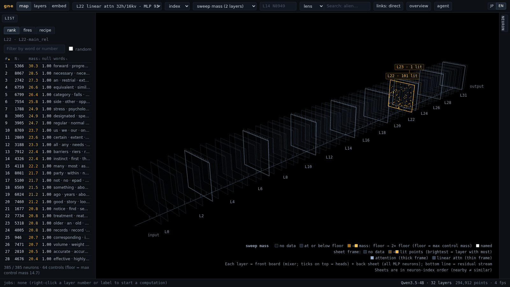
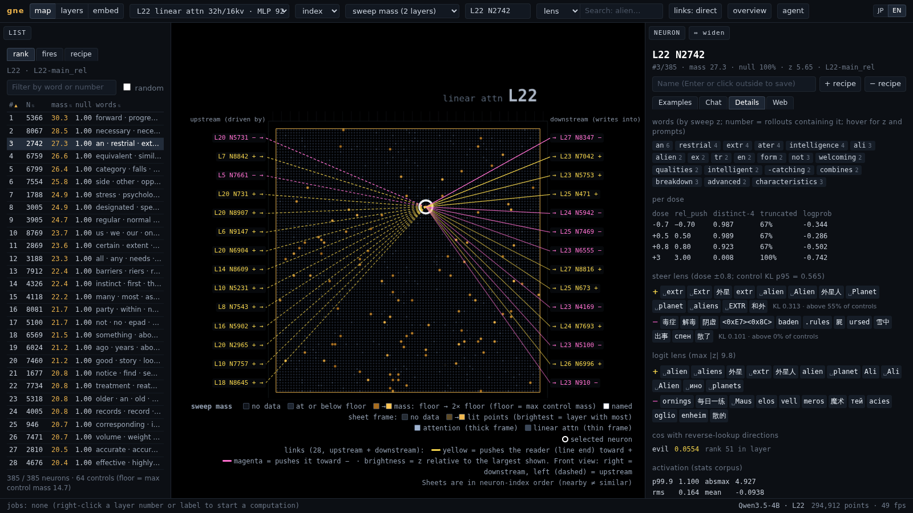

**English** | [日本語](README.ja.md)

# gguf-neuron-explorer (`gne`)

Find, rank and steer individual MLP neurons of GGUF models on llama.cpp, then ship what you find as a control vector that stock `llama-cli` / `llama-server` can load.



`gne` pushes a neuron's output direction (a column of `W_down`) into the residual stream, generates text, and measures what changed against random-direction controls. It runs on llama.cpp through llama-cpp-python, so it works with the quantized GGUF files you already have.

- **Sweep and rank.** Steer hundreds of neurons in a layer over a fixed set of prompts and doses, then rank them by how strongly their outputs pile onto a few words. Every score is compared with random directions pushed the same way.
- **Cheap first passes.**
  - **Logit lens:** weights only, on the CPU.
  - **Steer lens:** the next-token change when a neuron is pushed ± a dose.
  - **Reverse lookup:** contrast two personas, then rank every neuron in every layer by cosine to the difference.
- **Dossier per neuron.** Sweep rank, top words per prompt, rollouts, lens results and up/downstream connections, all in one view.
- **Recipes.** Combine units such as `14:8949:+1.0` and `13:7956:-1.0`, compare them in a 3-column chat (−, no steering, +), and export them:
  - as a control vector (`.cvec.gguf`), checked against `llama-completion --control-vector`;
  - as npz, json or safetensors;
  - baked into a GGUF as FFN down biases, for architectures whose llama.cpp graph reads that bias (llama, granite, mistral3, nemotron, gpt2 and others; not Qwen or Gemma — see [configs/arch/bias_support.yaml](configs/arch/bias_support.yaml)).
- **Web UI.** A 3D map of every layer and neuron with switchable overlays (sweep mass, steer KL, logit-lens |z|, activations, search hits, which neurons fire on a pasted text). It also has:
  - a ranked list and a neuron panel;
  - live 3-column chat;
  - wiring between neurons and UMAP layouts;
  - an embedding scatter of rollouts;
  - background jobs that share the GPU;
  - a JP / EN switch.
- **Agent access.** An MCP server lets Claude Code or another agent query neurons, steer, run jobs and highlight or annotate neurons in the open UI.

This is a from-scratch reimplementation, for llama.cpp and GGUF, of the method in [lyramakesmusic/neuron-explorer](https://github.com/lyramakesmusic/neuron-explorer) (which targets Qwen3.5-4B on a modified vLLM). No code from that repository is used.

## Requirements

- Python 3.11 or newer
- [llama-cpp-python](https://github.com/abetlen/llama-cpp-python) 0.3.36 or newer. Build it with GPU support for anything bigger than a toy model.
- An NVIDIA GPU is recommended. CPU-only (`--n-gpu-layers 0`) works but is slow.

Tested on:
- RTX 3080 12 GB under WSL2, CUDA 12.4, Python 3.12, llama-cpp-python 0.3.36 built from source.
- Models: Qwen3-0.6B, Qwen3.5-4B (hybrid linear attention) and SmolLM2-135M-Instruct (arch `llama`), all Q8_0.
- Metal has not been tested.

## Install

```bash
git clone <this repository> && cd gguf-neuron-explorer
uv venv --python 3.12 .venv
CMAKE_ARGS="-DGGML_CUDA=on" uv pip install --python .venv/bin/python -e '.[ui,mcp]'
source .venv/bin/activate
```

Extras:
- `ui`: the web UI (FastAPI, uvicorn, umap-learn).
- `mcp`: the MCP server.
- `dev`: the tests (pytest, Playwright).

## Quick start

Every command takes `-m <model.gguf>`, or reads `GNE_MODEL`. Results are stored under `~/.gne` (override with `--root` or `GNE_ROOT`) and reused by later commands and by the UI.

```bash
export GNE_MODEL=models/Qwen3.5-4B-Q8_0.gguf

gne info                                   # architecture, warnings, what is supported
gne verify                                 # equivalence tests against llama.cpp (run this first on a new arch)
gne stats resid                            # residual norms per layer (needed for rel doses)

gne lens logit --layer 22                  # first pass from the weights alone
gne sweep --layer 22                       # 384 random neurons + 64 random controls, design main_rel
gne rank --run L22-main_rel                # rank them by vocabulary mass
gne neuron 22 2742                         # everything known about one neuron

gne steer --unit 22:2742:+0.8 -p "Who are you?" --compare
gne chat --unit 22:2742:+0.8 -p "Tell me about yourself."

gne reverse --contrast configs/contrast/evil.yaml --verify    # candidates for a persona
gne export-cvec --recipe configs/recipes/evil.yaml            # → ~/.gne/export/evil.cvec.gguf
```

`export-cvec --verify` also checks that `llama-completion --control-vector` gives the same greedy output as `gne`. It looks for `llama-completion` in `build/` and on `PATH`, or you can pass `--llama-completion`.

Then use the vector with llama.cpp:

```bash
llama-cli -m models/Qwen3.5-4B-Q8_0.gguf --control-vector ~/.gne/export/evil.cvec.gguf
llama-cli -m models/Qwen3.5-4B-Q8_0.gguf --control-vector-scaled ~/.gne/export/evil.cvec.gguf:0.6
```

Run `gne --help` and `gne <command> --help` for the full list. The help text is in Japanese.

### Doses

Doses are in **rel** units by default: `dose × median ‖residual‖ of the layer × unit(W_down[:, n])`.

On Qwen3.5-4B:
- 0.5 slips a topic in, 0.8 takes over the topic, and 1.0 and above starts to break the text.
- A dose of 3.0 deliberately breaks the text, to show what a neuron "wants" to write.
- Layers 0–2 have small residuals, so rel doses do not transfer there.
- Layer 0 cannot be pushed with a control vector, but a bake can push it.

### How long things take

Qwen3.5-4B Q8_0 on an RTX 3080:

| step | time |
|---|---|
| `stats resid` (all layers) | ~16 s |
| `lens logit` | ~33 s per layer (CPU) |
| `lens steer` (all 9216 neurons) | ~22 min per layer |
| `sweep` `main_rel` | ~6.4 s per neuron (385 units in 48 min) |
| `reverse` | ~6 s; ~4 min with `--verify` on 20 candidates |

A full `main_rel` sweep of one layer takes about 16 hours. Narrow candidates down with the lenses and reverse lookup first.

## Web UI

```bash
gne serve -m models/Qwen3.5-4B-Q8_0.gguf      # http://127.0.0.1:8791
```



The UI has three views:
- **map:** every layer as a sheet of neurons, with overlays.
- **layers:** per-layer summaries.
- **embed:** a UMAP of rollout texts.

Click a neuron or a list row to open its panel, which has four tabs:
- **Examples:** rollouts per prompt and dose.
- **Chat:** live 3-column steering.
- **Details:** lens results, per-dose metrics and connections.
- **Web:** the multi-hop wiring.

To compute missing data (lenses, sweeps, connections, layouts), right-click a layer label. Jobs run in the background and give way to chat when it needs the GPU. The language switch is at the top right; you can also open the UI with `?lang=en` or `?lang=ja`.

The server binds to 127.0.0.1 only. It also rejects requests that arrive with a foreign Host header and cross-origin writes.

## Using it from an agent (MCP)

```bash
claude mcp add gne -- gne mcp --model /path/to/model.gguf
```

The tools are `model_overview`, `layer_summary`, `neuron`, `search`, `steer`, `steer_lens`, `fires`, `reverse`, `recipe_save`, `export_cvec`, `bake`, `set_name` and `job_start` / `job_status` / `job_cancel`.

If the web UI is open, add `--ui-url http://127.0.0.1:8791`. With it, the agent can highlight and annotate neurons and open them in the browser (`ui_highlight`, `ui_note`, `ui_open`). When the UI already holds the model on the same GPU, also add `--n-gpu-layers 0`.

[docs/agent_playbook.md](docs/agent_playbook.md) describes how an agent should judge results: compare against controls, distrust cheap effects such as a changed self-name, and separate facts from interpretation.

## Tests

```bash
uv pip install --python .venv/bin/python -e '.[dev,ui,mcp]'
python -m playwright install chromium
python -m pytest -q
```

- Model tests use `GNE_TEST_MODEL`, which defaults to `models/Qwen3-0.6B-Q8_0.gguf`.
- Browser tests use the Playwright Chromium; `GNE_CHROME` sets its path.
- Tests whose model or browser is missing are skipped.

## Documentation

The documentation is in Japanese:
- [docs/verification.md](docs/verification.md): what was checked against llama.cpp, and the findings.
- [docs/measurements.md](docs/measurements.md): timings and throughput.
- [docs/agent_playbook.md](docs/agent_playbook.md): how to read the results.

## License

MIT — see [LICENSE](LICENSE).

Bundled third-party files:
- three.js (MIT), in `gne/ui/static/vendor/three/`.
- The default statistics corpus (`configs/corpus/default.txt`), made of public-domain texts from Project Gutenberg and Aozora Bunko. Details are in [configs/corpus/README.md](configs/corpus/README.md).
